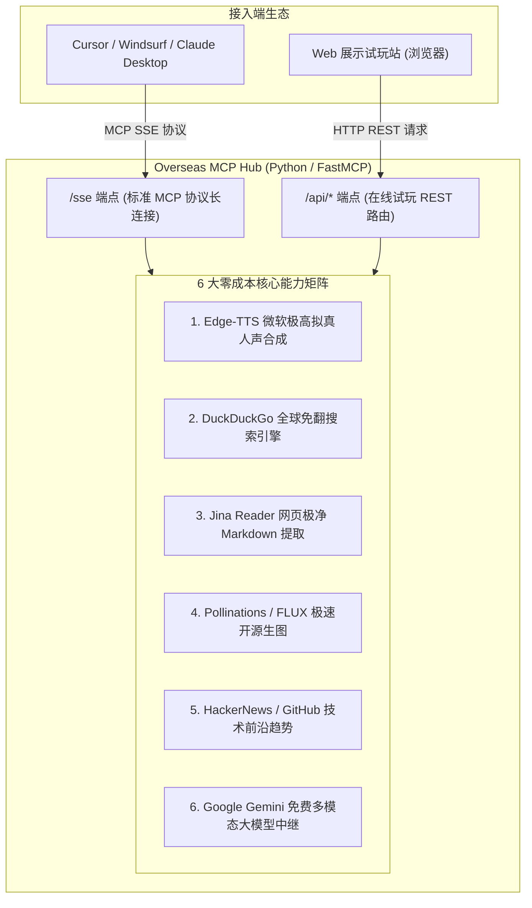

# Overseas-MCP-Hub（海外零元神仙能力中枢）开发计划

本项目旨在构建一个高可用、零额外 API 费用的海外能力代理中枢与现代化 Web 展示试玩平台。
通过聚合海外节点的网络优势、开源免 Key 接口以及大厂免费额度，赋能国内开发者在 IDE（Cursor / Windsurf / Claude Desktop）与 Web 端零门槛即插即用。

---

## 一、 系统整体架构

---

## 二、 6 大核心能力技术选型与实现方案

| 序号 | 模块能力 | 商业收费参考 | 本项目零元落地技术选型 | 优势与特点 |
| :--- | :--- | :--- | :--- | :--- |
| **01** | **拟真语音合成 (TTS)** | ElevenLabs ($5~$22/月) | Python `edge-tts` (微软人声) | 永久免费、免 API Key，支持晓晓/云希等顶级自然情感人声 |
| **02** | **全球无阻搜索** | SerpAPI / Google ($50/月) | Python `duckduckgo-search` | 0 成本、免 Key、无搜索广告污染、支持全球前沿内容检索 |
| **03** | **网页极净提取** | Firecrawl ($16+/月) | `r.jina.ai` 官方免 Key 提取端点 | 自动过滤样式脚本，输出专门针对 LLM 优化的纯净 Markdown |
| **04** | **开源极速生图** | Midjourney ($10+/月) | `Pollinations.ai` (基于 FLUX.1) | 0 门槛、无需排队，1~2 秒出图，适合图标与视觉概念生成 |
| **05** | **社区前沿趋势** | Twitter API ($100/月) | Hacker News / GitHub Trending API | 公开透明无费用，掌握硅谷极客最新项目动向与热议技术 |
| **06** | **多模态模型中继** | GPT-4o 按 Token 计费 | Google AI Studio (Gemini 2.0 Flash) | 海外原生 IP 独享高并发免费额度，支持百万长上下文与图文 |

---

## 三、 执行里程碑与阶段规划

### 阶段一：后端项目脚手架与环境初始化
- [ ] 在项目中创建独立后端模块目录 `overseas_hub/`。
- [ ] 配置 `pyproject.toml` 或 `requirements.txt`：
  - 核心依赖：`mcp`, `fastmcp`, `uvicorn`, `starlette`, `httpx`
  - 能力依赖：`edge-tts`, `duckduckgo-search`, `google-genai`
- [ ] 搭建统一错误处理、异步客户端连接池管理与日志规范。

### 阶段二：6 大核心工具库逐一编写与自测
- [ ] **工具 1 (`tts_tool.py`)**：实现文本转语音，支持音色切换、语速调节，返回 base64 或临时音频文件链接。
- [ ] **工具 2 (`search_tool.py`)**：封装 DuckDuckGo 搜索，提取标题、摘要、原始链接，并做结果过滤优化。
- [ ] **工具 3 (`reader_tool.py`)**：利用 Jina Reader 异步拉取网页并解析为结构化 Markdown。
- [ ] **工具 4 (`image_tool.py`)**：调用 Pollinations FLUX 端点，生成高清图片链接并附带参数透传。
- [ ] **工具 5 (`trend_tool.py`)**：拉取 Hacker News Top Stories 和 GitHub 每日 Trending 仓库。
- [ ] **工具 6 (`llm_tool.py`)**：封装 Gemini 免费 API 接口，实现极速问答与多模态分析。

### 阶段三：双通道服务暴露（MCP SSE + REST 接口）
- [ ] 使用 `FastMCP` 将 6 个工具注册为标准 MCP Tools。
- [ ] 暴露 `/sse` 和 `/messages` 路径，支持 Cursor / Windsurf / Claude Desktop 标准接入。
- [ ] 在底层 FastAPI/Starlette 实例上挂载 `/api/playground/*` 路由，供展示网站免鉴权或按需调用。

### 阶段四：现代化 Web 展示与在线试玩站（Showcase & Playground）
- [ ] **设计风格**：采用类似 Pollinations 的暖沙/米白/黑曜极简高级美学，搭配微动效。
- [ ] **功能模块**：
  1. **能力卡片超市**：分类筛选（Audio, Image, Search, DevTools），标明响应时间与“0 成本”标识。
  2. **在线极速试玩区 (Playground)**：
     - 在线试听微软人声合成并播放。
     - 在线输入 Prompt 即时查看生图效果。
     - 输入 URL 实时预览抓取出的 Markdown 效果。
  3. **一键接入配置生成器**：
     - 勾选所需工具，一键生成 `Cursor` / `Claude Desktop` 的 JSON 配置代码，支持一键剪贴板复制。
  4. **海外节点健康监控**：展示当前海外节点延迟与在线状态。

### 阶段五：联调、测试与部署打包
- [ ] 本地全链路联调（Cursor 接入 MCP 测试 + Web 端交互测试）。
- [ ] 编写 Nginx 反向代理配置（配置 SSE `proxy_buffering off` 确保流式正常）。
- [ ] 输出单容器 `Dockerfile` 与一键启动脚本（`docker-compose.yml`）。
- [ ] 编写详细的使用说明与常见避坑指南文档。

---

## 四、 交付成果物清单

1. **后端服务源码**：`overseas_hub/` 完整 Python FastMCP 代码。
2. **前端展示网站源码**：`showcase_web/` 极简高颜值试玩站代码。
3. **配置文件与脚本**：
   - `nginx.conf`：反代与 SSE 流式配置样例。
   - `docker-compose.yml`：海外服务器一键拉起脚本。
   - `mcp_client_config.json`：分发给其他人的 Cursor/Claude 导入模版。
