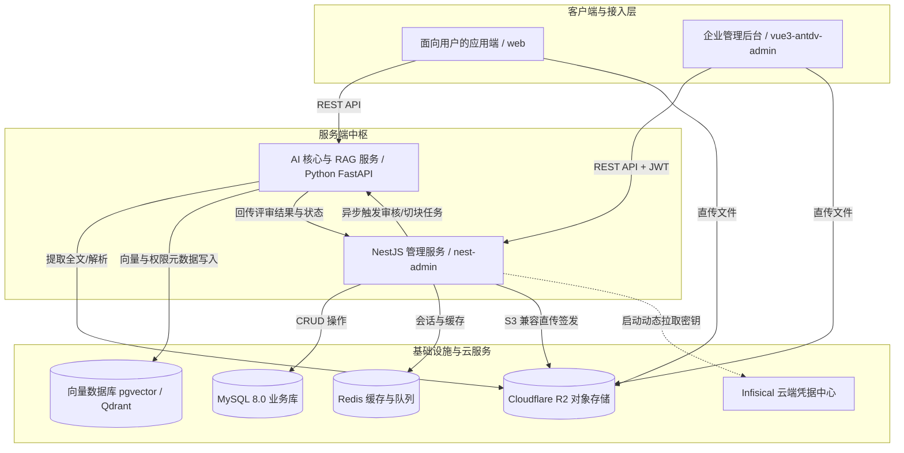
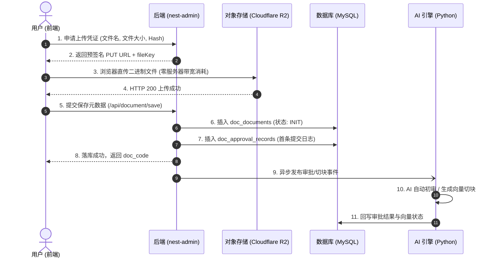

# 🏗️ my-ai-reviewer 项目全景架构与技术规范 (Project Architecture)

> **文档定位**：本文档为 `my-ai-reviewer` 全系统的顶层架构全景图，旨在为人类开发者与 AI 编程助手（AI Agents）提供全局上下文索引、各子系统技术选型、核心业务闭环及代码编写规范。在进行任何代码修改或新特性开发前，必须以此规范为基准。
>
> 📋 **业务模块 PRD 索引**：
> - [知识库文档与生命周期管理模块 PRD (v1.0.0)](./docs/PRD_DOCUMENT_MODULE.md)

---

## 一、系统全貌与工程拓扑 (System Topology)

本项目是一个融合了 **大模型自动化初审（AI Reviewer）**、**人工合规生命周期流转**、**多模态文档解析** 以及 **企业级 RAG 向量检索** 的全栈混合工程（Monorepo / Multi-system 协同架构）。



### 子项目职责划分清单

| 目录/工程 | 技术栈 | 职责与定位 |
| :--- | :--- | :--- |
| **`nest-admin`** | NestJS 10 + Fastify + TypeORM + MySQL + Redis | **企业级管理中枢**：负责用户鉴权 (JWT)、RBAC 权限、部门组织、文档元数据落库、审批单流转、R2 预签名凭证分发。 |
| **`vue3-antdv-admin`** | Vue 3 + Vite + TypeScript + Pinia + Ant Design Vue | **企业级管理前端**：提供中后台界面、文档列表、上传弹窗、审批审核工作台、字典与权限配置。 |
| **`01_base_agent` ~ `03_rag` / 根目录** | Python 3.12+ + FastAPI + uv + LangChain + MCP | **AI 核心引擎**：负责文档文本解析、智能合规质检、文本分块（Chunking）、向量生成与检索（RAG）。 |
| **`web`** | 前端应用 (HTML / JS / Framework) | **面向最终业务用户的交互端**。 |
| **`docs/`** | Markdown | 业务流程、MCP 协议与 RAG 专项方案文档。 |

---

## 二、子系统架构与技术规范 (Technical Guidelines)

### 1. `nest-admin`（NestJS 后端服务规范）

- **HTTP 底层**：基于高性能 **Fastify** 驱动（非 Express），注入 Request/Response 时需遵循 Fastify 规范。
- **实体基类（Entity Convention）**：
  - 所有持久化业务实体**必须继承 `CommonEntity`**（位于 `src/common/entity/common.entity.ts`），自动具备 `id` (bigint 自增主键)、`created_at`、`updated_at`。
- **双主键安全策略（Double Identifier Strategy）**：
  - **内部索引**：数据库关系关联、外键引用必须使用自增主键 `id`（性能最高、B+树最紧凑）。
  - **对外公开**：所有面向前端接口、URL 路径、对外展示，**必须使用唯一的业务编码 `doc_code`**（例如 `doc_` + 16位随机字符，通过 `generateUUID(16)` 生成），**严禁在外部接口直接暴露自增 ID**，防止竞品/黑客遍历。
- **配置与凭据注入**：
  - 系统集成 **Infisical 云端凭据管理**（见 `src/shared/infisical.ts`）。开发阶段支持 `.env` / `.env.development` 兜底。
  - 启动阶段动态装载云端变量，禁止在代码中硬编码任何 AccessKey/Secret。
- **存储与传输原则**：
  - 严禁让后端服务器充当大文件上传的中转代理；
  - 统一采用 **S3 兼容协议预签名直传（Presigned URL）**：后端通过 `DocumentService.getUploadSign()` 签发带有过期时间的 PUT URL，前端浏览器直接 PUT 上传至 Cloudflare R2，完成后调用后端保存元数据。

---

### 2. `vue3-antdv-admin`（Vue 3 前端后台规范）

- **开发风格**：
  - 严格使用 **Vue 3 Composition API** 搭配 `<script setup lang="ts">`。
  - 组件库遵循 **Ant Design Vue (antdv)** 最新规范。
- **表格与列渲染（Columns）**：
  - 表格列定义统一放置在组件同级的 `columns.tsx` 中，使用 TSX 语法编写 `customRender`。
  - 状态展示统一使用 Ant Design Vue 的 `<a-tag>`，并根据状态预设 Semantic 色彩（详见第四节字典）。
- **状态管理与路由**：
  - 状态管理采用 **Pinia**。
  - 接口请求统一使用封装好的 `request` 实例，严禁在页面中裸写 `fetch` 或 `axios`。

---

### 3. Python AI 引擎与 RAG 规范（AI Core & RAG）

- **依赖管理**：基于现代包管理器 **`uv`**（配置见 `pyproject.toml`）。
- **AI 评审流转**：
  - 文档保存后触发 AI 评审，针对文本进行敏感信息排查、规范性评分。
  - 审核结果存入单据审批流历史，并在主表中流转状态。
- **向量切块与权限隔离（RAG Security Baseline）**：
  - **禁止无权限切块**：每个文本块（Chunk）在写入向量数据库时，**必须将父文档的权限属性注入为 Metadata**：
    ```json
    {
      "chunk_id": "chunk_doc_xxx_001",
      "doc_id": 1001,
      "metadata": {
        "visible_range": "DEPT",
        "allowed_dept_ids": [3],
        "allowed_roles": ["admin"],
        "creator_id": 15
      }
    }
    ```
  - **向量检索预过滤（Pre-Filtering）**：任何 AI 问答在向量库检索时，必须携带当前提问者的身份上下文进行 Metadata 过滤，严禁全量无权限搜索。

---

## 三、核心业务闭环：文档生命周期与落库流转



---

## 四、全局数据字典与状态枚举映射规范 (Data Dictionaries)

前后端与数据库状态必须严格统一，严禁擅自修改字面量：

### 1. 审批状态枚举 (`ReviewStatus`)

| 枚举值 (`string`) | 语义 | 前端显示标签 | Tag 颜色 | 触发场景 |
| :--- | :--- | :--- | :--- | :--- |
| `INIT` | 待提交 / 草稿 | 草稿 | `default` | 刚完成直传，尚未进入审核 |
| `AI_REVIEWING` | AI 初审中 | AI审核中 | `processing` | 任务推送到 Python 引擎初审 |
| `MANUAL_REVIEWING` | 人工审核中 | 待人工复核 | `warning` | AI 评分疑似风险，流转至人工池 |
| `APPROVED` | 审核通过 | 已通过 | `success` | AI 直接通过或管理员人工同意 |
| `REJECTED` | 审核驳回 | 已驳回 | `error` | 内容违规或被管理员拒绝 |

### 2. 向量化状态枚举 (`VectorStatus`)

| 枚举值 (`string`) | 语义 | 前端显示标签 | Tag 颜色 | 触发场景 |
| :--- | :--- | :--- | :--- | :--- |
| `unprocessed` | 未解析 | 未解析 | `default` | 尚未开始向量化切块 |
| `processing` | 正在切块解析 | 解析中 | `processing` | 正在下载文件分块并生成 Embedding |
| `completed` | 向量化就绪 | 就绪 | `success` | 向量已入库，可供 RAG 语义检索 |
| `failed` | 解析失败 | 失败 | `error` | 文件格式受损或模型接口超时 |

---

## 五、AI 结对编程与开发纪律 (AI Agent Rules)

为了确保工程的健壮性与高质量，AI 助手在执行开发任务时必须无条件遵守：

1. **中文沟通**：所有技术决策解释、代码注释、commit message 均**强制使用中文**。
2. **渐进式实施，避免过度设计**：
   - 当前阶段以跑通“直传落库 + 审批流单表 + 列表展示”为主；
   - 除非用户明确要求，不要在单次迭代中横向扩大改动范围（如无故去修改已有的 `sys_user` 逻辑或全局 Auth 架构）。
3. **保持基类与命名一致**：
   - 实体字段使用数据库下划线规范（`snake_case`），TS 实体属性使用驼峰命名（`camelCase`）。
   - 遵循 DRY 原则，复用既有工具函数（如 `generateUUID()`、`CommonEntity`、`dayjs` 等）。
