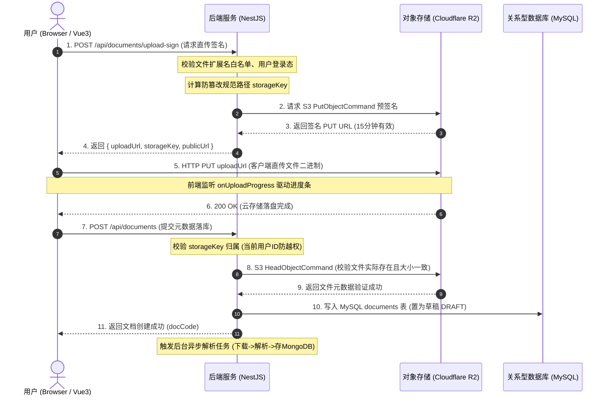

# 知识库一期：对象存储与客户端预签名直传设计与实现

> 模块代号：`Storage & Direct Upload`  
> 核心目标：解决传统服务端中转上传的性能瓶颈，实现基于 Cloudflare R2 的免服务器中转、安全防篡改、极速客户端直传体系。

---

## 一、背景与设计考量

### 1.1 传统服务端中转上传的弊端
在传统的 Web 架构中，文件上传通常是前端将二进制流提交给 Node.js / Java 后端，后端接收完整文件后再转存至对象存储（OSS / S3）。这种模式在企业级文档库场景下存在严重缺陷：
1. **服务器带宽吞吐瓶颈**：100 人同时上传 20MB 的 Word/Excel 会瞬间占满服务器出口与入口带宽。
2. **内存消耗与长连接压力**：Node.js 保持大量大文件二进制 Buffer 容易造成内存溢出（OOM）或垃圾回收卡顿。
3. **超时与传输失败率高**：链路为 `客户端 -> 后端 -> R2`，链路越长，网络抖动导致的重试成本越高。

### 1.2 客户端预签名直传架构（Presigned URL）
本系统采用 **Cloudflare R2（S3 兼容协议）预签名 PUT URL 客户端直传模式**：
- 客户端向 NestJS 后端申请一个**带有强时效性（15 分钟）和严格权限限制的专用上传凭据 URL**；
- 浏览器直接通过 `HTTP PUT` 将文件推送到 Cloudflare 全球 Anycast CDN 边缘节点入库；
- 上传完毕后前端携带唯一 `storageKey` 请求后端落库。后端通过 `HeadObject` 校验对象真实性与防篡改规则。

---

## 二、端到端上传时序与数据流



---

## 三、核心设计与实现细节

### 3.1 存储路径防碰撞与租户隔离规范
文件在 R2 存储桶中的 Key 遵循强约束的结构化命名空间：
```
knowledge/docs/{yyyyMMdd}/{userId}/{nanoid(16)}{ext}
```
- **时间分区 `{yyyyMMdd}`**：按天切分路径，避免单目录下对象过多，便于冷热归档与审计。
- **租户与用户隔离 `{userId}`**：将上传人 User ID 固化在路径层级中，**杜绝越权伪造漏洞**。
- **唯一防重 `{nanoid(16)}`**：生成 16 位高碰撞阻断的随机 ID，彻底解决同名文件覆盖问题。

### 3.2 服务端预签名核心实现 (`r2-storage.service.ts`)

```typescript
// nest-admin/src/modules/document/r2-storage.service.ts

export const ALLOWED_DOC_EXTENSIONS = [
  '.pdf', '.doc', '.docx', '.xlsx', '.xls',
  '.pptx', '.ppt', '.csv', '.md', '.txt', '.markdown',
]

@Injectable()
export class R2StorageService {
  async generatePresignedPutUrl(
    dto: GenerateUploadSignDto,
    userId: number,
    expiresIn = 900, // 15分钟
  ): Promise<UploadSignResultDto> {
    const client = this.ensureClient()
    const { fileName, fileSize, contentType, category = 'default', scope = 'PUBLIC' } = dto

    // 1. 严格白名单扩展名校验
    const ext = path.extname(fileName).toLowerCase()
    if (!ALLOWED_DOC_EXTENSIONS.includes(ext)) {
      throw new BadRequestException(
        `不支持的文件格式 [${ext}]，仅允许上传 Word、Excel、PPT、PDF、Markdown、TXT 格式文档`,
      )
    }

    // 2. 生成安全规范存储 Key
    const dateStr = new Date().toISOString().slice(0, 10).replace(/-/g, '')
    const fileId = nanoid(16)
    const storageKey = `knowledge/docs/${dateStr}/${userId}/${fileId}${ext}`

    // 3. 构建 PutObjectCommand 指令，固化 Content-Length 与自定义元数据
    const command = new PutObjectCommand({
      Bucket: this.r2Config.bucket,
      Key: storageKey,
      ContentType: contentType,
      ContentLength: fileSize,
      Metadata: {
        originalname: encodeURIComponent(fileName),
        uploadedby: String(userId),
        category: encodeURIComponent(category),
        scope,
      },
    })

    // 4. 生成带有时效签名的 PUT URL
    const uploadUrl = await getSignedUrl(client, command, { expiresIn })

    return {
      uploadUrl,
      storageKey,
      publicUrl: this.buildPublicUrl(storageKey),
      expiresIn,
    }
  }
}
```

### 3.3 防篡改双重校验与越权防御 (`verifyUploadedObject`)
客户端直传后提交给后端的 `storageKey` 可能会被恶意用户篡改，系统实施了严格的**二次防越权校验**：

```typescript
async verifyUploadedObject(storageKey: string, userId: number, expectedSize: number): Promise<void> {
  // (1) 正则校验路径格式及所属用户 ID，防止引用他人的文件或遍历越权
  const exts = ALLOWED_DOC_EXTENSIONS.map(e => e.replace('.', '\\.')).join('|')
  const keyPattern = new RegExp(`^knowledge/docs/\\d{8}/${Number(userId)}/[\\w-]{16}(${exts})$`)
  if (!keyPattern.test(storageKey)) {
    throw new ForbiddenException('存储 Key 非法或不属于当前用户，请重新获取上传签名')
  }

  // (2) 调用 R2 HeadObject 探查对象真实存在，且云端真实大小与客户端声明一致
  const client = this.ensureClient()
  try {
    const head = await client.send(
      new HeadObjectCommand({
        Bucket: this.r2Config.bucket,
        Key: storageKey,
      }),
    )
    if (head.ContentLength !== expectedSize) {
      throw new BadRequestException('文件上传不完整或大小不匹配，请重新上传')
    }
  }
  catch {
    throw new BadRequestException('未检测到云端文件，请确认直传成功后再保存')
  }
}
```

---

## 四、前端直传驱动实现 (`DocumentUploadModal.vue`)

前端使用原生 `axios` / `fetch` 发送 `PUT` 请求，直接对接 R2 上传并实时驱动进度条：

```typescript
// 1. 获取直传签名
const signRes = await documentGetUploadSign({
  fileName: file.name,
  fileSize: file.size,
  contentType: file.type || 'application/octet-stream',
  category: uploadForm.category,
  scope: uploadForm.scope,
})

// 2. 客户端直接 PUT 推送二进制流至 Cloudflare R2
await axios.put(signRes.uploadUrl, file, {
  headers: {
    'Content-Type': file.type || 'application/octet-stream',
  },
  onUploadProgress: (progressEvent) => {
    if (progressEvent.total) {
      uploadPercent.value = Math.round((progressEvent.loaded * 100) / progressEvent.total)
    }
  },
})

// 3. 直传成功后，提交元数据落库创建文档
await documentCreate({
  title: uploadForm.title,
  storageKey: signRes.storageKey,
  fileSize: file.size,
  fileType: file.name.split('.').pop()?.toLowerCase() || '',
  category: uploadForm.category,
  scope: uploadForm.scope,
  visibleDeptIds: uploadForm.scope === 'DEPT' ? uploadForm.visibleDeptIds : [],
})
```

---

## 五、模块收益与指标

1. **零服务器带宽消耗**：文件流量完全由 Cloudflare 全球 CDN 吸收，后端仅处理千字节级别的 JSON 签名交互。
2. **大并发韧性**：轻松支持万人级别并发上传，无需部署额外的上传中转集群。
3. **安全闭环**：通过严格的正则白名单、User ID 路径绑定、HeadObject 双重校验，彻底防止了越权引用与伪造文件注入。

