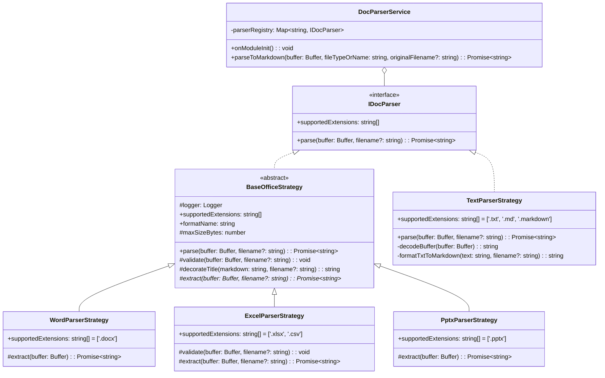

# 知识库二期：文档多格式结构化解析引擎设计与实现

> 模块代号：`Document Parser Engine`  
> 核心目标：将异构文档（Word、Excel、PPT、Markdown、TXT）以零乱码、高保真、结构化的方式统一转换为标准 Markdown，为后续 RAG 向量切片与大模型审查奠定纯文本统一标准。

---

## 一、架构设计：策略模式 + 模板方法模式

为了应对多格式解析库繁杂、未来可能无缝切换解析引擎（如后续替换为 Python 微服务或 MinerU）的需求，本模块严格采用面向对象设计原则：



---

## 二、生命周期管道 (`BaseOfficeStrategy`)

所有 OOXML 类文档（Word / Excel / PPTX）继承自 `BaseOfficeStrategy` 模板类，执行固定的四阶段不可变管道：

```
[1. validate 校验] ➔ [2. extract 抽象提取] ➔ [3. postprocess 清理] ➔ [4. decorateTitle 标题注入]
```

```typescript
// nest-admin/src/shared/parser/strategies/base-office.strategy.ts

export abstract class BaseOfficeStrategy implements IDocParser {
  async parse(buffer: Buffer, filename?: string): Promise<string> {
    // 1. 基础校验：文件大小限制与 ZIP 归档魔数校验 (50 4B 03 04)
    this.validate(buffer, filename)

    // 2. 核心文本提取：委托具体子类实现，与三方解析库解耦
    let rawMarkdown = ''
    try {
      rawMarkdown = await this.extract(buffer, filename)
    }
    catch (error: any) {
      throw new BadRequestException(`${this.formatName} 文档解析失败: ${error.message || '文件损坏或受密码保护'}`)
    }

    // 3. 后处理规范化与空结果检查
    const cleaned = postprocessMarkdown(rawMarkdown)
    if (!cleaned) {
      throw new BadRequestException(`${this.formatName} 文档内容为空，或仅包含无法提取的纯图片/扫描内容`)
    }

    // 4. 智能大标题注入：若全文首行没有一级大标题 (# 标题)，自动补充文件名作为最高级主标题
    return this.decorateTitle(cleaned, filename)
  }
}
```

> **极低换库成本**：若未来需要将 Word 引擎更换为 `mammoth` 或 `MinerU`，上层业务代码 0 修改，仅需修改对应策略类内部的 `extract()` 2 行代码。

---

## 三、各格式解析策略深度剖析

### 3.1 纯文本与 Markdown 解析策略 (`TextParserStrategy`)
- **智能自适应多编码探针**：
  零依赖利用原生 `TextDecoder`，按 `UTF-16 LE/BE (BOM 探针) ➔ UTF-8 (fatal 严格模式) ➔ GBK (容错兜底)` 顺序解码，彻底解决 Windows 中文记事本保存乱码问题。
- **启发式段落与章节提取**：
  识别中文章节正则（`第X章`、`一、`、`1.1`、`【重要提示】`），自动将平铺文本升级为 Markdown 二级/三级标题。
- **防换行塌陷**：
  在普通段落行末尾自动追加双空格（`  \n`），保障 CommonMark 渲染时不被合并折叠。
- **边界防御**：
  修复了金额小数（如 `3.14`、`100.00元`）被误当成章节标题、前置空格导致文件名重复注入的边界缺陷。

### 3.2 Word 文档解析策略 (`WordParserStrategy`)
- 限制 `supportedExtensions = ['.docx']`（废弃易乱码的二进制 `.doc`）。
- 调用 `officeparser` 转换为结构化 AST，关闭 OCR（`ocr: false`），输出标准 GFM Markdown。
- 完整提取表格为标准 Markdown Pipe Table（`| 列1 | 列2 |`）。

### 3.3 Excel 电子表格解析策略 (`ExcelParserStrategy`)
- **多工作表（Sheet）独立识别与组织**：
  遍历 AST 中的各 `sheet` 节点，为每个 Sheet 生成独立的二级标题（`## 工作表：[Sheet名]`），空 Sheet 友好标注 `*(此工作表为空)*`，不产生破损表格线条。
- **超大表格（500行）安全截断保护**：
  内置 `truncateLargeMarkdownTables` 工具函数，对超过 500 行的超大数据表自动截断并追加提示行，防止挤爆 LLM 上下文。
- **CSV 兼容**：
  通过 `fileType: 'csv'` 显式传参，解决了纯文本缺少魔数导致解析引擎自动探针报错的问题。

### 3.4 PPT 演示文稿解析策略 (`PptxParserStrategy`)
- 提取各页幻灯片文本框、层级大纲与备注内容，以清晰的分页格式组织输出。

---

## 四、安全与防御体系设计 (`parser.utils.ts`)

```typescript
// 1. ZIP / OOXML 文件头魔数强校验
export function validateZipMagicNumber(buffer: Buffer, formatName = 'Office'): void {
  if (
    !buffer
    || buffer.length < 4
    || buffer[0] !== 0x50
    || buffer[1] !== 0x4B
    || buffer[2] !== 0x03
    || buffer[3] !== 0x04
  ) {
    throw new BadRequestException(`[${formatName}] 文件格式非法或已损坏：未检测到合法的 ZIP/OOXML 文件头，请勿直接修改扩展名`)
  }
}

// 2. 旧版二进制格式拦截
if (ext === '.doc' || ext === '.xls' || ext === '.ppt') {
  throw new BadRequestException(`检测到旧版 Office 格式 [${ext}]，系统暂不支持，请将其另存为 .docx / .xlsx / .pptx 新版格式后重新上传`)
}

// 3. Markdown 后处理流水线
export function postprocessMarkdown(markdown: string): string {
  return markdown
    .replace(/^\uFEFF/, '')        // 剥离 BOM
    .replace(/\r\n/g, '\n')        // 统一 CRLF
    .replace(/\r/g, '\n')          // 统一 CR
    .replace(/\n{3,}/g, '\n\n')    // 连续 3 个以上空行压缩为 2 个
    .trim()
}
```

---

## 五、单元测试保障体系

模块建立了完整的 Jest 自动化测试套件，**5 大套件共 53 个用例全部通过（53/53 Pass）**：

| 测试文件 | 用例数 | 覆盖要点 |
| :--- | :---: | :--- |
| `text.strategy.spec.ts` | 23 | UTF-8/GBK/UTF-16 编码探针、中文章节正则、防小数误判、空文件防御 |
| `word.strategy.spec.ts` | 8 | 魔数校验、20MB 上限拦截、大标题注入、Markdown 转换、受保护文档异常包装 |
| `excel.strategy.spec.ts` | 7 | 多 Sheet 标题生成、空 Sheet 过滤、超 500 行表格截断、CSV 豁免魔数校验 |
| `pptx.strategy.spec.ts` | 6 | 幻灯片大纲提取、50MB 大小上限拦截、魔数校验 |
| `doc-parser.service.spec.ts` | 9 | 全格式自动路由分发、空 buffer 防御、旧版 .doc/.xls/.ppt 拦截引导 |

