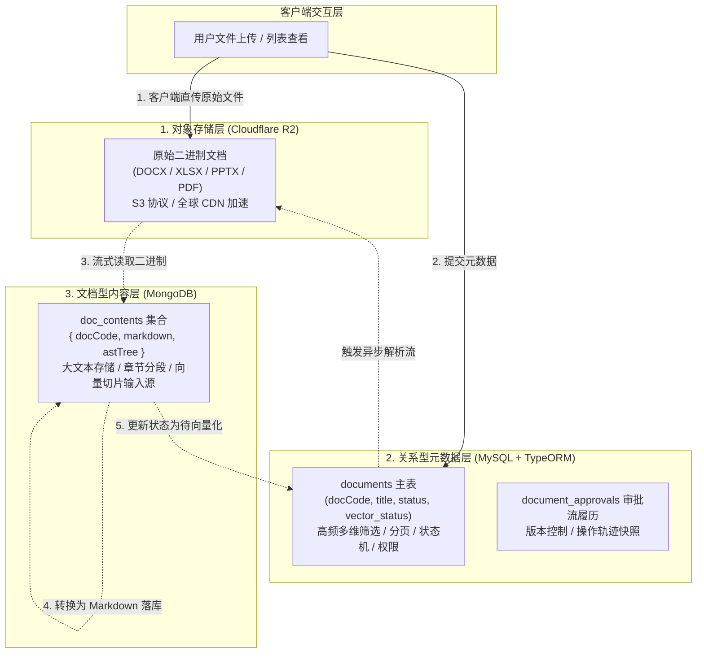

# 知识库三期：多模态混合持久化架构设计与实现

> 模块代号：`Polyglot Persistence Architecture`  
> 核心目标：解决企业级文档知识库中高并发检索、超大文本 Markdown 存储、原始二进制文件持久化之间的技术冲突，实现 MySQL + MongoDB + Cloudflare R2 三位一体的高性能持久化底座。

---

## 一、架构设计：为什么采用三层混合持久化？

在传统的知识库系统设计中，常有团队将所有数据（含文件二进制或几万字的 Markdown 正文）全部存入 MySQL 关系数据库中。但在实际业务运行中会遇到三大致命问题：
1. **MySQL 性能断崖式下跌**：MySQL InnoDB 表的单行如果存放几万字的大文本（`TEXT` / `LONGTEXT`），会产生严重的**行溢出（Row Overflow）**，导致 Buffer Pool 内存命中率骤降，多条件分页查询严重卡顿。
2. **备份与扩容成本极高**：将几百 GB 的 Word/PDF 二进制数据存在数据库，会导致数据库全量备份极为缓慢，主从复制延迟大幅增加。
3. **全文与结构化属性诉求不同**：元数据需要高频事务与强类型外键，正文文本需要灵活的文档树结构，二进制文件需要全球 CDN 边缘加速。

为此，本系统采用 **三层分立、各司其职的多模态混合持久化（Polyglot Persistence）**：



---

## 二、三层职责与数据建模规范

### 2.1 关系型元数据层 (MySQL `documents`)
- **核心定位**：管理文档生命周期、审批流状态、向量化状态、可见范围权限。
- **字段设计**（节选核心字段）：
  ```sql
  CREATE TABLE `documents` (
    `id` bigint unsigned NOT NULL AUTO_INCREMENT,
    `doc_code` varchar(36) NOT NULL COMMENT '业务唯一编码 (doc_xxxx)',
    `title` varchar(255) NOT NULL COMMENT '文档标题',
    `category` varchar(64) NOT NULL COMMENT '分类 (技术规范/财务制度/法务合同)',
    `file_type` varchar(20) NOT NULL COMMENT '文件后缀扩展名',
    `file_size` bigint NOT NULL COMMENT '文件字节大小',
    `storage_key` varchar(500) NOT NULL COMMENT 'R2 对象存储完整 Key',
    `status` varchar(20) NOT NULL DEFAULT 'DRAFT' COMMENT '生命周期状态 (DRAFT/UNDER_REVIEW/PUBLISHED/ARCHIVED)',
    `review_status` varchar(20) NOT NULL DEFAULT 'INIT' COMMENT '审批流状态 (INIT/AI_REVIEWING/MANUAL_REVIEWING/APPROVED/REJECTED)',
    `vector_status` varchar(20) NOT NULL DEFAULT 'unprocessed' COMMENT '向量化状态 (unprocessed/processing/completed/failed)',
    `scope` varchar(20) NOT NULL DEFAULT 'PUBLIC' COMMENT '权限范围 (PUBLIC/DEPT/PRIVATE)',
    `visible_dept_ids` json DEFAULT NULL COMMENT '部门多选授权列表 JSON',
    `created_by` bigint unsigned NOT NULL COMMENT '创建人 ID',
    PRIMARY KEY (`id`),
    UNIQUE KEY `uk_doc_code` (`doc_code`),
    KEY `idx_status_scope` (`status`, `scope`),
    KEY `idx_created_by` (`created_by`)
  ) ENGINE=InnoDB DEFAULT CHARSET=utf8mb4 COMMENT='知识库文档主表';
  ```

### 2.2 文档型全文内容层 (MongoDB `doc_contents`)
- **核心定位**：专职存储从原始文件解析出的标准化 **Markdown 全文**及章节树，免去 MySQL 行溢出压力。
- **Schema 定义** (`doc-content.schema.ts`)：
  ```typescript
  @Schema({ collection: 'doc_contents', timestamps: true })
  export class DocContent {
    @Prop({ required: true, unique: true, index: true })
    docCode: string // 关联 MySQL 的业务 doc_code

    @Prop({ required: true })
    docId: number // 关联 MySQL 自增主键

    @Prop({ required: true, type: String })
    markdown: string // 标准化 Markdown 全文字符串

    @Prop({ type: Object })
    metadata?: Record<string, any> // 文档扩展属性（字数、段落数、Sheet清单等）
  }
  ```

### 2.3 对象存储二进制层 (Cloudflare R2)
- **核心定位**：原汁原味保存用户上传的源文件，供随时重新下载、原始排版留档与灾难恢复。
- **安全隔离**：用户仅能通过带鉴权的接口申请临时下载 URL，无法任意公开遍历。

---

## 三、异步解析与最终一致性流转机制

为避免大文档解析耗时（1 ~ 5 秒）阻塞前端接口响应，系统在创建文档后采用**异步后台流转**：

```typescript
// nest-admin/src/modules/document/services/document.service.ts

async asyncParseAndSaveContent(
  docId: number,
  docCode: string,
  storageKey: string,
  fileName: string,
  fileType: string,
): Promise<void> {
  try {
    this.logger.log(`[自动解析流] 开始拉取并解析文档: ${docCode} (${fileName})`)

    // 1. 标记当前处于解析中 (借用 PROCESSING 状态通知前端)
    await this.docRepo.update(docId, {
      vectorStatus: VectorStatusEnum.PROCESSING,
    })

    // 2. 从 R2 内存流式下载为 Buffer (不占用本地磁盘)
    const buffer = await this.r2StorageService.downloadBuffer(storageKey)

    // 3. 策略路由：文档解析引擎转换为 Markdown
    const markdown = await this.docParserService.parseToMarkdown(buffer, fileType, fileName)

    // 4. 存入 MongoDB doc_contents 集合
    await this.docContentService.saveContent(docCode, docId, markdown)

    // 5. 更新 MySQL 状态为待向量化 (UNPROCESSED)
    await this.docRepo.update(docId, {
      vectorStatus: VectorStatusEnum.UNPROCESSED,
    })

    this.logger.log(`[自动解析流] 文档 ${docCode} 已成功转换为 Markdown 并写入 MongoDB`)
  }
  catch (err: any) {
    this.logger.error(`[自动解析流] 解析失败: docCode=${docCode}: ${err.message}`, err.stack)

    // 容错处理：标记为解析失败，并把具体原因写入 reviewRemark 供前台 Tooltip 展示
    await this.docRepo.update(docId, {
      vectorStatus: VectorStatusEnum.FAILED,
      reviewRemark: `解析失败: ${err.message || '文件损坏或格式受损'}`,
    })
  }
}
```

---

## 四、级联清理机制（Cascade Cleanup）

当文档在知识库中被彻底删除时，系统保障跨数据库的资源一致性释放：
1. **MySQL 记录删除**：从 `documents` 表及 `document_approvals` 中删除；
2. **MongoDB 内容清除**：根据 `docCode` 物理删除 `doc_contents` 记录；
3. **R2 云存储文件删除**：调用 `DeleteObjectCommand` 从 Cloudflare R2 存储桶中物理抹除源文件，不留存储孤儿垃圾。

