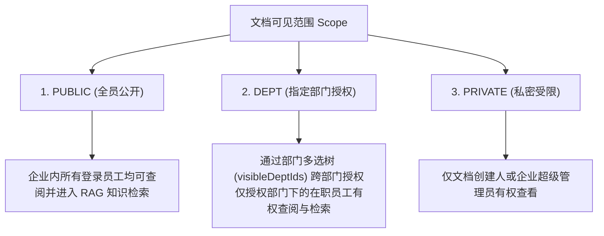

# 知识库四期：文档管理、权限控制与前端交互系统实现

> 模块代号：`Document Management, ACL & Frontend UI`  
> 核心目标：构建高交互性、权限严密、状态清晰的企业级知识库管理工作台，打通前端直传进度反馈、多维权限隔离、全生命周期审批与 SSOT 状态机体系。

---

## 一、技术栈与前端工程架构

- **前端技术栈**：Vue 3 (Composition API / `<script setup>`) + TypeScript + Ant Design Vue 4.x + TailwindCSS + Vite。
- **页面组织结构**：
  ```
  vue3-antdv-admin/src/views/document/
  ├── list/                               # 知识库文档列表主页
  │   ├── index.vue                       # 主容器，承载筛选栏、统计卡片、DynamicTable
  │   ├── columns.tsx                     # 表格列定义与 Badge / Tag 渲染器
  │   └── components/
  │       └── DocumentUploadModal.vue     # 核心直传上传弹窗 (带权限联动与进度条)
  ├── review/                             # 审批工作台 (审核员视图)
  └── record/                             # 审批轨迹与历史快照留档
  ```

---

## 二、三层数据安全权限模型 (Access Control List - ACL)

知识库中的每一份文档不仅需要区分创建者，还需要控制**谁有权查阅、谁有权在 RAG 问答中检索该文档**。系统实现了三级可见范围控制：



### 2.1 部门树条件联动选择 (`DocumentUploadModal.vue`)
前端根据 `scope === 'DEPT'` 条件渲染 Ant Design Vue 的 `a-tree-select`，支持勾选多个部门：
```html
<a-form-item label="访问权限范围" required>
  <a-radio-group v-model:value="uploadForm.scope">
    <a-radio value="PUBLIC">全员公开 (公共知识库)</a-radio>
    <a-radio value="DEPT">指定部门可见 (多选授权)</a-radio>
    <a-radio value="PRIVATE">私密文档 (仅授权人)</a-radio>
  </a-radio-group>
</a-form-item>

<!-- 仅在勾选 DEPT 时动态展开跨部门多选树 -->
<a-form-item
  v-if="uploadForm.scope === 'DEPT'"
  label="指定允许查阅的部门 (支持跨部门勾选)"
  required
>
  <a-tree-select
    v-model:value="uploadForm.visibleDeptIds"
    :tree-data="authorizedDeptTree"
    tree-checkable
    allow-clear
    :show-checked-strategy="TreeSelect.SHOW_ALL"
    placeholder="请勾选允许查阅该文档的部门"
  />
</a-form-item>
```

### 2.2 后端数据权限注入与过滤 (`document.service.ts`)
在分页查询时，后端结合当前用户的管辖部门与所属部门，动态拼装 SQL 条件：
```typescript
// 普通用户查阅时：公开文档 OR 自己创建的文档 OR 包含在授权部门里的文档
if (!isSuperAdmin) {
  qb.andWhere(
    new Brackets((sub) => {
      sub.where('doc.scope = :publicScope', { publicScope: 'PUBLIC' })
        .orWhere('doc.created_by = :userId', { userId })
        .orWhere(
          'doc.scope = :deptScope AND JSON_OVERLAPS(doc.visible_dept_ids, :userDeptIds)',
          {
            deptScope: 'DEPT',
            userDeptIds: JSON.stringify(currentUserDeptIds),
          },
        )
    }),
  )
}
```

---

## 三、文档生命周期与全局 SSOT 状态机体系

为保证系统状态在前后端、数据库以及接口文档中高度一致，所有状态定义收敛于后端的单一可信源（Single Source of Truth - SSOT）：

### 3.1 三套相互独立的状态机制

| 维度 | 字段 | 枚举值 | 前端视觉表现 |
| :--- | :--- | :--- | :--- |
| **文档生命周期** | `status` | `DRAFT` (草稿)<br>`UNDER_REVIEW` (审核中)<br>`PUBLISHED` (已发布)<br>`ARCHIVED` (已归档) | 灰色 / 蓝色 / 绿色 / 橙色 Tag 标签 |
| **审批流状态** | `reviewStatus` | `INIT` (草稿/未提交)<br>`AI_REVIEWING` (AI 初审中)<br>`MANUAL_REVIEWING` (待人工复核)<br>`APPROVED` (审核通过)<br>`REJECTED` (已驳回) | 状态徽标与驳回原因悬浮提示 (Tooltip) |
| **向量化状态 (RAG)** | `vectorStatus` | `unprocessed` (**待向量化**)<br>`processing` (**切片向量化中**)<br>`completed` (**已就绪(可检索)**)<br>`failed` (**向量化失败**) | `Badge` 状态圆点 (灰色/蓝色闪烁/绿色/红色) |

> **关键文案纠偏**：将 `unprocessed` 从误导性的“未解析”修正为 **“待向量化”**，彻底理清了“文档文本解析（Doc Parsing ➔ Markdown）”与“知识库向量化（Chunking ➔ Embedding）”的阶段界限。

---

## 四、前端核心交互体验细节

1. **自动提取标题**：
   用户选择或拖拽文件（如 `01_员工出差与报销管理办法.docx`）时，`beforeUpload` 钩子自动剥离扩展名，预填至“文档标题”输入框中，减少繁琐输入。
2. **直传实时进度反馈**：
   在文件直传云端 R2 过程中，实时展示百分比进度条与“Cloudflare R2 极速传输中”提示，避免用户误触关闭。
3. **格式友好拦截与提示**：
   弹窗明确展示 `支持 Word, Excel, PPT, PDF, Markdown, TXT`，并对伪造或旧版文件在提交时予以清晰的错误提示反馈。
4. **多维表格操作交互**：
   提供“提交审核”、“删除”、“查看详情报告”、“重新切片”等灵活的操作权限按钮，根据当前用户的角色与文档状态动态显隐。

