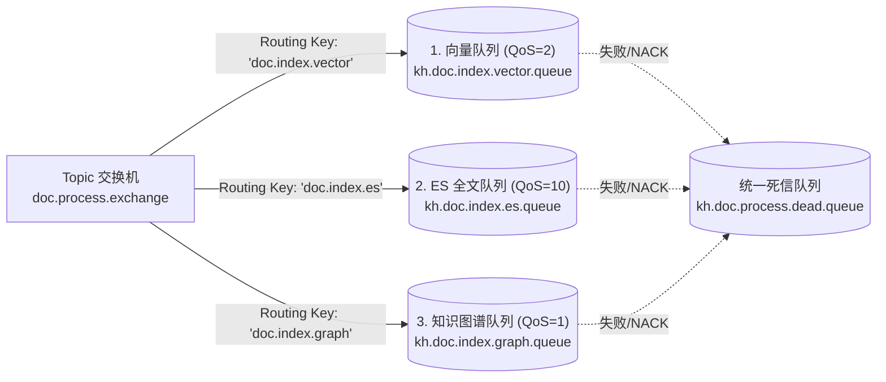
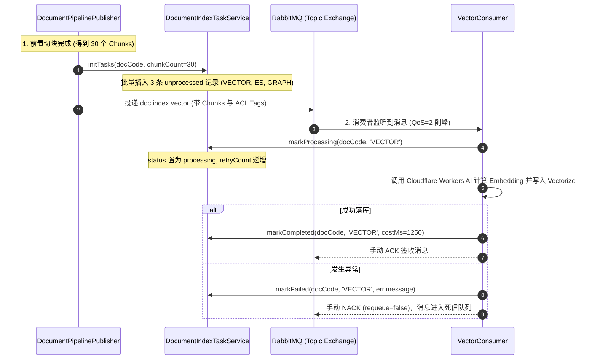

# 知识库五期：异步索引消息总线与三路衍生状态调度中枢实现

> 模块代号：`MQ & Index Task Orchestration Pipeline`  
> 核心目标：基于 **RabbitMQ Topic 交换机** 构建高可用、防削峰、强隔离的“一源三路衍生”异步索引管道，并结合 **独立状态任务表（方案 B）** 建立涵盖耗时监控、错误排障与单点重试的企业级状态机。

---

## 一、为什么需要这套架构？（核心设计权衡）

在知识库 RAG 与企业大模型检索中，文档解析切块后通常派生出 **三条异步索引通路**：
1. **密集向量索引 (Vector)**：调用 Embedding 模型生成高维向量，存入向量数据库（Cloudflare Vectorize）；
2. **全文倒排索引 (ES)**：基于中文分词器将文本切词入库，提供精确术语、代码和型号的 BM25 检索；
3. **知识图谱 (Graph)**：调用大语言模型（LLM）抽取实体与关系三元组，写入图数据库（Neo4j）。

### 1.1 痛点与架构决策点

| 核心痛点 | 错误的做法 | 本项目的标准解法 (Best Practice) |
| :--- | :--- | :--- |
| **计算负载极度异构** | 在同一个串行队列里跑，ES 几十毫秒搞定，却被耗时 30 秒的图谱严重卡死。 | **拆分 3 个专用队列**，利用 RabbitMQ Topic 交换机进行差异化 QoS 削峰与扇出派发。 |
| **重复解析切块开销** | 三路 Worker 各自去下载 R2 源文件并解析切块（重复消耗算力与 IO）。 | **“本地同步轻量解析切块 ➔ 结果存 Mongo ➔ 仅向 MQ 派发已就绪的切块”**，纯计算复用。 |
| **单点失败与错误覆盖** | 状态记录在文档主表，向量成功但图谱超时，单个 `error_msg` 会覆盖历史状态，无法单独重试。 | **方案 B：主从解耦**，建立独立的 `doc_index_tasks` 表，每条路拥有独立的成功/失败/耗时追踪。 |

---

## 二、RabbitMQ Topic 拓扑与路由规范

系统定义了统一的 **Topic（主题模式）** 交换机 `doc.process.exchange`，它既能支持**切块完成后一键并发触发三路**，又能支持**故障时只单点重试其中一路**。



### 2.1 资源常量定义 (`nest-admin/src/mq/mq.constants.ts`)

```typescript
/** 统一文档处理 Topic 交换机 */
export const DOC_TOPIC_EXCHANGE = 'doc.process.exchange'

/** 路由键 (Routing Keys) 规范 */
export const DOC_ROUTING_KEYS = {
  PARSE: 'doc.process.parse',       // 阶段一：前置解析 / 失败重新拉取解析
  INDEX_VECTOR: 'doc.index.vector', // 阶段二：向量数据库 (Cloudflare Vectorize)
  INDEX_ES: 'doc.index.es',         // 阶段二：Elasticsearch 全文倒排
  INDEX_GRAPH: 'doc.index.graph',   // 阶段二：知识图谱 (Neo4j)
} as const

/** 队列名称规范 (Queues) */
export const DOC_QUEUES = {
  INDEX_VECTOR: 'kh.doc.index.vector.queue',
  INDEX_ES: 'kh.doc.index.es.queue',
  INDEX_GRAPH: 'kh.doc.index.graph.queue',
  DEAD_LETTER: 'kh.doc.process.dead.queue',
} as const
```

---

## 三、状态机数据建模（方案 B：`doc_index_tasks`）

为了保证文档主表 `doc_documents` 的轻量与纯粹，所有衍生索引的加工生命周期全部解耦收敛到独立表 `doc_index_tasks`。

### 3.1 实体设计 (`document-index-task.entity.ts`)

```typescript
@Entity({ name: 'doc_index_tasks' })
// 核心约束：一篇文档的同一种索引类型只占一行，保证更新天然幂等
@Index('uk_doc_index_type', ['docCode', 'indexType'], { unique: true })
export class DocumentIndexTaskEntity extends CommonEntity {
  @Column({ name: 'doc_code', type: 'varchar', length: 32, comment: '文档唯一业务编码' })
  docCode: string

  @Column({ name: 'index_type', type: 'varchar', length: 20, comment: 'VECTOR / ES / GRAPH' })
  indexType: 'VECTOR' | 'ES' | 'GRAPH'

  @Column({ type: 'varchar', length: 20, default: 'unprocessed' })
  status: 'unprocessed' | 'processing' | 'completed' | 'failed'

  @Column({ name: 'chunk_count', type: 'int', default: 0, comment: '切块总数' })
  chunkCount: number

  @Column({ name: 'cost_ms', type: 'int', nullable: true, comment: '处理耗时(毫秒)' })
  costMs?: number

  @Column({ name: 'retry_count', type: 'tinyint', default: 0, comment: '已重试次数' })
  retryCount: number

  @Column({ name: 'error_message', type: 'text', nullable: true, comment: '失败异常摘要' })
  errorMessage?: string

  @Column({ name: 'completed_at', type: 'datetime', nullable: true, comment: '完成时间戳' })
  completedAt?: Date
}
```

---

## 四、全生命周期流转与通信协议

### 4.1 核心流转时序图



### 4.2 向量消息契约 (`messages/doc-vector.message.ts`)

```typescript
export interface DocChunkItem {
  chunkIndex: number
  content: string
  headingPath?: string
  page?: number
  scope: string            // PUBLIC / DEPT / PRIVATE
  visibleDeptIds?: number[] // 权限预过滤
}

export interface DocVectorMessage {
  schemaVersion: 1
  taskId: string
  traceId: string
  docCode: string
  docId: number
  title: string
  fileType: string
  chunks: DocChunkItem[]
  attempt: number
  createdAt: string
  timestamp: number
}
```

---

## 五、单点故障恢复与单项重试机制

基于这套架构，系统具备高度的**自愈韧性**：

1. **场景 A：图谱调用大模型超时失败，而向量和 ES 已成功**
   - 传统方案必须全量重跑；
   - **本方案**：管理员点击前端的 `【重试图谱】` 按钮，后端仅需向交换机发布一条 Routing Key 为 `doc.index.graph` 的消息。
   - **效果**：只有图谱队列收到任务重新跑，向量和 ES 库零干扰、不重复计算！

2. **场景 B：格式损坏导致前置解析失败（未入 Mongo）**
   - 源文件持久化在 Cloudflare R2，元数据在 MySQL；
   - 点击 `【重新解析】` 触发 `doc.process.parse`，后台自动重新下载文件 Buffer 重走解析，用户**无需重新上传**。

---

## 六、联调与自测端点

在 NestJS 后端（`MqController`）内置了方便测试的端点（可在 Swagger 中直接测试）：

- **模拟初始化并投递向量通道**：  
  `POST /test/mq/publish-vector`  
  *参数*：`{ "docCode": "test_doc_01", "chunkCount": 5 }`  
  *行为*：在 `doc_index_tasks` 生成 3 条任务，并投递 5 个切块至向量队列。
- **查询三路索引加工详情**：  
  `GET /test/mq/index-tasks/:docCode`  
  *返回*：该文档当前在 VECTOR、ES、GRAPH 三个维度的耗时、状态与错误信息。

