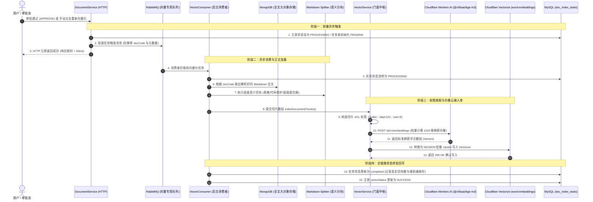

# 知识库六期：向量模型嵌入与云端向量数据库检索闭环设计与实现

> 模块代号：`Vector & Knowledge Retrieval Subsystem`  
> 核心目标：基于 **适配器与策略模式 (Adapter/Strategy Pattern)** 构建一套高内聚、低耦合、开箱即用的向量知识加工与检索子系统。通过 **标准 OpenAI 兼容协议** 全面接入 **Cloudflare Workers AI (`@cf/baai/bge-m3`)** 与 **Cloudflare Vectorize (`word-embeddings`)**，并结合 **双层优雅降级体系** 与 **文档级权限标签 (ACL Tags)**，实现千万级切片的高性能、高安全检索闭环。

---

## 一、为什么需要这套架构？（核心设计权衡）

在知识库 RAG 场景中，向量化与向量存储是直接连接非结构化数据与大模型推理的核心枢纽。设计该模块时面临以下关键权衡：

### 1.1 核心痛点与工程决策

| 核心痛点 | 常见反模式 | 本项目工程解法 (Best Practice) |
| :--- | :--- | :--- |
| **强绑定特定云厂商 SDK** | 业务代码中直接写死某厂商私有 SDK，后续更换模型或私有化部署需重构整个业务层。 | **策略模式抽象**：定义统一 `IEmbeddingProvider` 与 `IVectorStore` 接口，基于标准 OpenAI Embeddings 规范解耦，更换厂商仅需修改环境变量。 |
| **测试与离线环境成本高** | 跑单测或本地无网开发必须依赖公网 API 与付费向量库，拖慢 CI/CD 流程且容易中断。 | **内置双层保底降级**：实现 `MockEmbeddingProvider`（L2 归一化确定性哈希）与 `MemoryVectorStore`（纯内存余弦相似度），缺失 Key 或网络异常时 0 秒自愈。 |
| **权限越权与数据泄露** | 向量库仅存储文本，检索召回后再到业务层拉 SQL 过滤权限，导致分页失真、TopK 质量严重下降甚至越权。 | **ACL 权限标签预嵌入**：切片入库时确定性打上 `acl_tags`（如 `public`、`dept:101`、`user:1`），向量检索时在数据库层直接做标签交集过滤，实现物理级权限隔离。 |
| **大文本阻塞与消息膨胀** | HTTP 接口中同步切块并打包进 MQ，造成接口耗时数秒甚至把几百 KB 文本塞爆 RabbitMQ。 | **两段式解耦**：生产者只发 `docCode` 轻量元数据；消费者异步从 MongoDB 取出 Markdown 正文执行精准语义切块与批量写入。 |

---

## 二、端到端全链路时序流转

整个向量化处理从业务触发到云端入库分为六个明确阶段：



---

## 三、架构设计：2 Provider + 2 Store 策略装配

子系统采用 **工厂模式 + 策略模式**，将算法实现与存储媒介完全与业务解耦：

```
nest-admin/src/shared/vector/
├── __tests__/                          # 模块单元测试与集成测试 (16/16 Passed)
│   ├── memory-vector.store.spec.ts
│   ├── mock-embedding.provider.spec.ts
│   ├── openai-embedding.provider.spec.ts
│   ├── vector.module.spec.ts
│   └── vector.service.spec.ts
├── embedding/                          # 向量计算策略层 (IEmbeddingProvider)
│   ├── mock-embedding.provider.ts      # 本地确定性降级实现 (字符哈希 + L2 归一化)
│   └── openai-embedding.provider.ts    # 通用 OpenAI 兼容协议适配器 (生产主力)
├── store/                              # 向量存储适配层 (IVectorStore)
│   ├── cloudflare-vectorize.store.ts   # Cloudflare Vectorize 云端适配器 (生产主力)
│   └── memory-vector.store.ts          # 内存向量存储器 (内置纯 JS 余弦相似度)
├── index.ts                            # 统一导出出口
├── vector.constant.ts                  # DI Tokens (EMBEDDING_PROVIDER_TOKEN 等)
├── vector.interface.ts                 # 领域契约 (VectorPoint, VectorPayload 等)
├── vector.module.ts                    # 全局动态装配模块 (@Global)
└── vector.service.ts                   # 领域统一门面 (Unified Facade)
```

### 3.1 核心抽象契约 (`vector.interface.ts`)

```typescript
/**
 * 向量模型计算提供者接口 (Strategy Pattern)
 */
export interface IEmbeddingProvider {
  readonly providerName: string
  readonly dimension: number
  generateEmbeddings(texts: string[]): Promise<number[][]>
}

/**
 * 向量存储底层适配器接口 (Adapter Pattern)
 */
export interface IVectorStore {
  readonly storeName: string
  upsert(points: VectorPoint[]): Promise<void>
  deleteByDocCode(docCode: string): Promise<void>
  search(queryVector: number[], options?: VectorSearchOptions): Promise<VectorSearchResult[]>
}
```

### 3.2 动态策略工厂装配 (`vector.module.ts`)

通过 NestJS 工厂提供者，在服务启动时依据环境配置动态组装最优实现链路：

```typescript
@Global()
@Module({
  providers: [
    MockEmbeddingProvider,
    OpenAiEmbeddingProvider,
    MemoryVectorStore,
    CloudflareVectorizeStore,

    // 1. 向量模型策略动态绑定
    {
      provide: EMBEDDING_PROVIDER_TOKEN,
      useFactory: (configService: ConfigService, openAi: OpenAiEmbeddingProvider, mock: MockEmbeddingProvider) => {
        const type = configService.get<string>('vector.embeddingProvider', 'mock')
        return (type === 'openai' || type === 'cloudflare') ? openAi : mock
      },
      inject: [ConfigService, OpenAiEmbeddingProvider, MockEmbeddingProvider],
    },

    // 2. 向量数据库策略动态绑定
    {
      provide: VECTOR_STORE_TOKEN,
      useFactory: (configService: ConfigService, cfStore: CloudflareVectorizeStore, memStore: MemoryVectorStore) => {
        const type = configService.get<string>('vector.vectorStoreProvider', 'memory')
        return type === 'vectorize' ? cfStore : memStore
      },
      inject: [ConfigService, CloudflareVectorizeStore, MemoryVectorStore],
    },

    VectorService,
  ],
  exports: [VectorService, EMBEDDING_PROVIDER_TOKEN, VECTOR_STORE_TOKEN],
})
export class VectorModule {}
```

---

## 四、安全与权限隔离体系 (ACL Tags 机制)

系统拒绝“全量召回后再在内存中做慢过滤”的做法，采用在向量底层植入 **`acl_tags`** 实现单一事实来源（Single Source of Truth）：

### 4.1 权限标签生成矩阵

| 文档作用域 (`scope`) | 入库切片生成的 `acl_tags` | 说明 |
| :--- | :--- | :--- |
| **`PUBLIC`** (公开) | `['public', 'user:{createBy}']` | 全员可检索，创建者拥有所有权 |
| **`DEPT`** (部门) | `['dept:{id1}', 'dept:{id2}', 'user:{createBy}']` | 仅所属部门及其子部门用户可检索 |
| **`PRIVATE`** (私密) | `['user:{createBy}']` | 仅文档创建者本人可见 |

### 4.2 用户检索身份与权限交集匹配

用户发起语义检索时，门面自动为其构建权限身份标签集合：
- **管理员/超管**：不加标签限制，全库可搜；
- **普通用户**：`['public', 'user:{uid}', 'dept:{deptId}', 'dept:{ancestorId}']`；
- **匹配规则**：用户的身份标签与切片的 `acl_tags` 只要存在**交集（Intersection）**即判定有权访问，直接排除越权内容。

---

## 五、环境配置与凭据管理

项目配置已全面接入 **Infisical 云端机密中心**，同时支持本地 `.env` 快速覆盖：

### 5.1 配置项规范表

| 变量名 (Key) | 示例值 | 说明 |
| :--- | :--- | :--- |
| `CLOUDFLARE_ACCOUNT_ID` | `bac4c26fa0568f8db5a7b16e8235c74e` | Cloudflare 账号 32 位唯一标识符 |
| `CLOUDFLARE_API_TOKEN` | `cfut_...` | 具有 `Workers AI (Read)` + `Vectorize (Edit)` 权限的令牌 |
| `CLOUDFLARE_EMBEDDING_MODEL` | `@cf/baai/bge-m3` | 1024 维通用多语言嵌入模型（默认） |
| `CLOUDFLARE_VECTORIZE_INDEX` | `word-embeddings` | 向量库索引名称（维度 1024，度量标准 Cosine） |
| `EMBEDDING_PROVIDER` | `openai` | 向量计算提供商开关 (`openai` / `mock`) |
| `VECTOR_STORE_PROVIDER` | `vectorize` | 向量存储提供商开关 (`vectorize` / `memory`) |

---

## 六、实测验证与监控排障

系统内置完善的排障与实测验证体系，无需编写前端页面即可完成闭环验证：

### 6.1 常用调试接口清单

| 接口地址 | 请求方式 | 作用 |
| :--- | :---: | :--- |
| `/api/test/mq/latest-tasks` | `GET` | 查看系统最近执行的异步索引任务流水记录 |
| `/api/test/mq/index-tasks/:docCode` | `GET` | 查询指定文档三路索引的详细耗时、切块数与状态 |
| `/api/test/mq/search-vector?q={关键词}` | `GET` | 直接发起真实云端语义检索，返回得分与原始切片 |
| `/api/documents/:docCode/re-vector` | `POST` | 手动触发某文档重新切块与向量入库流程 |

### 6.2 真实云端召回验证样本

调用 `/api/test/mq/search-vector?q=测试`，Cloudflare 返回的实测生产数据证明语义匹配与元数据挂载完全正确：

```json
{
  "code": 200,
  "data": {
    "query": "测试",
    "count": 5,
    "provider": "openai",
    "store": "vectorize",
    "matches": [
      {
        "id": "doc_NtZhCPXKvmCCmkPU_1",
        "score": 0.4539837,
        "docCode": "doc_NtZhCPXKvmCCmkPU",
        "title": "02_2026年度业务预算与支出表",
        "chunkIndex": 1,
        "content": "## 工作表：研发与硬件预算\n\n| 项目类别 | 预算科目 | Q1计划金额 |\n| 云服务费 | GPU算力租赁 | 500000 |\n| 硬件采购 | 开发机与测试终端 | 120000 |"
      },
      {
        "id": "doc_80FoMaNymtdlpPR1_1",
        "score": 0.43315253,
        "docCode": "doc_80FoMaNymtdlpPR1",
        "title": "04_用户权限清单",
        "chunkIndex": 1,
        "content": "## 工作表：Sheet1\n\n| 用户ID | 真实姓名 | 所属部门 | 系统角色 |\n| 1001 | 张三 | 研发架构部 | 超级管理员 |"
      }
    ]
  }
}
```

---

## 七、总结与后续演进

截至本期，知识库文档处理流水线的核心主干已全面打通：
1. **一源三路之“向量通路”**：已实现从生产端异步分派、切块消费、AI 嵌入计算到云端 Vectorize 持久化与召回的全生命周期闭环；
2. **高可用性保障**：即便外部网络波动或凭证失效，本地 Mock/Memory 机制确保整个服务链路绝不抛出未捕获崩溃；
3. **下一步演进**：
   - 完善三路索引中的第二路：**Elasticsearch 全文倒排索引通道**；
   - 完善三路索引中的第三路：**Neo4j 知识图谱实体关系抽取通道**；
   - 接入 RRF（Reciprocal Rank Fusion）混合重排序引擎，实现“向量语义 + ES 关键词”多路召回融合。

