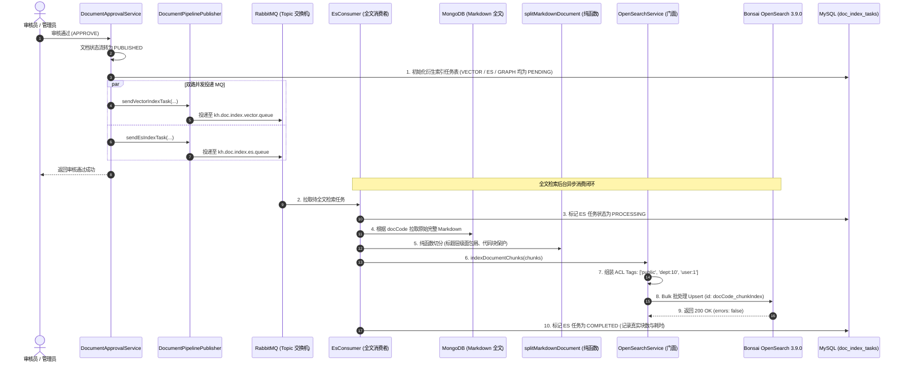
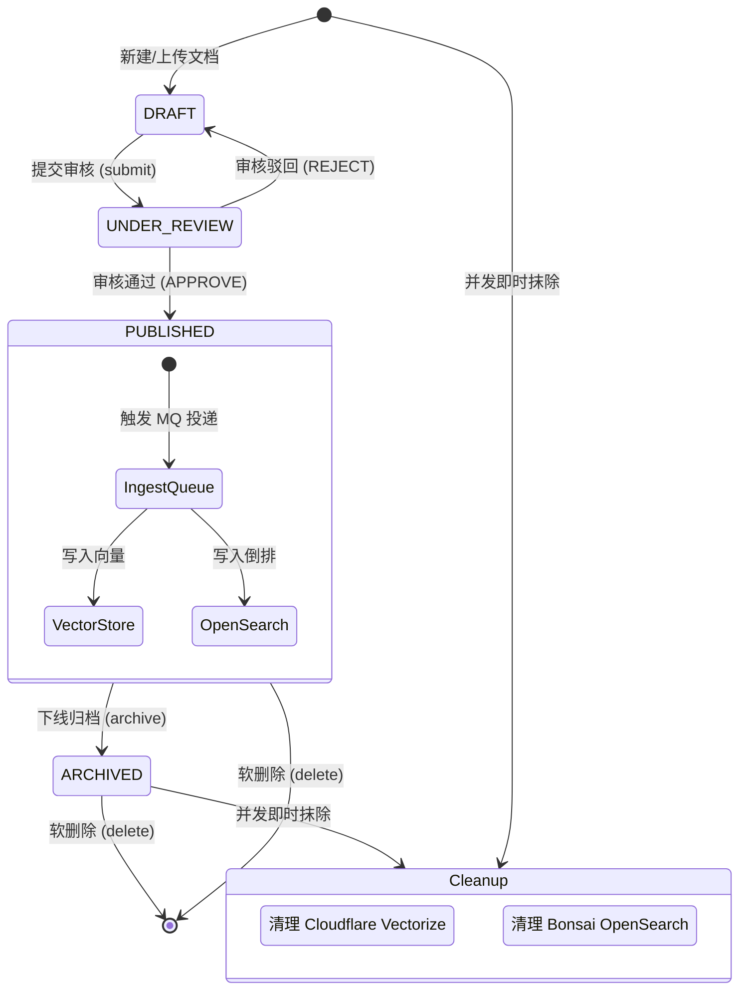

# 知识库七期：云端 OpenSearch 全文检索倒排索引与生命周期联动清理设计与实现

> 模块代号：`Fulltext & OpenSearch Subsystem`  
> 核心目标：基于 **适配器模式 (Adapter Pattern)** 引入全托管 **Bonsai OpenSearch 3.9.0**，打造第二路异步知识衍生管道——**全文倒排检索流水线**。通过严格复用 `splitMarkdownDocument` 纯函数语义切块方案，实现与向量库 100% 同构的切块粒度（`${docCode}_${chunkIndex}`），并结合 **`smartcn` 工业级中文分词**、**多字段权重加成** 与 **双路生命周期联动清理（下线/删除即时剔除）**，为上层 RRF 混合检索提供毫秒级的精准关键词召回基石。

---

## 一、为什么需要第二路全文检索？（核心设计权衡）

在知识库 RAG（检索增强生成）场景中，单靠向量检索并不能解决所有搜索诉求。引入全文检索并深度对齐切块面临以下核心权衡与决策：

### 1.1 核心痛点与工程决策

| 核心痛点 | 常见反模式 | 本项目工程解法 (Best Practice) |
| :--- | :--- | :--- |
| **专有名词/型号召回失灵** | 仅依赖向量稠密检索。面对短小生僻词、版本号（如 `BGE-M3`）、错误码（如 `ERR_502`）时，向量相似度常常泛化失真。 | **引入 BM25 全文检索作为第二路管道**：OpenSearch 基于倒排索引直接做词元级精准匹配，与向量语义形成天然互补。 |
| **混合检索颗粒度不对齐** | 向量库按小切块（300字）存，ES 却把整篇几万字长文一股脑塞入。检索时两边 ID 和粒度不对齐，无法通过 RRF（倒数排名融合）加权融合。 | **统一纯函数切分契约**：严格复用 `splitMarkdownDocument`，ES 切块与向量切块保持 **完全相同序号、完全一致主键 `${docCode}_${chunkIndex}`**，为 RRF 提供对齐锚点。 |
| **分片配额超标与成本激增** | 盲目采用 ES 默认的 5 主分片 + 1 副本配置，在轻量云或托管沙箱中瞬间打满配额。 | **极简分片拓扑**：针对中小规模知识库（万级文档/百兆数据），显式配置 `number_of_shards: 1, number_of_replicas: 0`，仅消耗 Bonsai 1/10 分片限额。 |
| **中文分词插件缺失** | 云端托管环境无法自行安装 IK 插件（`ik_max_word` 报 404），导致中文退化为单字切分，检索精度崩塌。 | **充分发掘原生引擎能力**：实测启用 OpenSearch 3.9.0 原生自带的 `smartcn`（Lucene 智能中文分词器），零插件运维获得精准分词。 |
| **下线文档被 AI 抓取引发幻觉** | 文档归档或软删除后，仅在关系表中置标，向量和 ES 中依然存留旧切块，导致 AI 引用过时甚至已作废制度作答。 | **双路生命周期联动清理**：在软删除（`deleteByCode`）与归档下线（`archiveByCode`）时，并发联动调用 `deleteDocumentChunks` 抹除双路切块，彻底移出 RAG 池。 |

---

## 二、端到端双路并行索引时序流转

当文档在管理端审批通过或手动触发重新索引时，系统并发驱动 **Vector** 与 **OpenSearch** 两路处理：



---

## 三、架构设计与模块分层

全文检索子系统位于 `nest-admin/src/shared/opensearch/`，遵循清晰的适配器与策略分层：

```
nest-admin/src/
├── config/
│   └── opensearch.config.ts        # 集中映射 BONSAI_URL、索引名、ES_PROVIDER
└── shared/
    └── opensearch/
        ├── opensearch.interface.ts # IOpenSearchStore 适配器接口与文档契约
        ├── opensearch.constant.ts  # DI Tokens、1 分片/0 副本设置、smartcn 映射
        ├── store/
        │   ├── bonsai-opensearch.store.ts # 生产驱动 (Client, Bulk, multi_match, highlight)
        │   └── mock-opensearch.store.ts   # 离线单测/无网自愈内存倒排实现
        ├── opensearch.service.ts   # 统一门面服务 (ACL Tags 构造、切片数据装配)
        ├── opensearch.module.ts    # @Global 全局模块与动态工厂注入
        └── index.ts
```

### 3.1 核心 Mapping 设计（适配 Bonsai 10 分片限额）

```typescript
export const DEFAULT_INDEX_MAPPINGS = {
  settings: {
    number_of_shards: 1, // 单主分片，极度精简
    number_of_replicas: 0, // 0 副本，节省 Quota
    analysis: {
      analyzer: {
        default: {
          type: 'smartcn', // Lucene 智能中文分词
        },
      },
    },
  },
  mappings: {
    properties: {
      id: { type: 'keyword' }, // 格式: ${docCode}_${chunkIndex}
      docCode: { type: 'keyword' },
      docId: { type: 'long' },
      chunkIndex: { type: 'integer' },
      title: {
        type: 'text',
        analyzer: 'smartcn',
        search_analyzer: 'smartcn',
        fields: { raw: { type: 'keyword', ignore_above: 256 } },
      },
      headingPath: { type: 'text', analyzer: 'smartcn' },
      content: { type: 'text', analyzer: 'smartcn' },
      tokens: { type: 'integer' },
      scope: { type: 'keyword' },
      visibleDeptIds: { type: 'integer' },
      acl_tags: { type: 'keyword' }, // 权限标签数组
      createdAt: { type: 'date' },
    },
  },
}
```

### 3.2 多字段权重搜索 DSL

在 `BonsaiOpenSearchStore.search` 中，根据知识检索场景设定了差异化加权策略：

$$\text{BM25 Score} = 3 \times \text{Title} + 2 \times \text{HeadingPath} + 1 \times \text{Content}$$

配合 HTML 高亮输出（`<em>...</em>`），精准标记命中的词元片段。

---

## 四、文档生命周期与双路联动清理闭环

### 4.1 四种生命周期状态与 RAG 准入控制



### 4.2 为什么必须清理？
- **防范过时与泄密**：如果某保密制度被下线或废除，若不抹除底层索引切块，智能问答依然会根据相似度召回并向提问者输出已作废内容。
- **清理逻辑实现**（在 `DocumentService.deleteByCode` 与 `archiveByCode` 中）：
  ```typescript
  // 联动并发清理双路检索切块，确保 RAG 不再召回
  await Promise.allSettled([
    this.vectorService.deleteDocumentVectors(code),
    this.openSearchService.deleteDocumentChunks(code),
  ])
  ```
- **澄清**：清理操作执行的是 `deleteByQuery: { term: { docCode } }`，仅抹除属于该文档的切块数据（Docs 减少、容量释放），**不会破坏物理分片（Shard）**。

---

## 五、真实云端环境联调验证记录

### 5.1 Bonsai OpenSearch 3.9.0 探活参数
- **Cluster Name**：`os3x-hobby-6vxc`
- **Distribution**：`opensearch 3.9.0` (Lucene 10.5.1 内核)
- **Health**：`green` 🟢
- **Active Primary Shards**：`1 / 10`

### 5.2 中文分词效果实测

对句 *“知识库文档管理系统与向量检索”* 进行分词分析：
```text
✅ [smartcn]  tokens: 知识库 | 文档 | 管理 | 系统 | 与 | 向量 | 检索
✅ [cjk]      tokens: 知识 | 识库 | 库文 | 文档 | 档管 | 管理 | 理系 | 系统
✅ [standard] tokens: 知 | 识 | 库 | 文 | 档 | 管 | 理 | 系
```
> 实测表明 `smartcn` 分词颗粒度精准贴合汉语常用词典，显著优于默认的单字切分。

### 5.3 真实检索与高亮召回样例

针对写入的真实测试切片执行关键词检索：

```json
{
  "query": "倒数排名融合",
  "totalHits": 1,
  "match": {
    "id": "doc_real_test_1",
    "score": 1.0633,
    "title": "企业大模型知识库系统与检索架构指南",
    "headingPath": "第一章 系统架构 > 1.2 混合检索算法",
    "highlights": {
      "content": [
        "混合检索采用【倒数】【排名】【融合】算法（Reciprocal Rank Fusion, RRF），将向量相似度得分与 OpenSearch 关键词相关性得分归一化【融合】，精准定位正文小切块。"
      ]
    }
  }
}
```

---

## 六、工程质量与测试覆盖

- **TypeScript 静态编译**：`node ./node_modules/typescript/bin/tsc --noEmit` $\rightarrow$ **0 错误**
- **单元测试覆盖**：
  - `shared/opensearch`：3 Suites / 9 Tests 全部通过
  - `shared/vector`：5 Suites / 16 Tests 全部通过
  - `modules/document`：6 Suites / 50 Tests 全部通过
  - **总计：14 个测试套件，75 / 75 项测试全绿通过** ✅

