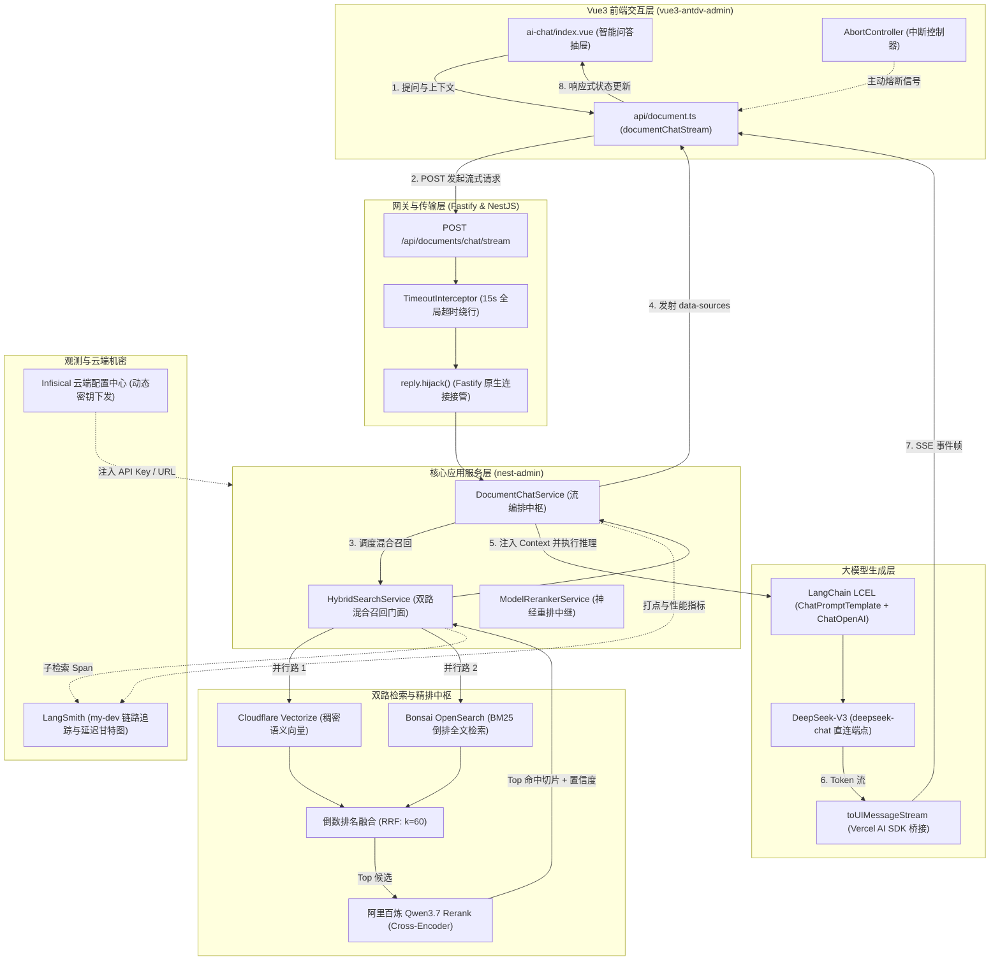

# 知识库九期：企业知识库全链路前后端对接与生产级流式 RAG 实现全景

> **模块定位**：`End-to-End Hybrid RAG & UI Streaming Architecture`  
> **核心目标**：记录从前端交互组件、SSE 流式通信协议、后端 NestJS 控制器、双路混合检索、阿里百炼深度精排、DeepSeek-V3 极速推理，到 LangSmith 链路追踪与 Infisical 云端机密接管的**完整前后端工程对接闭环**。

---

## 一、系统全景对接架构图



---

## 二、前后端传输协议与事件帧规范

系统采用 **Vercel AI SDK UI Message Stream** 标准协议（兼容标准 Server-Sent Events, SSE），所有帧以 `data: <JSON>\n\n` 格式单向推送到前端：

| 事件类型 (`type`) | 关键载荷字段 | 触发时机 | 前端交互呈现 |
| :--- | :--- | :--- | :--- |
| `start` | `messageId` | 连接建立伊始 | 初始化助理消息气泡，清空上轮状态 |
| `data-status` | `data.stage`, `data.text` | 检索与重排阶段 | 气泡内部显示脉冲提示：“正在多路召回知识库并执行语义重排…” |
| `data-sources` | `data: CitationItemDto[]` | 混合检索与重排完成瞬间 | **首字未出，出处先行**：即刻展开《参考知识库来源》可折叠卡片与置信度百分比 |
| `reasoning-start` | `id` | 大模型开启深度思考（如有） | 展开思维链手风琴折叠框（Deep Thinking） |
| `reasoning-delta` | `id`, `delta` | 思维链 Token 增量 | 在折叠框中逐字更新模型推理过程 |
| `reasoning-end` | `id` | 思维链结束 | 自动收起或标记思考完毕（耗时统计） |
| `text-start` | `id` | 正文正式生成开始 | 隐藏阶段提示文字，光标就位 |
| `text-delta` | `id`, `delta` | 正文字符增量 | **真打字机**：实时追加到 Markdown 渲染缓冲区 |
| `text-end` | `id` | 正文生成完毕 | 结束该段文本块 |
| `finish` | - | 完整生命周期结束 | 移除闪烁光标，持久化会话历史 |
| `[DONE]` | - | 传输层终结标志 | 客户端主动释放 `ReadableStreamReader` |

---

## 三、前端实现全景（`vue3-antdv-admin`）

### 3.1 客户端原生流消费引擎 ([`document.ts`](file:///Users/moliang/Desktop/coder/my-ai-reviewer/vue3-antdv-admin/src/api/backend/api/document.ts))

告别传统轮询与整包接收，采用 `fetch` + `ReadableStreamDefaultReader` + `TextDecoder` 解码流数据，并支持 `AbortSignal` 随时熔断连接：

```typescript
export async function documentChatStream(
  data: DocumentChatParams,
  handlers: DocumentChatStreamHandlers,
  signal?: AbortSignal,
): Promise<void> {
  const response = await fetch(`${prefix}/chat/stream`, {
    method: 'POST',
    headers: {
      'Content-Type': 'application/json',
      Authorization: `Bearer ${useUserStore().token}`,
    },
    body: JSON.stringify(data),
    signal,
  })

  const reader = response.body?.getReader()
  const decoder = new TextDecoder('utf-8')
  let buffer = ''

  while (true) {
    const { done, value } = await reader.read()
    if (done) break

    buffer += decoder.decode(value, { stream: true })
    const lines = buffer.split('\n')
    buffer = lines.pop() || '' // 留存未截断的半帧

    for (const line of lines) {
      const trimmed = line.trim()
      if (!trimmed.startsWith('data:')) continue
      const raw = trimmed.replace(/^data:\s*/, '')
      if (raw === '[DONE]') {
        handlers.onFinish?.()
        return
      }

      const payload = JSON.parse(raw)
      switch (payload.type) {
        case 'data-status':
          handlers.onStatus?.(payload.data)
          break
        case 'data-sources':
          handlers.onSources?.(payload.data)
          break
        case 'reasoning-delta':
          handlers.onReasoningDelta?.(payload.delta)
          break
        case 'text-delta':
          handlers.onTextDelta?.(payload.delta)
          break
      }
    }
  }
}
```

### 3.2 UI 响应式设计与交互收敛 ([`ai-chat/index.vue`](file:///Users/moliang/Desktop/coder/my-ai-reviewer/vue3-antdv-admin/src/components/business/ai-chat/index.vue))

* **单头像单气泡流式收敛**：避免“检索中”与“回答中”渲染两个头像的体验 Bug。当用户提问后，系统立即创建一条包含 `.stage-loading` 的 Assistant 消息；收到 `data-sources` 后在泡内展开出处；收到 `text-delta` 后平滑隐藏加载提示并进入 Markdown 渲染。
* **主动中断与状态复原**：右上角配备“停止生成”按钮，调用 `abortController.abort()`，前端立即停止打字并结束 Loading，后端感知断开后级联停止上游 DeepSeek 消耗。

---

## 四、后端核心实现全景（`nest-admin`）

### 4.1 Fastify 原生连接接管与超时绕行 ([`document.controller.ts`](file:///Users/moliang/Desktop/coder/my-ai-reviewer/nest-admin/src/modules/document/document.controller.ts))

NestJS 默认的全局拦截器会将返回值包装为统一结构（如 `{ code: 200, data: ... }`），且 `TimeoutInterceptor` 默认设置了 15 秒强制超时：

```typescript
@Post('chat/stream')
@Bypass() // 1. 绕行全局响应包装拦截器
@ApiOperation({ summary: '知识库 AI 对话流式接口 (Vercel AI SDK 协议规范)' })
async chatStream(
  @Body() dto: DocumentChatDto,
  @AuthUser() user: IAuthUser,
  @Res() reply: FastifyReply,
): Promise<void> {
  // 2. 劫持 Fastify 底层原生 HTTP 连接，直接交由 Web Streams 写入管道
  reply.hijack()
  await this.documentChatService.streamChat(dto, user, reply.raw)
}
```

在 [`TimeoutInterceptor`](file:///Users/moliang/Desktop/coder/my-ai-reviewer/nest-admin/src/common/interceptors/timeout.interceptor.ts) 中注入 `Reflector`：
```typescript
if (this.reflector.get(BYPASS_KEY, context.getHandler())) {
  return next.handle() // 流式接口豁免 15s 强制熔断
}
```

---

### 4.2 工业级双路混合检索与语义重排 ([`hybrid-search.service.ts`](file:///Users/moliang/Desktop/coder/my-ai-reviewer/nest-admin/src/modules/document/services/hybrid-search.service.ts))

```
提问 -> [路1: Cloudflare Vectorize] (Dense 语义) ──┐
     -> [路2: Bonsai OpenSearch]    (BM25 倒排全文) ──┴─> [RRF 倒数融合] ──> [阿里 Qwen3.7 Rerank] ──> Top 命中
```

1. **并行双路召回**：通过 `Promise.allSettled` 并发请求两路，即使某一外部网络短暂超时，另一路依然可以无缝降级支撑；
2. **倒数排名融合 (RRF)**：
   $$RRF\_Score(d) = \sum_{m \in \{Vector, ES\}} \frac{w_m}{k + Rank_m(d)} \quad (k=60)$$
   彻底抹平向量余弦分与 ES BM25 分数的量纲差异；
3. **阿里百炼 Cross-Encoder 重排**：将 Top 8 候选切块送入 `qwen3.7-text-rerank` 进行深度交叉自注意力打分，重排置信度高于 0.85 的高质量切片输入大模型。

---

### 4.3 智能模型路由与真流式管道 ([`document-chat.service.ts`](file:///Users/moliang/Desktop/coder/my-ai-reviewer/nest-admin/src/modules/document/services/document-chat.service.ts))

#### 1. 动态服务商自适应解析器 (`resolveChatConfig`)
彻底杜绝“拿着 DeepSeek Key 请求 Cloudflare 报错”的环境漂移问题：
```typescript
private resolveChatConfig() {
  const deepseekKey = process.env.DEEPSEEK_API_KEY
    || (this.vectorConfig.chatApiKey?.startsWith('sk-') ? this.vectorConfig.chatApiKey : '')

  // 只要检测到 DeepSeek Key，100% 路由至官方极速端点
  if (deepseekKey) {
    return {
      apiKey: deepseekKey,
      baseURL: process.env.DEEPSEEK_BASE_URL || 'https://api.deepseek.com',
      model: process.env.DEEPSEEK_MODEL || 'deepseek-chat',
    }
  }

  // 兜底回退至 Cloudflare 官方最新 LLaMA 3.1
  return {
    apiKey: this.vectorConfig.apiToken,
    baseURL: `https://api.cloudflare.com/client/v4/accounts/${this.vectorConfig.accountId}/ai/v1`,
    model: '@cf/meta/llama-3.1-8b-instruct',
  }
}
```

#### 2. LangChain 与 Vercel AI SDK 的双轨流融合
```typescript
const stream = createUIMessageStream<DocChatUIMessage>({
  execute: async ({ writer }) => {
    writer.write({ type: 'start' })
    writer.write({ type: 'data-status', data: { stage: 'retrieve', text: '正在多路召回知识库并执行语义重排…' } })

    // 1. 混合检索与重排
    const searchRes = await this.hybridSearchService.search(...)
    // 2. 出处先行广播
    writer.write({ type: 'data-sources', data: citations })

    // 3. 组装 LangChain LCEL 并开启流式推理
    const ragChain = promptTemplate.pipe(llm).withConfig({ runName: 'deepseek_rag_generation' })
    const langchainStream = await ragChain.stream({ context, chat_history, input: query })

    // 4. 动态桥接入 UI Message Stream
    writer.merge(toUIMessageStream(mapReasoningStream(langchainStream) as never, {
      sendStart: false,
      sendFinish: false,
    }) as never)
  }
})

pipeUIMessageStreamToResponse({ stream, response: res })
```

---

## 五、链路追踪与性能监控（LangSmith）

通过接入 **LangSmith**，问答全链路具备了工业级可观测性：

### 5.1 实测性能大盘指标

* **检索与重排耗时 (`hybrid_search_retrieval`)**：~2.99s（包含 Cloudflare 向量召回、美东 Bonsai 倒排检索、阿里百炼重排与 MySQL 实体富化）；
* **大模型首字延迟 (First Token / TTFT)**：**`0.24s` (240ms)** —— 极速响应，几乎在检索出处卡片就位的刹那即开始打字；
* **大模型生成速率**：1.53K Tokens / 3.04s，高吞吐流式吐字；
* **冲突防御**：系统自动屏蔽了 `LANGSMITH_AGENT_*` 导致的冲突，统一汇聚至项目 **`my-dev`**。

---

## 六、生产环境配置清单（Infisical / 云端）

所有真实敏感凭证已交付至 **Infisical 云端机密中心**，本地 `.env` 保持零敏感信息：

```env
# 知识库第二路：Bonsai OpenSearch 全文倒排检索 (BM25)
BONSAI_URL=https://<username>:<password>@<cluster>.us-east-1.bonsaisearch.net
OPENSEARCH_INDEX=kh_doc_chunks
ES_PROVIDER=bonsai

# 阿里百炼 DashScope 深度重排 (qwen3.7-text-rerank)
DASHSCOPE_API_KEY=sk-your-dashscope-api-key
RERANK_MODEL=qwen3.7-text-rerank
RERANK_BASE_URL=https://dashscope.aliyuncs.com/api/v1/services/rerank/text-rerank/text-rerank
RERANK_PROVIDER=model

# DeepSeek-V3 官方大模型极速推理
DEEPSEEK_API_KEY=sk-your-deepseek-api-key
DEEPSEEK_BASE_URL=https://api.deepseek.com
DEEPSEEK_MODEL=deepseek-chat
CLOUDFLARE_CHAT_MODEL=@cf/meta/llama-3.1-8b-instruct

# LangSmith 链路追踪 (my-dev 项目)
LANGSMITH_TRACING=true
LANGSMITH_ENDPOINT=https://api.smith.langchain.com
LANGSMITH_API_KEY=lsv2_pt_your_langsmith_api_key
LANGSMITH_PROJECT=my-dev
LANGCHAIN_TRACING_V2=true
LANGCHAIN_ENDPOINT=https://api.smith.langchain.com
LANGCHAIN_API_KEY=lsv2_pt_your_langsmith_api_key
LANGCHAIN_PROJECT=my-dev
```

---

## 七、架构验收与质量保障总结

1. **协议解耦**：前端基于标准 Web Streams 规范，完全与特定 UI 框架解耦；
2. **体验极致**：阶段状态可见、来源出处前置、0.24 秒首字响应、支持中途打断；
3. **容错兜底**：任何模型服务商抖动或网络超时均具备本地智能合成兜底，绝不白屏崩溃；
4. **安全合规**：所有环境密钥动态从云端载入内存，彻底告别明文泄漏风险。

