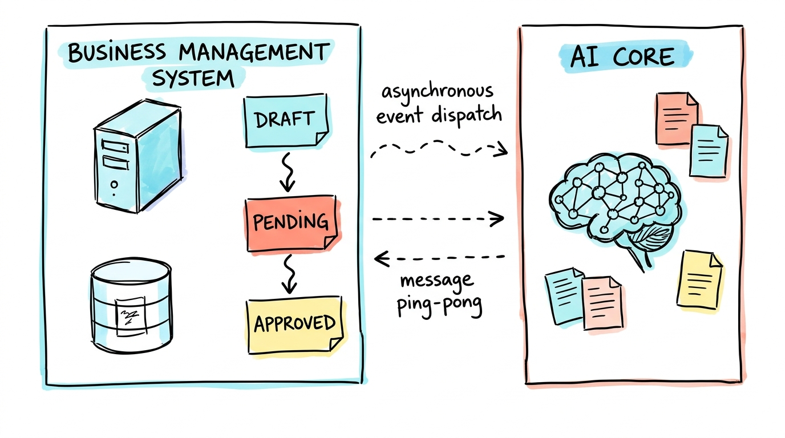

# 别死背 AI 概念了：我从零手搓企业知识库的架构与避坑实录

## 前言

最近在学习 AI 开发，硬啃了一堆概念。

结果发现，天天在网上看什么 Embedding、向量数据库、RAG 架构图，脑子以为学会了，打开编辑器还是一脸懵：这玩意到底怎么接进业务里？文件丢哪？怎么跟前端交互？

死记概念真没用，不如直接干。我决定抛开那些花架子，拿一个最经典的场景开刀——**自己动手写一个企业知识库**。

---

## 二、架构划分：别在 Python 里重写后台，各司其职

动工前，我先琢磨了一下整体架构。

知识库系统表面上看是 AI 应用，但真正动手做就会发现，**80% 的工作量其实是传统业务工程**：登录鉴权、部门组织架构、角色权限、文档生命周期状态机……

如果全部在 Python 里硬写一套后台用户系统，纯属吃力不讨好；中途我也考虑过用 Go，但综合开发效率，最后还是选了生态更熟悉的 Node。

我直接把系统划分为两块，各司其职：

1. **业务与管理底座（NestJS + Vue 3）**：
   我直接基于开源的成熟中后台套件当地基：
   - 后端：[`nest-admin`](https://github.com/buqiyuan/nest-admin)（NestJS + Fastify + TypeORM + MySQL + Redis）
   - 前端：[`vue3-antdv-admin`](https://github.com/buqiyuan/vue3-antdv-admin)（Vue 3 + Vite + Ant Design Vue）
   
   组织架构、部门人员、RBAC 权限等基础功能开箱即用，我只需要专注把精力花在**文档元数据落库**和**审批状态流转**上。

2. **AI 核心引擎（Python + FastAPI）**：
   Python 生态搞 AI 还是无可替代。独立搞一个 FastAPI 服务，专门负责文本解析、分块切片（Chunking）、向量化存储以及后续的语义检索。

后端管业务，Python 管算法，两者通过接口异步通信。这样一来，地基直接稳了，省下了大量无意义的搬砖时间。

---

## 三、定义状态机：审核通过后，才推给 Python 处理

有了用户和权限底座后，我先把文档的核心生命周期状态定下来，确保流程可控：

### 1. 明确的业务状态流转
- **草稿态（`DRAFT`）**：文档刚上传完默认为草稿，只有作者自己能在草稿箱看到。
- **待审核（`UNDER_REVIEW`）**：作者确认无误后点击“提交审核”，进入待审核队列。
- **审核裁决**：
  - **审核通过（`PUBLISHED`）**：文档正式发布。**只有在这个节点，系统才会向 Python 端推送切块任务。**
  - **审核驳回（退回 `DRAFT`）**：打回草稿箱并附带驳回原因，供作者修改后重新送审。

### 2. 异步推送与解耦
审核通过后，Node 后端会异步给 Python FastAPI 端推一个任务事件，告诉它这个文档可以开始处理了。

Node 端不用等耗时的大模型推理，直接完成业务流转；Python 端在后台异步接单：读取文件、解析正文、切块（Chunking）并存入向量库，处理完后将向量化状态更新为就绪（`completed`）。

---

## 四、环境准备：上云免运维，自己搭一套干净的 ENV 管理

在正式写业务前，基础设施的环境我也做了一些权衡。

以前自己写 demo，习惯在本地装个 MySQL、起个 Docker 跑 Redis。但如果换台电脑或者协同开发，导数据、连本地服务极其折腾，环境稍微对不上就报错。

这次我直接把存储全部搬到了云端 Serverless 服务上，主打一个**免运维、多端开箱即用**：

### 1. 云端基础设施选型
- **云 MySQL（TiDB Cloud）**：
  直接用了 TiDB Cloud 的 Serverless 实例，原生兼容 MySQL 8.0 语法和 TypeORM，自带 SSL 加密和高可用。我不需要在本地装数据库，任何地方连上就能查表。
- **云 Redis（Upstash）**：
  缓存和分布式锁直接上了 Upstash 的 Serverless Redis，带 TLS 安全连接。用来存登录态、验证码、接口防刷和送审并发锁，毫秒级响应，而且不用担心本地 Redis 进程挂掉。

### 2. 凭据管理：用开源的 Infisical 告别本地 .env 乱传
基础设施上云后，最怕的就是把连接密码手滑提交到 GitHub，或者在微信群里互发 `.env` 文件。

这里我接入了开源的凭据管理中心 [Infisical](https://github.com/Infisical/infisical)：

- **密钥统一云端托管**：MySQL、Redis 以及各类 API Key 统一放在 Infisical 后台，代码库里只保留一份干净的 `.env.development.example` 模板；
- **服务启动动态拉取**：在后端 `main.ts` 启动的最前置阶段，通过 `@infisical/sdk` 动态拉取最新凭据并注入到内存中的 `process.env`；
- **自动安全降级**：本地若未配置云端凭据，会自动兜底回退读取本地环境变量，既保证了敏感信息不落盘、不提交代码库，又完全不影响单机开发体验。

---

## 五、写在最后

折腾完这几步，知识库最基础也是最繁琐的“骨架”终于搭结实了。

后面我们慢慢填，下一篇写一下文档解析及两个系统的通信。
