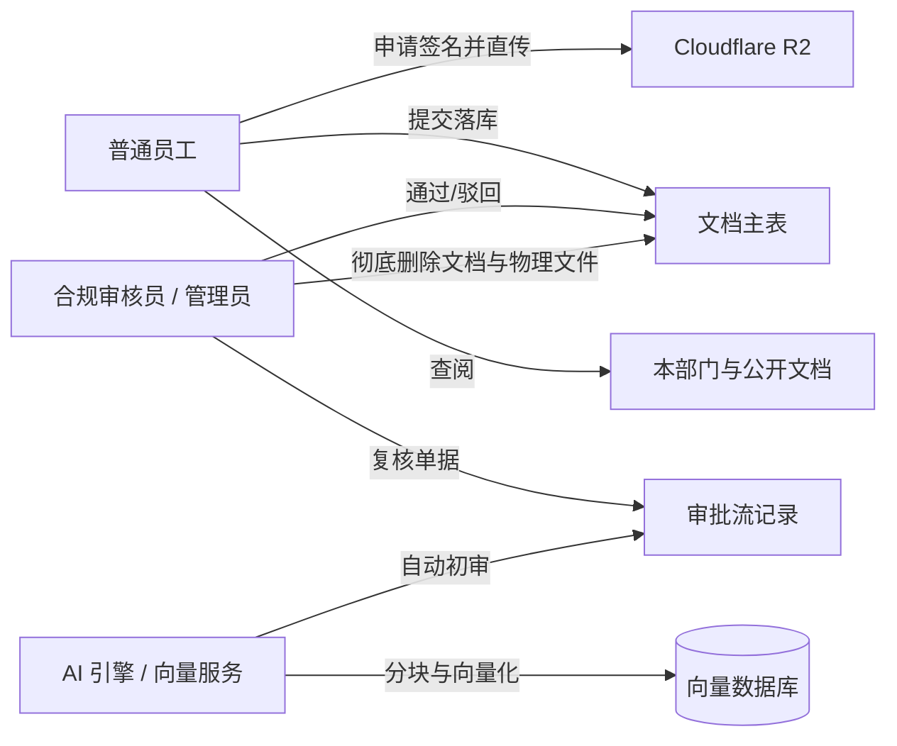
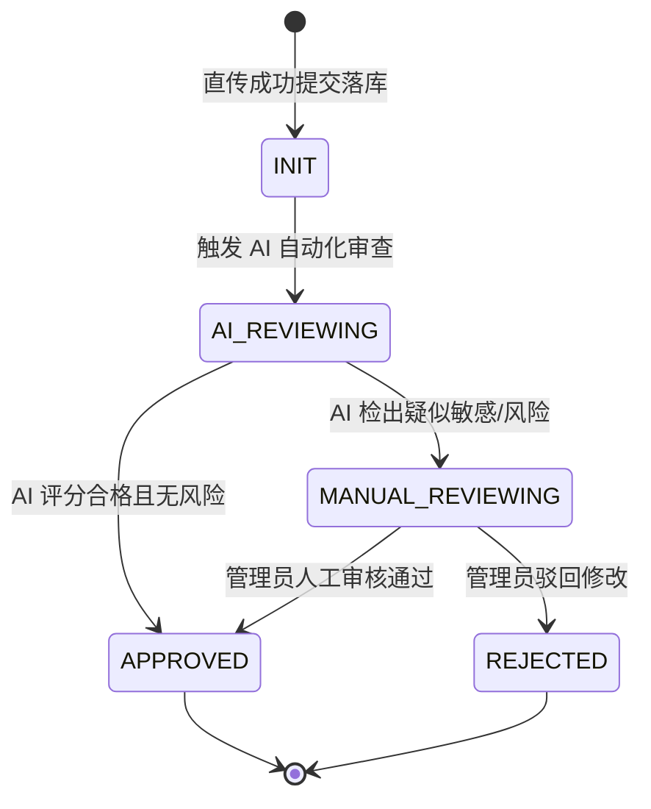

# 📄 产品需求文档 (PRD)：知识库文档与生命周期管理模块

| 文档版本 | 状态 | 编写日期 | 关联工程 | 适用对象 |
| :--- | :--- | :--- | :--- | :--- |
| **v1.0.0** | 已实施 (Implemented) | 2026-10-30 | `nest-admin` / `vue3-antdv-admin` / `03_rag` | 产品、前后端开发、AI 算法工程师 |

---

## 一、需求背景与产品定位 (Background & Vision)

### 1. 业务痛点
传统企业知识库与协同文档管理通常存在三大痛点：
1. **服务器带宽瓶颈与存储昂贵**：大文件上传经由业务后端中转，严重挤占服务器 CPU 与上下行带宽；
2. **缺乏流程审计与 AI 质检**：文档上传后直接发布，缺乏合规走查机制（如敏感凭证泄漏、弱口令、制度冲突），人工审批流程混乱无记录；
3. **与下游 RAG 向量检索严重割裂**：文档切块后缺失企业级权限元数据，普通用户通过 AI 检索助手时可轻易穿透越权问出机密内容。

### 2. 产品目标
打造一套**零服务器带宽消耗**、**双主键安全隔离**、**审批流全程溯源**并**天生契合企业级 RAG 权限过滤**的现代化知识库文档中枢。

---

## 二、用户角色与用例场景 (User Roles & Scenarios)



| 角色 | 权限范围与典型用例 |
| :--- | :--- |
| **普通员工** | ① 申请直传凭证并上传个人或部门规范文件；<br>② 查询全员公开文档及所属部门文档；<br>③ 查看自身提交文档的审核状态与审核意见；<br>④ 仅允许删除本人上传的私有文档。 |
| **部门审核人 / 管理员** | ① 接收并审阅「待人工复核」的文档；<br>② 查看 AI 合规走查报告与违规片段；<br>③ 执行通过/驳回操作，录入审批意见；<br>④ 拥有全量文档的查询与管理删除权限。 |
| **AI 评审助手 (System)** | ① 监听文档落库事件，提取全文进行敏感信息、弱口令审查；<br>② 自动生成初审评分与修改建议；<br>③ 对通过的文档执行自动化语义切片（Chunking）与向量入库。 |

---

## 三、核心功能与业务规则 (Functional Specifications)

### 1. 客户端预签名直传 (Direct-to-Cloudflare R2)
- **业务流程**：
  1. 客户端向后端发起 `POST /api/documents/upload-sign` 申请直传凭据；
  2. 后端基于 AWS S3 兼容协议，生成带有动态过期时间（默认 3600 秒）的 `PUT Presigned URL`；
  3. 客户端使用原生 HTTP PUT 直传二进制文件至 Cloudflare R2，**完全不占用后端主机带宽**。
- **校验约束**：
  - 单文件体积上限：**≤ 50 MB**；
  - 支持文件格式：`pdf`、`docx`、`doc`、`md`、`txt` 等；
  - 文件命名：自动在 S3 Key 前拼接日期及唯一随机串，如 `knowledge/docs/20261030/doc_xxxx.pdf`。

### 2. 双主键安全与入库规则 (Double Identifier Strategy)
- **内部主键 (`id: bigint`)**：数据库内自增，用于高效的主键索引、关联外键以及 B+ 树范围扫描。
- **外部公开业务编码 (`doc_code`)**：
  - 格式规范：`'doc_' + generateUUID(16)`（如 `doc_a1b2c3d4e5f6g7h8`）；
  - **安全红线**：所有面向前端的 API（URL 路径、传参、删除接口）**强制统一使用 `doc_code`**，严禁向外暴露递增 ID，防止黑客/爬虫通过 ID 猜解遍历企业机密文档。
- **安全净化 (Sanitize)**：落库时服务端强制剥离文件名中的危险字符（`< > " ' ; / \ ..` 等），杜绝 XSS 注入与路径穿越隐患。

### 3. 数据权限与可见范围控制 (Data Scope)
文档支持 3 级可见范围划分：

| 范围标识 (`scope`) | 语义 | 查阅与检索权限规则 |
| :--- | :--- | :--- |
| `PUBLIC` | 全员公开 | 系统内所有合法登录用户均可查阅并允许 RAG 语义检索。 |
| `DEPT` | 指定部门可见 | 支持跨部门多选授权（`visible_dept_ids`），仅被选部门员工可见。 |
| `PRIVATE` | 个人私有 | 仅文档创建者（`create_by`）及超级管理员有权查阅。 |

### 4. 审批状态机与解耦架构 (Approval Lifecycle)
为了确保主表整洁并沉淀高价值审计轨迹，**文档主表与审批轨迹表彻底解耦**。



- **首条记录自动生成**：用户提交保存文档时，系统在同一事务中向 `doc_approval_records` 插入首条 `SUBMIT` 节点轨迹。
- **多端流转兼容**：每次审批动作记录操作人 `operator_id`、节点类型 `node_type`、操作动作 `action`、评审意见 `comment` 及操作后状态快照 `snapshot_status`。

### 5. RAG 向量化切片与安全底座 (RAG Security Baseline)
- **独立状态机制**：向量化状态（`vector_status`）独立于业务审批状态，避免模型推理耗时阻塞日常文档流转。
- **元数据继承 (Metadata Inheritance)**：
  - 文档切块写入向量库（pgvector / Qdrant）时，每个 Chunk **必须强制携带父文档的权限属性**（`doc_id`, `visible_range`, `dept_ids`, `creator_id`）。
- **向量检索预过滤 (Pre-Filtering)**：
  - AI 问答在向向量库发起检索时，必须携带当前提问者的身份上下文进行元数据过滤，**严禁无权限召回**，从数据源头上保障企业多租户数据隔离。

### 6. 文档彻底清理与云端联动 (Cascade Physical Cleanup)
- 调用 `DELETE /api/documents/:code` 时：
  1. 校验操作权限（仅超管或创建者本人可删）；
  2. 异步调用 Cloudflare R2 SDK 删除物理文件；
  3. 清理审批流记录及文档主表记录。

---

## 四、数据模型与字典规范 (Data Dictionaries)

### 1. 核心数据表结构

#### ① 知识库文档主表：`doc_documents`
| 字段名 | 类型 | 约束 | 说明 |
| :--- | :--- | :--- | :--- |
| `id` | BIGINT | PK, 自增 | 内部物理主键 |
| `doc_code` | VARCHAR(32) | UNIQUE, NOT NULL | 对外唯一业务编码 |
| `title` | VARCHAR(255) | NOT NULL | 文档标题 |
| `category` | VARCHAR(50) | NULL | 业务分类（技术规范/财务/行政等） |
| `file_name` | VARCHAR(255) | NOT NULL | 原始文件名（已净化） |
| `file_size` | BIGINT | NOT NULL | 文件大小（字节） |
| `file_type` | VARCHAR(50) | NOT NULL | 文件格式（扩展名） |
| `storage_key`| VARCHAR(500) | NOT NULL | R2 存储唯一路径 Key |
| `public_url` | VARCHAR(1000)| NULL | 外部公共/加速访问 URL |
| `scope` | VARCHAR(20) | DEFAULT 'PUBLIC' | 可见范围：`PUBLIC` / `DEPT` / `PRIVATE` |
| `visible_dept_ids` | JSON | NULL | 允许查看的部门 ID 数组 |
| `visible_dept_names`| JSON | NULL | 冗余部门名称数组 |
| `status` | VARCHAR(20) | DEFAULT 'PUBLISHED' | 生命周期：`DRAFT` / `PUBLISHED` / `ARCHIVED` |
| `review_status` | VARCHAR(20) | DEFAULT 'APPROVED' | 审批状态（见字典） |
| `review_score` | DECIMAL(5,2)| NULL | AI 审核得分 (0~100) |
| `review_remark`| TEXT | NULL | 审核意见或驳回原因 |
| `vector_status`| VARCHAR(20) | DEFAULT 'unprocessed' | 向量化状态（见字典） |
| `create_by` | BIGINT | NULL | 创建人用户 ID |
| `created_at` | DATETIME | NOT NULL | 创建时间 |
| `updated_at` | DATETIME | NOT NULL | 更新时间 |

#### ② 审批记录轨迹表：`doc_approval_records`
| 字段名 | 类型 | 约束 | 说明 |
| :--- | :--- | :--- | :--- |
| `id` | BIGINT | PK, 自增 | 主键 |
| `doc_id` | BIGINT | INDEX, NOT NULL | 关联文档主表 ID |
| `doc_code` | VARCHAR(32) | INDEX, NOT NULL | 关联文档业务编码 |
| `node_type`| VARCHAR(50) | NOT NULL | 节点类型：`SUBMIT` / `AI_REVIEW` / `MANUAL_REVIEW` |
| `action` | VARCHAR(50) | NOT NULL | 审批动作：`SUBMIT` / `APPROVE` / `REJECT` / `TRANSFER` |
| `operator_id`| BIGINT | NULL | 操作人 ID（系统操作可为空） |
| `operator_name`| VARCHAR(50)| NULL | 操作人姓名或 AI 标识 |
| `comment` | TEXT | NULL | 审批评语 / 驳回建议 |
| `snapshot_status`| VARCHAR(20)| NULL | 变更后的快照状态 |
| `created_at` | DATETIME | NOT NULL | 审批时间 |

### 2. 枚举状态映射表

```
ReviewStatus (审批状态):
├── INIT: 待提交/草稿
├── AI_REVIEWING: AI 初审中
├── MANUAL_REVIEWING: 待人工复核
├── APPROVED: 审核通过
└── REJECTED: 已驳回

VectorStatus (向量化状态):
├── unprocessed: 未解析
├── processing: 切片向量化中
├── completed: 已就绪 (可检索)
└── failed: 解析失败
```

---

## 五、接口契约一览 (API Contracts)

| 请求方式 | 路径 | 功能说明 | 认证级别 |
| :--- | :--- | :--- | :--- |
| `POST` | `/api/documents/upload-sign` | 获取 Cloudflare R2 预签名上传凭证 | 需登录 (JWT) |
| `POST` | `/api/documents` | 直传 R2 完成后提交元数据落库保存 | 需登录 (JWT) |
| `GET` | `/api/documents` | 分页多维条件查询文档列表 | 需登录 (含数据权限过滤) |
| `GET` | `/api/documents/:code` | 根据业务编码获取文档详情及审批轨迹 | 需登录 |
| `DELETE`| `/api/documents/:code` | 根据编码彻底删除文档与云端物理存储 | 需登录 (限超管或创建者) |
| `GET` | `/api/documents/access-url`| 获取私有文档的临时带鉴权预览下载链接 | 需登录 |

---

## 六、演进路线与后续迭代规划 (Roadmap)

- [x] **v1.0 (已完成)**：
  - Cloudflare R2 预签名客户端直传闭环；
  - 双主键实体与审批单表架构落地；
  - 前后端分页联调、状态枚举统一与删除联动。
- [ ] **v1.1 (计划中)**：
  - 联动 Python AI 服务，实现文档直传后的自动化全文解析与合规走查；
  - 接入敏感词库，对包含弱密码或机密凭据的文档自动置为 `MANUAL_REVIEWING`。
- [ ] **v1.2 (计划中)**：
  - 基于 LangChain / pgvector 实现自动化文本切片（Chunking）；
  - 写入向量元数据，支持多租户基于部门的数据预过滤 RAG 问答。
- [ ] **v1.3 (规划中)**：
  - 增加 Cloudflare R2 孤儿文件定时对账与自动清理 Job。
