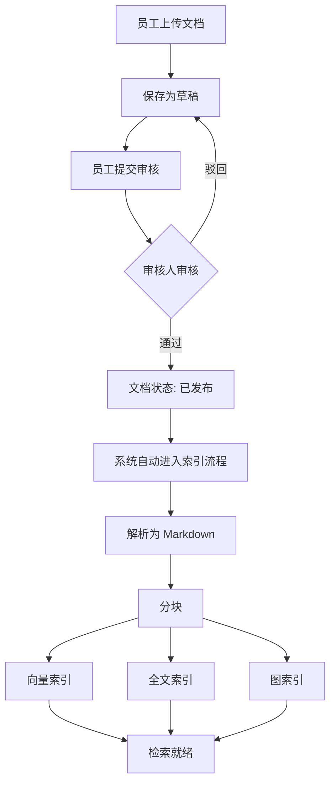
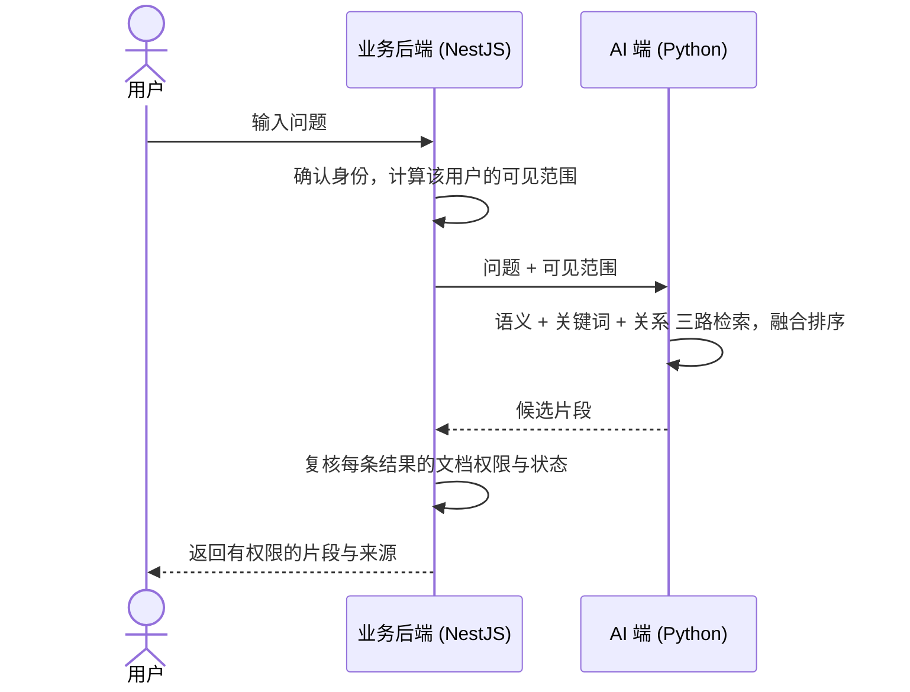

# 📚 产品需求文档 (PRD)：企业知识库智能检索（文档索引与权限检索）

| 文档版本 | 状态 | 编写日期 | 关联工程 | 适用对象 |
| :--- | :--- | :--- | :--- | :--- |
| **v0.2.0** | 草案 (Draft)，已确定向量库选型 | 2026-10-31 | `nest-admin` / Python AI 端（待建）/ `vue3-antdv-admin` / `web` | 产品、前后端开发、AI 算法工程师 |

> **与既有文档的关系**
> - 本文档承接并**取代** [PRD_DOCUMENT_MODULE.md](./PRD_DOCUMENT_MODULE.md) 路线图中的 v1.2（AI 合规走查）与 v1.3（pgvector 切片）。
> - **关键调整**：不再做 AI 自动初审，审核全部由人工（审核人角色）完成；AI 端只负责审核通过之后的**解析、分块、多路索引与检索**。
> - 文档管理（上传、审批、删除）的既有规则仍以 `PRD_DOCUMENT_MODULE.md` 为准，本文档只描述其**下游**：文档发布之后如何被检索，以及检索时如何保证权限。
> - 配套技术方案见 [TECH_KNOWLEDGE_RETRIEVAL.md](./TECH_KNOWLEDGE_RETRIEVAL.md)。

---

## 一、背景与目标

### 1. 背景
知识库文档目前只能上传、审核、列表查看。用户想从大量文档里找答案，只能靠标题搜索，找不到文档内部的内容，更没有智能问答。

同时企业文档有明确的访问边界：A 部门的制度文档，B 部门的人不应该能通过任何方式看到，**包括通过搜索或 AI 问答摘出其中的片段**。

### 2. 产品目标
1. **找得到**：用户输入自然语言或关键词，能检索到文档内部的相关内容，而不仅是标题。
2. **看得对**：检索结果严格遵守文档的可见范围，无权限的内容**既不出现，也不暴露它存在**。
3. **可追溯**：每条检索结果都能定位回来源文档与具体位置，点击可查看原文（原文访问同样受权限控制）。
4. **可运维**：文档的索引状态对管理员可见，失败可重试，删除和权限变更能同步到检索侧。

### 3. 范围（In Scope）
- 审核通过的文档自动进入索引流程。
- 索引包含三类能力：**语义检索（向量）**、**关键词检索（全文）**、**关系检索（图）**。
- 基于可见范围的检索权限控制。
- 索引状态展示、失败重试、删除与权限变更同步。

### 4. 非目标（Out of Scope）
- **AI 自动审核/合规走查**：明确不做。
- **文档在线编辑与协同**：不在本期。
- **多租户（跨公司）隔离**：本产品是单企业内部部署，权限边界是部门与个人。
- **图谱的全局摘要问答（社区摘要）**：第一期不做，原因见"权限规则"。

---

## 二、用户角色

| 角色 | 说明 | 与本功能相关的权限 |
| :--- | :--- | :--- |
| **普通员工** | 所有登录用户 | 检索时可看到：全员公开文档、自己创建的文档、被分享给自己所在部门（含上级部门分享）的文档。 |
| **文档创建者** | 上传文档的员工 | 始终能检索到自己创建的文档，无论可见范围。 |
| **审核人** | 拥有 `reviewer` 角色的员工 | 负责人工审核。**审核权限不等于检索权限**：检索时与普通员工一致。 |
| **管理员** | 拥有 `admin` / `super_admin` 角色 | **检索时不受可见范围限制，能搜到所有已发布文档**（含他人的私有文档）。 |

> 说明：管理员能检索全部文档是产品决策。同时意味着管理员账号的安全等级要求更高，检索行为应被审计（见"非功能需求"）。

---

## 三、核心业务流程

### 1. 文档从上传到可检索



要点：
- **只有已发布的文档才会被索引**，草稿、审核中、被驳回的文档不可被检索。
- 索引流程是**自动的、异步的**，用户和审核人无需手动操作。审核通过后，文档不是立刻能被搜到，而是在索引完成后才能被搜到（通常几十秒到几分钟，视文档大小）。

### 2. 用户检索



要点：
- **可见范围由业务后端根据登录身份计算，前端无法指定或篡改。**
- 结果返回前业务后端会**再复核一次**，确保文档仍存在、仍已发布、用户仍有权限。因此即使索引同步稍有延迟，**权限收回是立即生效的**。

---

## 四、权限规则（本产品最重要的部分）

### 1. 可见范围定义

| 可见范围 | 谁能检索到 |
| :--- | :--- |
| `PUBLIC` 全员公开 | 所有登录用户。 |
| `DEPT` 指定部门 | 被指定部门的成员，**以及这些部门的所有下级部门成员**；另外文档创建者本人。 |
| `PRIVATE` 个人私有 | 仅文档创建者本人。 |
| （任意范围） | 管理员始终可以。 |

### 2. 部门可见的具体语义

> 以下语义为推荐方案，**待产品确认**（见第十节）。

- **向下包含**：文档分享给"技术部"，则技术部、以及技术部下的"前端组""后端组"成员都能检索到。
- **不向上穿透**：上级部门的成员（如公司 CEO 办公室）**不会自动**看到下级部门的 `DEPT` 文档，除非文档被显式分享给了他所在的部门。
- **一人一部门**：当前系统中一个员工只属于一个部门。

### 3. 权限示例

组织结构：

```
公司
├── 技术部
│   ├── 前端组
│   └── 后端组
└── 财务部
```

| 文档 | 可见范围 | 前端组成员 | 技术部成员 | 财务部成员 | 创建者（财务部张三） | 管理员 |
| :--- | :--- | :---: | :---: | :---: | :---: | :---: |
| 员工手册 | PUBLIC | ✅ | ✅ | ✅ | ✅ | ✅ |
| 研发规范 | DEPT：技术部 | ✅ | ✅ | ❌ | ✅（若是他创建） | ✅ |
| 前端编码规范 | DEPT：前端组 | ✅ | ❌ | ❌ | ✅（若是他创建） | ✅ |
| 报销制度草案 | DEPT：财务部 | ❌ | ❌ | ✅ | ✅ | ✅ |
| 张三的个人笔记 | PRIVATE | ❌ | ❌ | ❌ | ✅ | ✅ |

### 4. 权限的硬性原则
1. **无权限的内容，不能出现在结果里，也不能暴露其存在**。例如"共找到 N 条结果"的 N 只统计有权限的结果；搜索建议、相关推荐同理。
2. **三种检索方式（语义、关键词、关系）必须使用同一套权限规则**，不允许某一路绕过。
3. **权限由业务后端判断**，AI 端只执行业务后端下发的条件，自己不做权限决策。
4. **宁可少返回，不可多返回**：当权限信息缺失或计算失败时，检索结果为空，而不是放开。

### 5. 关系检索（图）的特别约束
关系检索的特点是：同一个"实体"或"关系"可能来自多篇文档（例如"张三负责项目X"，一篇来自 A 部门文档，一篇来自公开文档）。因此：

- 每条关系必须记录它**来源于哪些文档片段**，用户只能沿着自己有权限的来源走。
- **第一期不做跨文档的"社区摘要/全局总结"**：这类预先聚合的摘要会把多篇文档内容混在一起，难以按权限切分，容易泄露。
- 若将来要做，只对 `PUBLIC` 文档做，或按权限范围分别生成。

---

## 五、检索体验需求

### 1. 检索入口
- 一个统一的搜索框，支持自然语言提问和关键词。
- 可选筛选项：文档分类。（分类筛选只能**进一步缩小**结果，不能放宽权限。）

### 2. 检索结果展示
每条结果包含：
- **片段内容**（命中的文字，关键词高亮）；
- **来源文档标题**、分类；
- **所在位置**（章节标题路径，如"第三章 > 3.2 报销流程"）；
- **操作**：查看原文。

> 点击"查看原文"走既有的文档访问链接流程（`access-url`），**同样要校验权限**。

### 3. 结果融合
- 三路检索的结果合并为一个排序列表，同一片段只出现一次。
- 用户不需要知道结果来自哪一路。

### 4. 空结果与异常
- 无权限和无命中，对用户表现一致：都显示"未找到相关内容"，不提示"有一些内容但你无权查看"。
- 检索服务不可用时，给出明确的失败提示，**不退化为不带权限的检索**。

---

## 六、索引状态与运维需求

### 1. 文档的索引状态
每个已发布文档对三类索引分别记录状态，对外汇总为一个总状态：

| 总状态 | 含义 | 展示 |
| :--- | :--- | :--- |
| 未索引 | 刚发布，尚未开始 | 灰色 |
| 处理中 | 正在解析、分块或写入索引 | 蓝色 |
| 已就绪 | 所有必需的索引都已完成，可被检索 | 绿色 |
| 失败 | 任一必需环节失败，且重试耗尽 | 红色，并显示失败环节与原因 |

> 第一期必需的索引是"向量 + 全文"，图索引上线后再纳入。

### 2. 管理员能力
- 在文档列表/详情看到索引总状态，以及各类索引的状态。
- 对**失败**的文档，可以手动点击"重新索引"。
- 重新索引是幂等的，重复点击不会产生重复内容。

### 3. 文档变更对检索的影响

| 操作 | 期望结果 |
| :--- | :--- |
| 文档被删除 | 检索中立即不可见；索引数据在后台清理。 |
| 文档被归档（下架） | 检索中立即不可见；索引数据保留或清理由实现决定。 |
| 文档可见范围**收紧** | **立即生效**（业务后端复核时拦截）；索引元数据稍后同步。 |
| 文档可见范围**放宽** | 索引元数据同步完成后生效（分钟级）。 |
| 员工调动部门 | **下一次检索即生效**（部门信息实时计算，不依赖索引里存的数据）。 |
| 驳回后修改再重新发布 | 按"新版本"重新索引，旧版本内容清理。 |

---

## 七、非功能需求

> 具体数值为初始目标，**待压测后修订**。

| 维度 | 要求 |
| :--- | :--- |
| **安全** | 1. 业务后端与 AI 端之间使用服务间鉴权；2. AI 端不直接面向终端用户；3. 向量库、全文库、图库的访问凭据只由 AI 端持有，自建时不对公网开放；**第一期使用的 Qdrant Cloud 免费版是公网可达的托管服务（以 API Key + TLS 保护，私有网络连接属于付费高级档），且块文字会存放在第三方云上**，试点阶段只使用允许托管在第三方的非敏感文档（见 Q12、技术文档 §16 R18）；4. 给 AI 端下载文件用的链接为短期有效。 |
| **性能** | 检索响应 P95 目标 ≤ 2 秒（不含大模型生成）；索引一份 10 MB 文档 ≤ 5 分钟（初始目标）。 |
| **规模** | 面向企业内部知识库：文档数千到数万篇，块数十万到百万级。应在百万级块下做性能验证。**第一期试点使用免费云资源，其容量上限低于该规模**（向量库免费集群在 1024 维下约可存数十万块，详见技术文档 §13），规模增长后升级付费版或自建。 |
| **成本** | 第一期优先使用免费云资源（向量库：Qdrant Cloud 免费版）。免费版**没有自动备份和 SLA，闲置会被暂停**，因此仅用于开发与试点，正式上线前需升级或自建（见技术文档 §16 风险 R13）。 |
| **可用性** | 索引流程失败可自动重试；AI 端短暂不可用不影响文档上传、审核等既有功能。 |
| **一致性** | 检索结果的权限以业务后端实时复核为准；索引内容与文档状态允许分钟级最终一致。 |
| **审计** | 记录检索行为（用户、时间、问题、返回的文档编码），管理员检索尤其需要。 |

---

## 八、验收标准（核心用例）

| 编号 | 用例 | 预期 |
| :--- | :--- | :--- |
| A1 | 前端组成员搜索"研发规范"（范围 DEPT：技术部）中的内容 | 能搜到（向下包含）。 |
| A2 | 财务部成员搜索同一内容 | 搜不到，且无任何提示暗示其存在。 |
| A3 | 技术部成员搜索"前端编码规范"（范围 DEPT：前端组）中的内容 | 搜不到（不向上穿透）。 |
| A4 | 任意员工搜索 PRIVATE 文档内容 | 仅创建者与管理员能搜到。 |
| A5 | 管理员搜索任意已发布文档内容 | 都能搜到。 |
| A6 | 文档处于草稿、审核中、被驳回 | 任何人（含管理员）都搜不到。 |
| A7 | 文档被删除后立即搜索 | 搜不到。 |
| A8 | 文档范围从 DEPT 收紧为 PRIVATE 后立即搜索 | 非创建者立即搜不到。 |
| A9 | 员工从财务部调到技术部后搜索技术部文档 | 下一次检索即可搜到。 |
| A10 | 向 AI 端直接伪造"管理员"检索请求（不带服务间鉴权） | 被拒绝。 |
| A11 | AI 端某一路索引失败，其他路正常 | 文档状态为"失败"并指出失败环节；可手动重试；重试后恢复。 |
| A12 | 同一文档重复触发索引 | 不产生重复片段。 |

---

## 九、分期路线

| 阶段 | 内容 | 产出 |
| :--- | :--- | :--- |
| **P0 方案与选型** | 向量库已定为 Qdrant（D5）；确定 embedding 模型、全文检索方案（优先评估在 Qdrant 内做混合检索）、文档解析方案；建立检索评测集；评审并冻结接口契约与块数据结构。 | 选型结论、冻结的契约、评测集。 |
| **P1 向量主链路** | 业务后端：用户权限标签计算、索引状态、推送与回调；AI 端：解析 → 分块 → 向量索引 → 检索；跑通 A1–A6、A10、A12。 | 能按权限做语义检索。 |
| **P2 全文检索与融合** | 增加全文索引与关键词检索；结果融合排序。 | 混合检索。 |
| **P3 变更同步与运维** | 删除/归档/范围变更同步；失败重试与手动重新索引；定时对账；跑通 A7–A9、A11。 | 可运维、数据一致。 |
| **P4 图索引与关系检索** | 图索引与带权限的关系检索（不含社区摘要）。 | 关系检索。 |
| **P5 加固与压测** | 百万级块性能验证；审计；告警。 | 可上线的稳定版本。 |

---

## 十、待确认事项与决策记录

### 已确定

| 编号 | 决策 | 日期 |
| :--- | :--- | :--- |
| D1 | 不做 AI 自动审核，全部人工审核，审核人通过角色定义。 | 2026-10-31 |
| D2 | 审核通过后推送 Python 端：解析为 Markdown → 分块 → 向量 / 全文 / 图三路索引。 | 2026-10-31 |
| D3 | 管理员检索不受可见范围限制。 | 2026-10-31 |
| D4 | 检索权限采用"权限标签 + 检索时过滤"，业务后端为权限唯一判断方。 | 2026-10-31 |
| D5 | 向量库选用 **Qdrant Cloud**，第一期使用免费版；embedding 向量为 **1024 维**。选型依据：免费额度、数组字段任意匹配、边检索边过滤，契合权限标签模型；开源，可平滑升级或自建。 | 2026-10-31 |
| D6 | **块的文字与向量存放在一起**（同一个 Qdrant 点的 payload 中，显式存放到磁盘），不单独再建块文字存储。 | 2026-10-31 |
| D7 | **R2 保留每个文档版本解析后的 Markdown**，作为重新分块、更换 embedding 模型时的回填来源。 | 2026-10-31 |

### 待确认

| 编号 | 问题 | 推荐 | 影响 |
| :--- | :--- | :--- | :--- |
| Q1 | "分享给某部门"是否包含其所有下级部门？ | 包含 | 决定 `DEPT` 的语义与测试用例。 |
| Q2 | 上级部门成员是否自动看到下级部门的 `DEPT` 文档？ | 不自动 | 同上。 |
| Q3 | 第一期是否先做"向量 + 全文"，图索引放到后期？ | 是 | 决定排期。 |
| ~~Q4~~ | ~~向量库选型~~ **已确定**，见 D5。 | — | — |
| Q5 | 全文检索：是否先在 Qdrant 内做混合检索（据 Qdrant 文档，较新版本支持带 BM25 评分的文字索引）？不可行再用 Elasticsearch / OpenSearch？**需验证**：免费集群的 Qdrant 版本、中文分词质量、关键词排序效果。 | 先评估 Qdrant 内混合检索 | 决定是否需要第二个检索存储，以及中文检索质量。 |
| Q6 | 文档解析方案（PDF/Word/Markdown/TXT → Markdown）用哪个库？是否需要 OCR？ | 待调研 | 决定解析质量与成本。 |
| Q7 | 检索请求是否必须经业务后端？（现有架构图是前端直连 Python） | 必须经业务后端 | 需要修改 `PROJECT_ARCHITECTURE.md`。 |
| Q8 | 文档被修改（替换文件）是否需要支持？支持则需版本机制。 | 先预留版本字段 | 影响数据模型。 |
| Q9 | 检索审计日志的保存周期与查看入口。 | 待定 | 合规要求。 |
| Q10 | embedding 模型选哪个？候选需输出 1024 维（如 bge-m3、Qwen3-Embedding-0.6B、阿里云 text-embedding-v3 等）。 | 用真实文档与评测集对比后定 | 影响中文检索质量与向量库容量。 |
| Q11 | 试点阶段预计的文档数量（几百、几千还是上万）？ | 待你提供 | 决定免费集群是否需要启用 float16 或量化压缩，以及何时升级。 |
| Q12 | **是否允许文档内容存放在第三方云（Qdrant Cloud）？** 块文字与向量会上传到该托管服务（区域可选但有限）。 | 试点只用非敏感文档；包含机密内容的文档需自建或付费私有部署 | 影响合规与上线路径。 |

---

## 十一、术语表

| 术语 | 含义 |
| :--- | :--- |
| **块 (Chunk)** | 文档被切分后的一小段文字，是检索的最小单位。 |
| **向量检索** | 把文字变成向量，按语义相似度找内容，擅长"意思相近"。 |
| **全文检索** | 按关键词匹配，擅长精确术语、编号、人名。 |
| **图检索** | 基于从文档里抽取的"实体与关系"做检索，擅长回答"谁和什么有关"。 |
| **权限标签** | 每个块上记录的可见范围标识（如 `public`、`user:12`、`dept:3`），检索时用它过滤。 |
| **预过滤** | 检索时就带上权限条件，而不是检索完再过滤。 |
| **索引** | 为了能被快速检索而建立的数据结构；"索引文档"即把文档写入这些结构。 |
