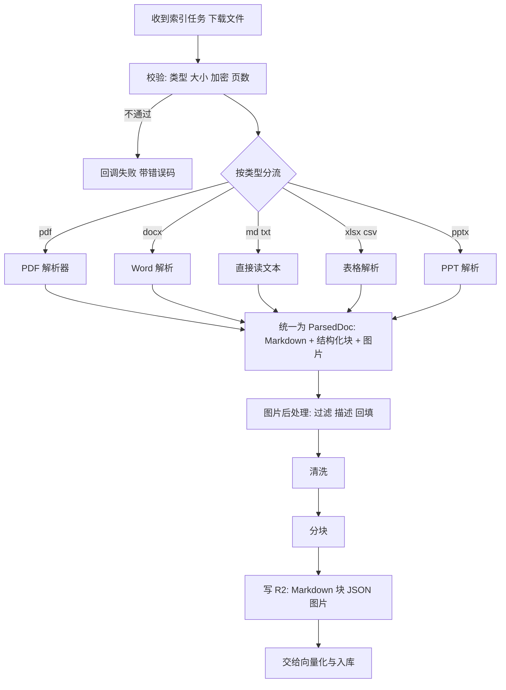

# 🛠️ 技术方案：多格式文档解析模块（解析 · 图片处理 · 分块）

| 文档版本 | 状态 | 编写日期 | 关联工程 | 适用对象 |
| :--- | :--- | :--- | :--- | :--- |
| **v0.1.0** | 草案 (Draft)，待评审 | 2026-10-31 | Python AI 端（待建） | AI 算法工程师、后端开发 |

> **与既有文档的关系**
> - 本文是 [TECH_KNOWLEDGE_RETRIEVAL.md](./TECH_KNOWLEDGE_RETRIEVAL.md) 中 **§8.3（解析为 Markdown）与 §8.4（分块）** 的详细展开，并对应其中的 Q6。决策编号 `D*`、风险编号沿用主文档；本文新增的待确认项编号为 `QP*`，风险为 `RP*`。
> - 业务背景见 [PRD_KNOWLEDGE_RETRIEVAL.md](./PRD_KNOWLEDGE_RETRIEVAL.md)。
> - 本文在原始初稿（多格式解析方案）基础上修订，主要补充了：与上传白名单的对齐、页码保留、图片的权限与缓存隔离、R2 持久化、错误码、限制与降级、测试评测。
>
> **阅读约定**
> - 「**已核实**」= 已对照官方文档/仓库确认，标注了来源。
> - 「**设计**」= 本方案的提案，尚未实现。
> - 「**待验证**」= 依赖尚未做的实测或未核实的假设。
> - 所有阈值（页数上限、超时、块大小等）均为**初始占位值**，P0 评测后确定，不在本文写死。

---

## 目录

1. [目标与范围](#一目标与范围)
2. [与主方案的边界](#二与主方案的边界)
3. [格式范围](#三格式范围)
4. [整体流程](#四整体流程)
5. [解析器选型](#五解析器选型)
6. [统一接口与数据结构](#六统一接口与数据结构)
7. [图片处理](#七图片处理)
8. [表格与 Excel](#八表格与-excel)
9. [清洗](#九清洗)
10. [分块](#十分块)
11. [限制、失败与降级](#十一限制失败与降级)
12. [部署与资源](#十二部署与资源)
13. [安全与合规](#十三安全与合规)
14. [可观测性](#十四可观测性)
15. [测试与评测](#十五测试与评测)
16. [分步实施](#十六分步实施)
17. [风险](#十七风险)
18. [待确认事项](#十八待确认事项)
19. [与既有文档的同步事项](#十九与既有文档的同步事项)
20. [附录：接口骨架](#附录接口骨架)

---

## 一、目标与范围

### 目标
把用户上传的各类文档，统一转成**带结构的 Markdown 与结构化块**，图片内容转成文字描述，输出**可直接分块**的结果，供后续向量化、检索使用。

### 范围内
- 按文件类型分流解析。
- 图片的过滤、描述、回填。
- 表格与 Excel 的处理。
- 清洗与分块（输出块列表，含 `heading_path`、`page` 等）。
- 解析结果持久化到 R2（主方案 D7）。
- 失败处理、限制、降级。

### 范围外
- 向量化、写入 Qdrant、检索（见主方案）。
- 文档审核（人工审核，不做 AI 审核，D1）。
- 在线编辑与 OCR 之外的内容理解（如音视频）。

---

## 二、与主方案的边界

### 输入（来自主方案 §6 的索引任务）

| 字段 | 说明 |
| :--- | :--- |
| `job_id`、`doc_code`、`doc_version` | 幂等与追踪 |
| `source_url` | 短期预签名下载链接 |
| `file_type`、`file_size` | 文件类型与大小 |
| `title`、`category` | 随块写入 |
| `acl_tags` | 权限标签，**解析模块只透传，不做任何权限判断**（D4） |

### 输出

| 产物 | 去向 |
| :--- | :--- |
| 块列表（`chunk_id`、`text`、`heading_path`、`page`、`image_keys` 等） | 交给向量化与写入（主方案 §8） |
| 解析后的 Markdown | 存 R2：`knowledge/parsed/{doc_code}/v{n}/doc.md`（D7） |
| 结构化块 JSON（含页码、块类型、图片引用） | 存 R2：`knowledge/parsed/{doc_code}/v{n}/blocks.json`（**设计**，见 §6） |
| 图片原件 | 存 R2：`knowledge/parsed/{doc_code}/v{n}/images/...`（**受控访问**，见 §7.5） |
| 失败时的错误码 | 回调业务后端（主方案 §6.3） |

### 适用的主方案决策

| 决策 | 对本模块的要求 |
| :--- | :--- |
| D4 权限标签 | 每个块带 `acl_tags`；图片访问权限等同文档。 |
| D6 文字与向量同存 | 块文字会存第三方云，**所以送去外部多模态模型的图片同样属于"出境"**，见 §13。 |
| D7 R2 保留 Markdown | 本模块负责写出，并保证可用于回填重建。 |
| P4 确定性块 ID | 分块必须是**纯函数**：同一输入、同一解析器版本、同一分块策略，输出完全相同。 |
| P5 先写新版本再清旧版本 | 版本号 `v{n}` 贯穿 R2 路径与块 ID。 |

---

## 三、格式范围

> ⚠️ **这是一个待决策项（QP1）**。初稿的格式范围与现有上传白名单不一致，**这会直接导致功能不通**。

### 现状（**已核实**，来自 `r2-storage.service.ts`）
上传白名单：`.pdf` `.doc` `.docx` `.md` `.txt` `.markdown`。落库时校验 `storageKey` 的正则也使用这个列表。

### 对照

| 格式 | 上传白名单 | 初稿方案 | 说明 |
| :--- | :--- | :--- | :--- |
| `pdf` | ✅ | ✅ | |
| `docx` | ✅ | ✅ | |
| `md` `markdown` `txt` | ✅ | ❌ **未处理** | 初稿骨架会对它们抛 `unsupported`。直接读文本即可，需补上。 |
| `doc`（旧版 Word） | ✅ | ❌ **未处理** | MarkItDown 的 Word 转换器只认 `.docx`。需先转成 `.docx`（如用 LibreOffice）或从白名单移除。 |
| `xlsx` `csv` | ❌ | ✅ | 上传会被拒绝。 |
| `pptx` `html` | ❌ | ✅ | 上传会被拒绝。 |

### 建议的分期

| 阶段 | 格式 | 备注 |
| :--- | :--- | :--- |
| **第一批** | `pdf` `docx` `md` `markdown` `txt` | 与现有白名单一致，不需要改上传代码。 |
| `doc` | 待定（QP2） | 转换成 `docx` 再走 docx 路径；或从白名单移除。 |
| **第二批** | `xlsx` `csv` `pptx` | 需要同时扩白名单（`ALLOWED_DOC_EXTENSIONS`、key 校验正则、PRD、上传提示文案）。 |
| 暂不支持 | `html` | 上传 HTML 有脚本与外链风险，**不建议**加入白名单；若需要，作为内部生成内容单独处理。 |

---

## 四、整体流程



要点：
- **校验在解析之前**：不合法的文件不要浪费解析资源。
- **所有格式汇聚到同一个 `ParsedDoc`**，后面的清洗和分块不关心来源（§6）。
- **图片后处理只处理需要的图片**：PDF 导出的图、docx/pptx 内嵌的图。
- **写 R2 在分块之后、入库之前**：先保证"源头"落盘，再入库；入库失败时可以直接从 R2 重建。

---

## 五、解析器选型

### 候选路线

| | **路线 A：混合** | **路线 B：全部走 MinerU** |
| :--- | :--- | :--- |
| PDF | MinerU | MinerU |
| docx / pptx / html | MarkItDown | MinerU |
| xlsx / csv | pandas + openpyxl | MinerU（xlsx）；csv 自行处理 |
| 页码、图片、结构的输出 | **三套格式**，需分别适配 | **一套格式**，统一 |
| 图片描述 | docx 图片需自己提取后走通用流程；pptx 可用 MarkItDown 内置能力 | 统一走图片后处理 |
| 依赖数量 | 多 | 少 |
| 风险 | 三个解析器的行为与版本各自演进 | 对 Office 格式的实际质量与资源占用**待验证** |

> **结论：不在文档层面拍板，通过 P0 评测决定（§15.3）。** 无论选哪条路线，对外都是同一个 `parse(path) -> ParsedDoc` 接口（§6），所以选型可以回头改。

### 已核实的事实

| 事实 | 来源 |
| :--- | :--- |
| MinerU **3.1.0（2026-04）起原生支持 DOCX、PPTX、XLSX**，覆盖图片、PDF 与三种 Office 格式。 | MinerU GitHub Release `mineru-3.1.0` |
| MinerU 的许可证已从 **AGPL-3.0 改为 Apache-2.0 + 附加条款**：商业使用无需另签许可（月活超 1 亿或月收入超 2000 万美元才需要）；**对第三方提供在线服务时必须标明使用了 MinerU**。**旧版本仍是 AGPL**，必须固定版本。 | MinerU 仓库 `LICENSE.md`、3.1.0 发布说明 |
| MinerU 输出的页码来自结构化输出的 `page_idx`，**从 0 开始**；图片文件名带页号，如 `images/page_0_image_1.png`；官方明确要求**按文档里的实际图片引用读取，不要自己拼文件名**；输出结构随版本变化。 | MinerU 官方 Output File Format 文档 |
| MarkItDown 的 **docx 转换器不会描述内嵌图片**：图片会变成被截断的 `data:image...` 字符串；图片描述仅对 pptx 与图片文件有效。 | MarkItDown GitHub issue #1497、#1508 |
| MarkItDown 有官方插件 `markitdown-ocr`，可用多模态模型提取 PDF/DOCX/PPTX/XLSX 内图片中的文字（要求 `markitdown>=0.1.8`）。 | 该插件 README |

### 待验证
- MinerU 对 DOCX / PPTX / XLSX 的**实际解析质量**（尤其是表格、合并单元格、图表）。
- MinerU 在我们可用的运行环境下的内存、耗时（§12）。
- `markitdown-ocr` 的质量与成本。

### 版本固定
- 解析器（MinerU、MarkItDown 等）与模型权重**必须固定版本**，版本号写入文档级解析记录（§6 `meta.parser`）。
- 升级解析器前，必须用回归样本集（§15.2）对比输出，避免静默改变分块结果。

---

## 六、统一接口与数据结构

### 1. 为什么除了 Markdown 还要结构化块

PDF 的页码不在 Markdown 里。如果只保存 `.md`，页码就丢了，而主方案的块字段需要 `page`（§5.1）。因此统一输出同时包含：

- **`markdown`**：回填图片描述后的正文，供人阅读和回填。
- **`blocks`**：结构化块列表，每块有类型、文本、页码、图片引用。**分块从 `blocks` 出发**，而不是从 Markdown 文本反推。

### 2. 数据结构（**设计**）

```python
from dataclasses import dataclass, field
from typing import Literal

BlockType = Literal["heading", "paragraph", "table", "image", "code", "list"]

@dataclass
class Block:
    type: BlockType
    text: str                      # 文本；表格为 Markdown 表格；图片为描述
    page: int | None = None        # 从 1 开始；无页概念的格式为 None
    level: int | None = None       # heading 的层级
    image_key: str | None = None   # image 块指向 R2 中的原图相对路径
    meta: dict = field(default_factory=dict)

@dataclass
class ParsedImage:
    key: str                       # R2 相对路径，不是可访问的 URL
    page: int | None
    sha256: str
    description: str | None        # None 表示描述失败或被过滤
    filtered: bool = False
    filter_reason: str | None = None

@dataclass
class ParsedDoc:
    source: str                    # 原文件标识（不要放本地临时路径进元数据）
    markdown: str
    blocks: list[Block]
    images: list[ParsedImage]
    meta: dict                     # file_type, page_count, parser, parser_version, parse_ms ...
```

> **页码约定**：对外一律从 **1** 开始。MinerU 的 `page_idx` 从 0 开始，在适配层 `+1`。
>
> **字段名以固定版本的实际输出为准**：MinerU 结构化输出的具体字段会随版本变化，适配层需要有针对固定版本的回归测试（§15.2）。

### 3. 解析器统一接口

```python
class Parser(Protocol):
    def parse(self, path: str) -> ParsedDoc: ...
```

每种解析器（PDF、Word、文本、表格、PPT）实现同一接口；分流器按扩展名分发，**未支持的类型抛 `UNSUPPORTED_TYPE`，不返回空结果**。

### 4. 持久化到 R2（D7）

| 对象 | 路径 | 作用 |
| :--- | :--- | :--- |
| Markdown | `knowledge/parsed/{doc_code}/v{n}/doc.md` | 人读、回填 |
| 结构化块 | `knowledge/parsed/{doc_code}/v{n}/blocks.json` | **回填时保留页码与结构**（只存 Markdown 会丢页码） |
| 图片 | `knowledge/parsed/{doc_code}/v{n}/images/...` | 原图，受控访问（§7.5） |

> 这三类对象是"换 embedding 模型、调分块策略"时的回填来源（主方案 §5.1）。**只存 Markdown 不够**，需要同时存 `blocks.json`。

---

## 七、图片处理

### 1. 处理对象
- PDF 解析器导出的图片。
- docx、pptx 内嵌的图片（docx 需自己提取，因为 MarkItDown 的 docx 转换器不描述图片；见 §5）。

### 2. 过滤（丢弃装饰图）

| 规则 | 说明 |
| :--- | :--- |
| 版面分类 | **优先使用解析器的版面分析结果**（页眉、页脚等块）判断，而不是只靠重复次数。 |
| 尺寸过小 | 低于阈值的图（图标、项目符号）。阈值待评测。 |
| 重复 | 同一张图在多页重复，且位于页眉页脚区域 → 丢弃。**仅"重复"不足以丢弃**：正文里重复出现的关键图表不应被误删。 |

被过滤的图片在 `ParsedImage` 中记录 `filtered=True` 与原因，便于排查"为什么这张图没被索引"。

### 3. 描述

| 项 | 要求 |
| :--- | :--- |
| 输入 | 图片本身；是否带上下文见下方"缓存与上下文" |
| 输出 | 2–3 句描述；对**图表**要求写出关键数据与结论（比泛泛描述更利于检索） |
| 表格截图 | 提示词要求直接输出 Markdown 表格 |
| 提示词 | **版本化**（`prompt_version`），与分块策略版本一起记录 |
| 失败 | **非致命**：该图降级为 `[图片]` + 图注，`description=None`，文档整体继续（§11） |
| 并发与预算 | 批量异步调用；设置单文档最大图片数、并发数、超时、总调用预算 |

### 4. 缓存与上下文（⚠️ 权限泄露风险）

初稿同时有两条规则：**描述时带上前后文字和图注**，**缓存以图片内容哈希为 key**。这两条冲突，并且会造成跨文档泄露：

> 同一张通用架构图出现在 A 部门私密文档和 B 部门公开文档里。先处理 A，模型的描述会带上 A 文档的上下文；缓存后处理 B 时直接复用，A 的内容就写进了 B 的块。

| 方案 | 描述质量 | 缓存范围 | 泄露风险 |
| :--- | :--- | :--- | :--- |
| **(a) 描述时不带上下文** | 较低，歧义图可能描述不准 | 可全局缓存，key = `sha256(图片) + model + prompt_version` | 无（描述只依赖图片本身） |
| **(b) 描述时带上下文** | 较高 | **只能在同一文档同一版本内缓存**，key = `doc_code + version + sha256(图片) + prompt_version` | 无（不跨文档复用） |

**建议默认采用 (b)**：保留描述质量，牺牲跨文档复用。文档内重复图仍可复用。若成本压力大，再评估 (a)。**绝对不要**"带上下文 + 全局缓存"。

### 5. 原图存储与访问（权限）

- 原图存 R2 受控路径（§6.4），**不是公开 URL**。
- 块里只存**相对路径**（`image_keys`），不存可直接访问的地址。
- "检索命中后展示原图"必须走**带鉴权的短期访问链接**，复用现有 `access-url` 的权限校验思路：先校验当前用户对该文档有读权限，再签发图片链接。
- 图片的权限等同其所属文档（`acl_tags`）；文档删除或可见范围变更时，图片同步处理。
- 删除文档时必须连同图片一起清理（主方案 §10 的 `DELETE` 要覆盖 `knowledge/parsed/{doc_code}/`）。

### 6. 回填
- 描述替换 Markdown 中的图片引用，同时 `blocks` 中保留 `image` 块与 `image_key`。
- 描述前加固定标记（如 `【图片描述】`），便于下游识别与隔离（§13 提示注入）。

---

## 八、表格与 Excel

### 1. 文档内表格（PDF、Word、PPT）
- **原则**：表格作为一个整体块，**不在中间拆开**。
- **超长表格**（超过 embedding 输入上限）：按**行块**拆分，**每个行块重复表头**，避免行脱离列含义。
- 表格以 Markdown 表格形式保存；复杂表格（合并单元格）解析器可能输出 HTML，需统一规范（**待验证**，取决于所选解析器）。

### 2. Excel（xlsx）
- 不整表塞进向量库，**自己控制切块**。
- 按 **sheet** 处理；每个 sheet 按**行块**切分，**每块带表头**。
- **sheet 名**写入 `heading_path`，如 `["销售报表.xlsx", "Q3"]`，否则行块脱离上下文无法理解。
- 合并单元格：向下/向右填充后再切块（**待验证**实际效果）。
- **公式**：读取单元格的缓存计算值。注意：**由程序生成、从未用 Excel 打开保存过的文件，公式单元格可能没有缓存值**，读出来是空，需要记录告警（**待验证**）。
- 行数上限：超大 sheet 设置上限，超限抽样或失败（§11）。

### 3. CSV
- **编码检测**：国内常见 GBK / GB18030，不能默认 UTF-8；使用编码检测并记录检测结果。
- 其余同 Excel 的行块规则。

---

## 九、清洗

清洗在**图片回填之后、分块之前**执行，目的是去噪，**不改变语义**。

| 项 | 说明 |
| :--- | :--- |
| 页眉页脚、页码 | 优先使用解析器的版面分类剔除；不要靠正则乱删正文里的数字。 |
| 空白与不可见字符 | 合并多余空行；去除零宽字符；统一全角/半角空格。 |
| 标题层级 | 规整层级跳跃（如 H1 直接到 H3）；保留原始层级信息以便排查。 |
| 代码块、表格 | **原样保留**，不做空白折叠。 |
| 连字符断行 | 英文跨行连字符还原；中文不处理。 |
| 去重 | 完全重复的相邻块去重（如页眉被误当正文）。 |

> 清洗规则变更会改变分块结果，应纳入 `chunk_strategy_version`（§10.5）。

---

## 十、分块

### 1. 策略
1. **先按 Markdown 标题层级切分**，每块记录 `heading_path`。
2. 超过上限的段落，**再按段落/句子切分**，带少量重叠。
3. **表格不拆开**；超长表格按 §8.1 行块拆分，每块重复表头。
4. **图片描述附着到所在位置相邻的块**，不单独成块（描述太短，单独成块检索价值低）。
5. 块过小的合并到相邻块。

### 2. 参数
- **块大小、重叠长度：初始值待实验确定**，需结合所选 embedding 模型的输入上限（主方案 Q10），不在本文写死。
- 参数作为**配置**，不写死在代码里。

### 3. 是否把标题路径拼进用于向量化的文本
业界常见做法是把 `heading_path` 作为前缀拼进送去 embedding 的文本，以提升检索效果。**待评测**：用检索评测集（主方案 §14.5）对比"拼"与"不拼"。注意展示给用户的 `text` 与用于 embedding 的文本可以不同，需明确存哪个。

### 4. 确定性（硬性要求）
- **分块是纯函数**：同一份 `blocks`、同一 `chunk_strategy_version`，必须得到完全相同的块序列。
- 块 ID：`{doc_code}_v{doc_version}_{chunk_index:05d}`（主方案 P4）。
- 不允许在分块里使用随机数、当前时间、无序集合的遍历顺序。
- 这是幂等重试、重复推送不产生重复块的前提。

### 5. 版本
- `chunk_strategy_version`：**分块参数 + 清洗规则 + 图片提示词版本**的组合标识。任何一项变化都要换版本号。
- 版本号写入每个块（主方案 §5.1 的 `chunk_strategy_version` 字段）。

### 6. 输出的块

| 字段 | 说明 |
| :--- | :--- |
| `chunk_id`、`doc_code`、`doc_version`、`chunk_index` | 同主方案 §5.1 |
| `text` | 块正文（含图片描述） |
| `heading_path` | 章节路径，Excel 含 sheet 名 |
| `page` | 页码，从 1 开始；块跨页时取**起始页**；无页概念的格式为空 |
| `image_keys` | **新增（设计）**：本块包含的图片的 R2 相对路径列表，用于展示原图 |
| `chunk_strategy_version` | 见上 |

> `image_keys` 需要同步加入主方案 §5.1 的块字段表（§19）。

### 7. 块唯一标识（Chunk ID）与向量库主键架构设计（核心决策）

#### 7.1 为什么不采用“雪花算法 (Snowflake ID)”作为切片主键？
在传统的分布式后台，雪花算法因 64 位整数递增被广泛用于订单号或表主键，但在 **RAG 文档向量切片** 场景下存在重大缺陷：
1. **破坏幂等更新（无法就地 Upsert 覆盖）**：雪花 ID 强依赖当前毫秒时间戳与机器序列。同一个文档重新向量化（如管理员点击重新解析、或切块参数调整）时，每次运行都会算出**完全不同的全新雪花 ID**。向量库执行 `upsert` 时无法原地覆盖旧记录，必须先做全量删除；如果删除步骤失败，向量库将产生大量无法被追溯的旧切片垃圾与数据污染。
2. **多节点分布式运维依赖**：雪花算法依赖协调分配各容器的 `WorkerId`（如依赖 Redis/ZK 注册），并且对容器服务器**时钟回拨**极其敏感，增加了 Python Worker 节点弹性伸缩时的运维复杂度。

#### 7.2 为什么不直接用字符串 `doc_code_00001` 作为向量点 ID？
部分主流向量数据库对主键类型有严格限制：
- **Qdrant**：Point ID **仅支持 unsigned 64 位整型** 或 **标准 UUID 格式（UUIDv4/UUIDv5）**，直接传入 `doc_..._0001` 这类自定义字符串会直接报错拦截（R16）。
- **Milvus / Zilliz**：若 Collection Schema 配置为 Int64 主键，同样不支持自定义字符串。

#### 7.3 企业级标准解法：确定性 UUIDv5 + Metadata 复合架构

采用 **“主键强兼容 + 语义归元数据”** 的双层结构：

```text
[业务标识] doc_code (doc_JOb25azDNslQ475n)
    │
    ▼ 派生规则: f"{doc_code}_v{doc_version}_{chunk_index:05d}"
[切片业务键] chunk_id ("doc_JOb25azDNslQ475n_v1_00000")
    │
    ├─► 计算 UUIDv5(NAMESPACE, chunk_id) ──► 向量库主键 Point ID (如 Qdrant / Milvus)
    │                                         (标准 UUID 格式，全局兼容，输入相同则结果恒定不变)
    │
    └─► 写入 Payload / Metadata ───────────► {"doc_code": "...", "chunk_id": "...", "page": 1, ...}
                                              (供业务级过滤、按文档批量清理与 RAG 溯源回显)
```

**Python 端标准实现**：
```python
import uuid

# 全局固定的命名空间（确保所有 Worker 与多环境计算出的 UUID 恒等）
RAG_CHUNK_NAMESPACE = uuid.UUID('e15863d8-91bf-41d6-a004-ebe5f36efa7d')

def derive_point_id(chunk_id: str) -> str:
    """基于确定性 chunk_id 计算向量库兼容的标准 UUIDv5 主键"""
    return str(uuid.uuid5(RAG_CHUNK_NAMESPACE, chunk_id))

# 示例:
# chunk_id: "doc_JOb25azDNslQ475n_v1_00000"
# point_id: "7b4c4fae-3066-512c-9a1b-90f7d5668e14" -> 直接用作 Qdrant 点 ID
```

**核心优势**：
- **天生幂等**：重试、重新切块时直接 `upsert` 原地覆盖，不需要先查先删，0 脏数据残留；
- **全平台兼容**：完美通过 Qdrant、Chroma、Milvus 等所有向量数据库的主键类型校验；
- **无状态计算**：算法纯本地计算，不依赖时钟、不依赖外部中心化 ID 发号器。

---

## 十一、限制、失败与降级

### 1. 限制（初始占位值，P0 评测后确定）

| 限制项 | 说明 |
| :--- | :--- |
| 文件大小 | 上传侧已限制 ≤ 50 MB；解析侧复核。 |
| PDF 页数 | 设置上限，超限失败，防止单个文件长期占用资源。 |
| 解析超时 | 按格式与大小分级设置。 |
| 单文档图片数 | 设置上限；超限只处理前 N 张并告警，或失败。 |
| 单文档块数 | 设置上限，超限失败。 |
| Excel 行数 | 设置上限。 |
| 压缩包类（docx/xlsx/pptx 本质是 zip） | 限制解压后总大小与文件数，防 zip 炸弹。 |

### 2. 错误码映射

沿用主方案 §6.3 的错误码，新增 2 个（**提案**，需同步到主方案契约）：

| 情形 | 错误码 | 可重试 |
| :--- | :--- | :--- |
| 扩展名不在支持范围 | `UNSUPPORTED_TYPE` | 否 |
| 文件损坏、解析器崩溃 | `PARSE_FAILED` | 否（可由管理员手动重试） |
| 解析后无有效文本 | `EMPTY_CONTENT` | 否 |
| **加密或有密码的文件** | **`ENCRYPTED_FILE`**（新增） | 否 |
| **超过页数/块数/图片数/超时等限制** | **`LIMIT_EXCEEDED`**（新增） | 否 |
| 下载链接过期 | `SOURCE_EXPIRED` | 是（由业务后端重签） |
| 多模态模型暂时不可用 | **不是错误** | 图片降级，文档继续（见下） |
| 下游存储暂时不可用 | `SINK_UNAVAILABLE` | 是 |

### 3. 降级策略

| 故障 | 降级 |
| :--- | :--- |
| 多模态模型不可用/超时/超预算 | 该图降级为 `[图片]` + 图注，`description=None`；文档整体继续索引；在文档级 `meta` 记录"N 张图片未描述"，管理员可批量补描述。 |
| MinerU 解析失败 | **仅对有文字层的 PDF**，可用 PyMuPDF 等直接抽取文字作为兜底，并在 `meta.parser` 标记为兜底、质量标记为"降级"。**扫描件无法兜底**，直接 `PARSE_FAILED`。 |
| 单个图片处理失败 | 只影响该图，不影响文档。 |

> **降级必须可见**：降级产出的文档要在 `meta` 里留下标记，管理员能筛选出"低质量解析"的文档并重新处理，**不能静默降级后让大家以为质量正常**。

---

## 十二、部署与资源

> 以下均为**待验证**。MinerU 的资源需求与部署方式以其 README 与官方文档为准，本文不给出具体资源数值。

- MinerU 部署较重（版面分析、OCR、视觉语言模型）。**Python 端的运行环境尚未确定**（QP6），而第一期倾向使用免费云资源，免费资源通常难以运行这类模型。
- 建议**解析器作为独立 Worker 进程**运行，通过任务队列（主方案 §8.2）取任务，**限制并发（初始 1–2）**，防止内存被打满。
- 模型权重首次加载慢，Worker 常驻、缓存权重，不要每个任务重新加载。
- **GPU 不是必须**，但 CPU 下处理大 PDF 会很慢，需要通过 §11 的页数上限与超时控制，并评估吞吐是否满足试点需求。
- 容器镜像体积大，需考虑构建与分发。
- **版本固定**：镜像内固定 MinerU 与模型权重版本（§5）。
- **许可证**：MinerU 现为 Apache-2.0 + 附加条款（§5）。若将来对**第三方**提供基于 MinerU 的在线服务，需要在产品界面或公开文档中标明；纯内部使用基本无此义务。以上依据仓库 `LICENSE.md`，上线前请再次确认当时版本的许可文本。

---

## 十三、安全与合规

### 1. 不可信文件
上传的 PDF、Office 文件都是**不可信输入**，解析器本身是攻击面（恶意构造的文件可能触发解析器漏洞、zip 炸弹、超大图片、外链加载）。

| 措施 | 说明 |
| :--- | :--- |
| 隔离运行 | 解析 Worker 运行在受限容器内；**除 R2 与多模态模型端点外，禁止出网**。 |
| 资源限制 | CPU、内存、磁盘、进程数、单文件超时。 |
| 临时文件 | 每个任务独立临时目录，结束必清理（含异常路径）。 |
| 禁止外链加载 | HTML/Office 中的外部资源引用不自动抓取。 |
| 文件校验 | 以实际内容（魔数）校验类型，不仅信任扩展名。 |

### 2. 数据出境（与 Q12 同类问题）
- **送去多模态模型的图片，等于把文档内容发给第三方**。图片里可能是流程图、截图、表格、手写内容，敏感度不低于正文。
- 因此多模态模型的选择需要和主方案的 **Q12（文档内容能否放第三方云）** 一并决策：
  - 若不允许：使用**自部署**的开源视觉模型，或对敏感文档**跳过图片描述**（仅保留图注）。
  - 若允许：明确供应商、数据保留与训练条款、传输加密。
- 建议支持**按文档开关图片描述**（例如私密、部门可见的文档默认不外发），**待产品确认（QP4）**。

### 3. 提示注入
- 图片中的文字可能含恶意指令。图片描述会进入索引，随后作为上下文送入大模型。
- 描述统一加 `【图片描述】` 标记（§7.6）；在**生成答案**阶段（本文范围外）把检索内容作为"资料"而不是"指令"处理。

### 4. 日志
- 不记录文档正文、图片描述全文。记录 `doc_code`、`job_id`、`trace_id`、耗时、错误码。

---

## 十四、可观测性

| 指标 | 用途 |
| :--- | :--- |
| 解析耗时（按格式、按文件大小分桶） | 容量规划、超时阈值 |
| 失败率（按错误码、按格式） | 发现哪种格式质量差 |
| 降级文档占比 | 解析质量与多模态模型可用性 |
| 图片：总数、被过滤数、描述成功/失败数、缓存命中率 | 成本与过滤规则效果 |
| 多模态调用次数与费用估算 | 成本控制 |
| 每文档块数、平均块大小 | 分块参数合理性 |
| `parser` 与 `parser_version`、`chunk_strategy_version` 的分布 | 版本升级影响面 |

告警：失败率异常上升；降级占比异常；多模态调用费用超预算；Worker 积压。

---

## 十五、测试与评测

### 1. 样本集
**每种格式挑 3–5 个真实文件**（脱敏后），必须包含难例：

| 格式 | 必含的难例 |
| :--- | :--- |
| PDF | 扫描件、多栏排版、含表格、含公式、含大量图片、跨页表格 |
| docx | 含内嵌图片、含表格、含目录与页眉页脚、含批注/修订 |
| md / txt | 含代码块、超长无标题文本、GBK 编码的 txt |
| xlsx | 多 sheet、合并单元格、公式、超大 sheet |
| csv | UTF-8 与 GBK 各一 |
| pptx | 含图片与图表、备注页 |

### 2. 自动化测试

| 类型 | 内容 |
| :--- | :--- |
| 确定性 | **同一文件、同一版本，连续解析与分块两次，块 ID 与内容完全一致。** |
| 回归 | 每个样本保存期望的 `blocks` 与块摘要，解析器或分块策略升级时对比，差异需人工确认。 |
| 错误映射 | 加密 PDF、损坏文件、空文件、超限文件、错误扩展名，分别断言错误码。 |
| 限制 | 超大页数、超多图片、zip 炸弹样本，断言被拒绝且不拖垮 Worker。 |
| 降级 | 模拟多模态模型不可用，断言文档继续、图片降级、`meta` 有标记。 |
| 权限 | ① 图片存储路径不可公开访问；② **同一张图出现在两个不同权限的文档中，一个文档的上下文不会出现在另一个文档的描述里**（针对 §7.4）。 |
| 页码 | PDF 块的 `page` 从 1 开始，抽检与原 PDF 页对应。 |

### 3. 路线对比评测（P0，决定路线 A 还是 B）

| 维度 | 做法 |
| :--- | :--- |
| 输出质量 | 人工按清单检查：标题层级、阅读顺序（多栏）、表格完整性、公式、图片是否被识别、页码是否对。 |
| 检索效果 | 用主方案 §14.5 的评测集，对比两条路线的 Recall@K、MRR。 |
| 资源与耗时 | 同一批文件的耗时、内存峰值。 |
| 稳定性 | 失败率、对异常文件的容错。 |

> 评测要看的不是"哪个更先进"，而是"在**我们真实的文档**上，哪个让检索更准、运维更简单"。

---

## 十六、分步实施

> 每一步可独立合并、独立验收。S2、S3 对应主方案 P1 的 AI 端解析环节。

| 步骤 | 内容 | 验收 |
| :--- | :--- | :--- |
| **S0 决策** | 确定格式范围与白名单（QP1、QP2）；确定多模态模型与数据出境策略（QP4）；确定运行环境（QP6）。 | 决策记录更新。 |
| **S1 评测** | 按 §15.1 备样本，按 §15.3 对比路线 A 与 B；评估 `markitdown-ocr`；测各难例。 | 评测报告，选定路线。 |
| **S2 骨架与文本路径** | 统一接口与 `ParsedDoc`；分流器；`md/txt`、`docx` 文本路径；清洗；分块（先不接图片）；写 R2；错误码映射；限制与超时。**打通到入库**。 | §15.2 的确定性、错误映射、限制测试通过。 |
| **S3 PDF** | 接入所选 PDF 解析器；适配结构化输出得到 `blocks`（含页码 +1）；扫描件与表格；有文字层 PDF 的兜底。 | PDF 难例人工检查通过；页码测试通过。 |
| **S4 图片** | 过滤、描述、回填；图片存 R2 受控路径；块带 `image_keys`；缓存（按文档隔离）；失败降级；预算。 | 降级、权限（含 §7.4 隔离）测试通过。 |
| **S5 其他格式** | `xlsx`、`csv`、`pptx`（需先扩上传白名单）。 | 对应难例通过。 |
| **S6 加固** | 隔离运行、资源限制、可观测性、告警；解析器版本升级的回归流程。 | 第 14、15 节完成。 |

---

## 十七、风险

| 编号 | 风险 | 影响 | 应对 |
| :--- | :--- | :--- | :--- |
| RP1 | **格式范围与上传白名单不一致**（§3） | 用户上传成功但无法解析，或解析器支持的格式无法上传 | S0 统一；`md/txt` 立即补上。 |
| RP2 | **图片描述缓存跨文档泄露**（§7.4） | A 文档上下文进入 B 文档 | 默认按文档隔离缓存；不允许"带上下文 + 全局缓存"。 |
| RP3 | **原图被公开访问或绕过权限**（§7.5） | 文档图片外泄 | 受控路径 + 带鉴权的短期链接；删除联动。 |
| RP4 | **页码丢失**（只存 Markdown） | 无法展示"所在页"，回填后页码也没了 | 同时存 `blocks.json`；分块从 `blocks` 出发。 |
| RP5 | MinerU 部署重，运行环境未定 | 无法落地或吞吐不足 | S0 确定环境；并发限制；有文字层 PDF 的兜底。 |
| RP6 | MinerU 对 Office 格式的质量**未验证** | 路线 B 不可行 | S1 评测；保留路线 A。 |
| RP7 | 解析器版本升级静默改变分块结果 | 检索质量波动、块 ID 对不上 | 版本固定；回归样本集；`chunk_strategy_version`。 |
| RP8 | 图片外发第三方多模态模型 | 数据泄露、合规风险 | 与 Q12 一并决策；支持按文档关闭；或自部署模型。 |
| RP9 | 图片文字中的提示注入 | 影响后续生成 | 描述加标记；生成阶段隔离。 |
| RP10 | 不可信文件触发解析器漏洞、zip 炸弹 | Worker 被拖垮或被攻击 | 隔离容器、资源限制、解压限制、禁出网。 |
| RP11 | 多模态调用成本失控 | 费用超预算 | 过滤、文档内缓存、单文档上限、总预算与告警。 |
| RP12 | Excel 公式无缓存值、合并单元格填充错误 | 数据缺失或错位 | 记录告警；评测难例；必要时人工复核。 |
| RP13 | CSV 编码误判 | 乱码 | 编码检测并记录结果；GBK 样本纳入测试。 |
| RP14 | 解析器静默降级后无人察觉 | 低质量文档混入索引 | 降级必须在 `meta` 留标记并可筛选（§11.3）。 |
| RP15 | MinerU 许可证条款变化 | 合规风险 | 固定版本，上线前复核当时许可文本；若对外提供在线服务需标明使用。 |

---

## 十八、待确认事项

| 编号 | 问题 | 推荐 | 影响 |
| :--- | :--- | :--- | :--- |
| QP1 | 支持的格式范围？是否扩上传白名单？ | 第一批：`pdf docx md markdown txt`；第二批再加 `xlsx csv pptx` | 决定是否改上传代码与 PRD。 |
| QP2 | `.doc`（旧版 Word）如何处理？ | 先转 `docx` 再解析；或从白名单移除 | 白名单是否保留 `.doc`。 |
| QP3 | 路线 A（混合）还是路线 B（全 MinerU）？ | S1 评测后定 | 依赖数量与维护成本。 |
| QP4 | 多模态模型选哪个？是否允许图片发给第三方？是否支持"按文档关闭图片描述"？ | 与主方案 Q12 一并决策；敏感文档默认不外发 | 数据合规、成本。 |
| QP5 | 图片描述缓存：按文档隔离 (b)，还是不带上下文 + 全局缓存 (a)？ | 默认 (b) | 描述质量与成本。 |
| QP6 | Python 端与解析 Worker 的运行环境？是否有 GPU？ | 待定 | 能否运行 MinerU、吞吐。 |
| QP7 | 块大小与重叠的初始值；`heading_path` 是否拼进 embedding 文本？ | 评测后定（依赖主方案 Q10） | 检索质量。 |
| QP8 | 超长表格、超大 Excel 的处理上限与策略？ | 行块拆分 + 重复表头；超限失败 | 数据完整性。 |
| QP9 | 降级文档（兜底解析）是否仍对外可检索？ | 可检索，但对管理员标记 | 质量与可用性的取舍。 |

---

## 十九、与既有文档的同步事项

需在 P0 修订，**本次未修改既有文档与代码**：

| 文档 / 代码 | 需修订内容 |
| :--- | :--- |
| `TECH_KNOWLEDGE_RETRIEVAL.md` §8.3、§8.4 | 指向本文；Q6 的状态更新。 |
| `TECH_KNOWLEDGE_RETRIEVAL.md` §5.1 块字段 | 新增 `image_keys`。 |
| `TECH_KNOWLEDGE_RETRIEVAL.md` §6.3 错误码 | 新增 `ENCRYPTED_FILE`、`LIMIT_EXCEEDED`。 |
| `TECH_KNOWLEDGE_RETRIEVAL.md` §10 变更同步 | `DELETE` 要覆盖 `knowledge/parsed/{doc_code}/`（Markdown、块 JSON、图片）。 |
| `TECH_KNOWLEDGE_RETRIEVAL.md` §16 风险 | 并入本文 RP2、RP3、RP4、RP8。 |
| `PRD_KNOWLEDGE_RETRIEVAL.md` Q6 | 指向本文，并并入 QP1、QP4。 |
| `r2-storage.service.ts` 与 PRD | **仅当 QP1 决定扩格式时**修改 `ALLOWED_DOC_EXTENSIONS`、key 校验正则、上传提示文案。 |

---

## 附录：接口骨架

> **仅为结构示意，未验证**。MinerU 的命令行与输出结构、MarkItDown 的接口细节，以**固定版本**的官方文档为准。

```python
from pathlib import Path

SUPPORTED = {".pdf", ".docx", ".md", ".markdown", ".txt"}  # 第一批；与上传白名单对齐

class ParseError(Exception):
    def __init__(self, code: str, message: str, retryable: bool = False):
        super().__init__(message)
        self.code = code            # UNSUPPORTED_TYPE / PARSE_FAILED / EMPTY_CONTENT / ENCRYPTED_FILE / LIMIT_EXCEEDED
        self.retryable = retryable

def parse(path: str) -> ParsedDoc:
    ext = Path(path).suffix.lower()
    check_limits(path)                       # 大小、页数、zip 解压总量等，超限抛 LIMIT_EXCEEDED
    if ext == ".pdf":
        doc = parse_pdf(path)                # 适配 MinerU 的结构化输出 -> blocks（page + 1）
    elif ext == ".docx":
        doc = parse_docx(path)               # 文本路径；图片自行提取，进入通用图片后处理
    elif ext in {".md", ".markdown", ".txt"}:
        doc = parse_text(path)               # 直接读文本，检测编码
    else:
        raise ParseError("UNSUPPORTED_TYPE", f"unsupported: {ext}")

    if not doc.blocks or not any(b.text.strip() for b in doc.blocks):
        raise ParseError("EMPTY_CONTENT", "no extractable text")
    return doc

def process(doc: ParsedDoc, ctx) -> list[Chunk]:
    doc = describe_images(doc, ctx)          # 过滤 -> 描述（按文档缓存）-> 回填；失败降级，不抛错
    doc = clean(doc)
    chunks = split(doc, strategy=ctx.chunk_strategy)   # 纯函数，确定性
    persist_to_r2(doc, chunks, ctx)          # doc.md、blocks.json、images/
    return chunks
```

要点：
- `parse()` **不吞错误**，所有失败转为带错误码的 `ParseError`，由上层回调业务后端。
- `describe_images()` **永不因多模态模型失败而抛错**，只降级。
- `split()` 必须是纯函数，保证 §10.4 的确定性。
- 所有临时文件在 `process()` 结束时清理（含异常路径）。
