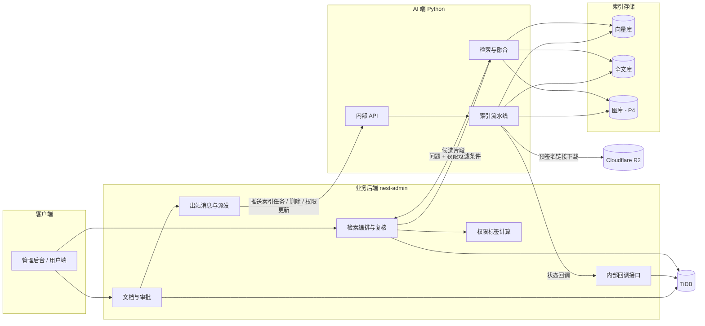
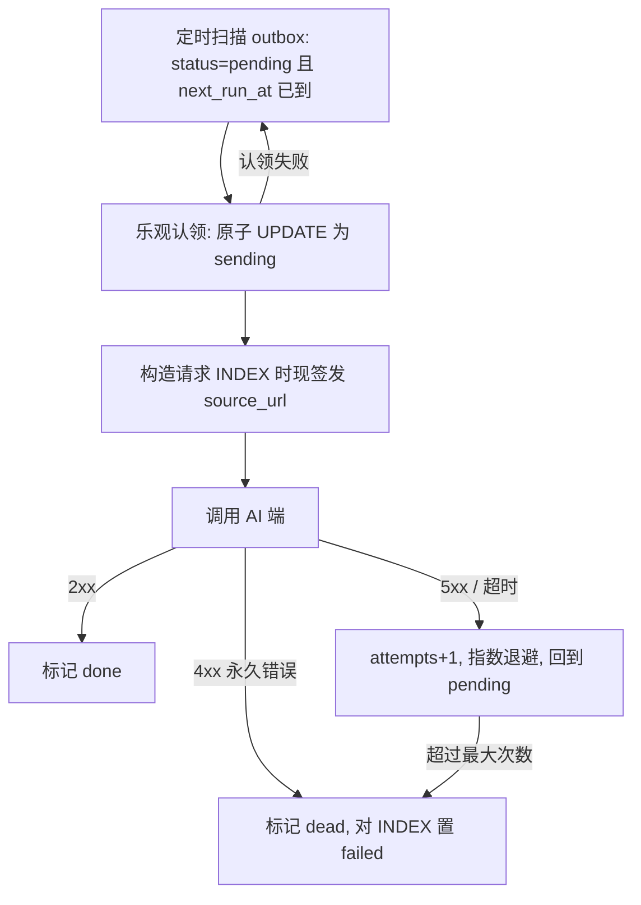
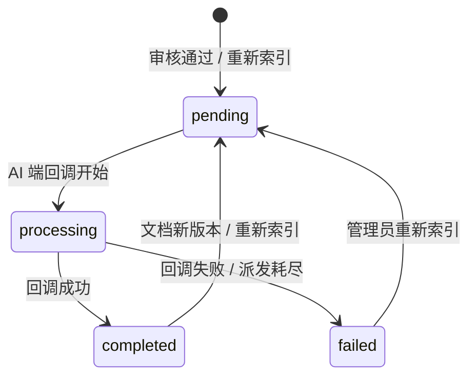
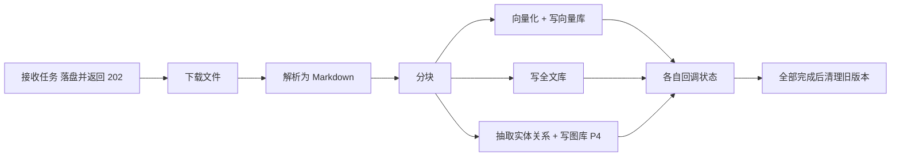
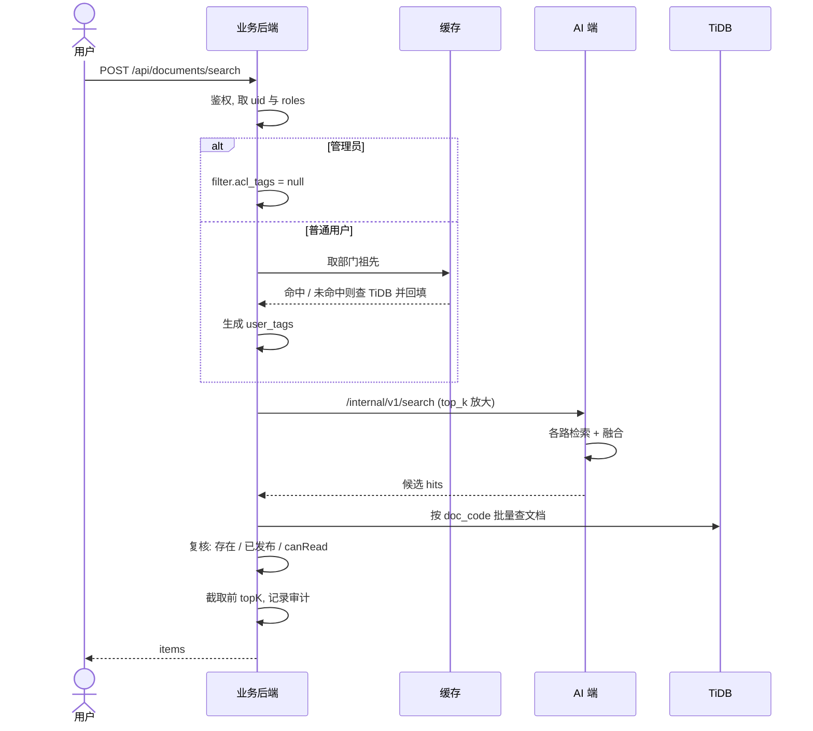

# 🛠️ 技术方案：企业知识库索引与权限检索

| 文档版本 | 状态 | 编写日期 | 关联工程 | 适用对象 |
| :--- | :--- | :--- | :--- | :--- |
| **v0.2.0** | 草案 (Draft)，已确定向量库选型 | 2026-10-31 | `nest-admin` / Python AI 端（待建） | 后端、AI 算法工程师 |

> **配套文档**：产品需求见 [PRD_KNOWLEDGE_RETRIEVAL.md](./PRD_KNOWLEDGE_RETRIEVAL.md)。本文中的 `D*`（已定决策）、`Q*`（待确认）编号与 PRD 第十节一致。
>
> **阅读约定**
> - 「**现状**」= 已在代码里实现，我们核对过。
> - 「**设计**」= 本方案提出，尚未实现。
> - 「**待定**」= 依赖尚未做出的选型或未验证的假设，标注了待验证项。
> - 本文给出的数据结构、接口和字段是**提案**，P0 阶段评审后冻结。冻结前允许调整。

---

## 目录

1. [现状基线](#一现状基线)
2. [总体架构](#二总体架构)
3. [关键设计决策](#三关键设计决策)
4. [权限模型](#四权限模型)
5. [数据模型](#五数据模型)
6. [业务后端与 AI 端的契约](#六业务后端与-ai-端的契约)
7. [可靠投递与状态机](#七可靠投递与状态机)
8. [AI 端设计](#八ai-端设计)
9. [检索流程](#九检索流程)
10. [变更同步](#十变更同步)
11. [安全](#十一安全)
12. [可观测性与审计](#十二可观测性与审计)
13. [性能与容量](#十三性能与容量)
14. [测试策略](#十四测试策略)
15. [分步实施计划](#十五分步实施计划)
16. [风险与待验证项](#十六风险与待验证项)
17. [与既有文档的同步事项](#十七与既有文档的同步事项)

---

## 一、现状基线

### 1. 已实现（`nest-admin/src/modules/document`）

| 能力 | 实现位置 | 说明 |
| :--- | :--- | :--- |
| 预签名直传 | `r2-storage.service.ts` | key 格式 `knowledge/docs/{yyyyMMdd}/{userId}/{nanoid16}{ext}`；落库前用 `HeadObject` 校验文件存在且大小一致；`storageKey` 有唯一索引。 |
| 文档主流程 | `services/document.service.ts` | 创建、列表、详情、删除、访问链接。创建与首条审批记录在同一事务。 |
| 审批流转 | `services/document-approval.service.ts` | 提交审核、审核通过/驳回。事务加悲观写锁（`lockDocumentByCode`）。 |
| 权限判定 | `services/document-permission.service.ts` | `isAdmin` / `isReviewer` / `isOwner` / `canAccessDocument` / `applyVisibilityFilter`。 |
| 角色常量 | `document.constant.ts` | `DOCUMENT_ADMIN_ROLES = [admin, super_admin]`，`DOCUMENT_REVIEWER_ROLES = [reviewer]`（占位，待与角色管理中的实际值一致）。 |
| 状态字段 | `document.entity.ts` | `status`、`review_status`、`vector_status`（`unprocessed/processing/completed/failed`，目前**无任何代码推进它**）。 |

### 2. 基础设施事实

| 项 | 事实 | 来源 |
| :--- | :--- | :--- |
| 业务库 | **TiDB Cloud (MySQL 兼容)**，不是自建 MySQL | `docs/CLOUD_SERVICES.md` |
| 缓存 | Upstash Serverless Redis（按命令计费） | `docs/CLOUD_SERVICES.md` |
| 已有依赖 | `@nestjs/bull`、`bull`、`ioredis`、`@nestjs/schedule`、`@nestjs/axios` | `nest-admin/package.json` |
| 部门 | `sys_dept` 为树，`@Tree('materialized-path')` | `dept.entity.ts` |
| 用户-部门 | 一个用户一个部门（`sys_user.dept_id`，`ManyToOne`） | `user.entity.ts` |
| 登录态 | `IAuthUser = { uid, pv, exp?, iat?, roles? }`，**没有部门** | `types/global.d.ts` |
| Python 端 | 仅有原型：`03_rag` 使用 Chroma + LangChain，**无服务化代码** | `03_rag/`、`pyproject.toml` |
| 向量库 | **尚未接入**；已选定 Qdrant Cloud（第一期免费版），见 §3 D5 | — |
| Schema 管理 | `synchronize` 默认关闭（`DB_SYNCHRONIZE`）；迁移目录中**没有** `doc_*` 表 | `database.config.ts`、`src/migrations/` |

### 3. 现状中与本方案相关的缺口

| 缺口 | 影响 | 处理阶段 |
| :--- | :--- | :--- |
| `IAuthUser` 无部门，`DEPT` 范围未实现 | 无法计算用户的部门标签 | P1 |
| `vector_status` 无人推进 | 需要状态机与回调 | P1 |
| 无"审核通过后触发后续动作"的钩子 | 需要在审核事务内写出站消息 | P1 |
| 删除文档只清 DB 与 R2 | 需要同步清索引，且删后需有持久化的待办 | P3 |
| 无修改可见范围的接口 | 权限变更同步无触发点 | P3 |
| `doc_*` 表不在迁移里 | 新表的建表方式需先统一（见 §16） | P0 |
| 既有文档仍描述 AI 初审 | 需要同步修订（见 §17） | P0 |

---

## 二、总体架构



### 职责边界

| 组件 | 负责 | 不负责 |
| :--- | :--- | :--- |
| **nest-admin** | 文档元数据与状态（唯一数据源）；**所有权限判断**；计算用户权限标签；出站消息与重试；检索编排与结果复核；审计。 | 解析、分块、向量、检索算法。 |
| **AI 端** | 解析、分块、写入三类索引、检索与融合排序；按给定过滤条件检索。 | **不做权限决策**；不直接面向终端用户；不保存文档元数据的权威副本。 |
| **索引存储** | 存块、向量、权限标签。 | 无业务逻辑。 |

> 对应决策：D2、D4，以及待确认的 Q7（用户检索必须经业务后端，需修改既有架构图）。

---

## 三、关键设计决策

下表记录决策与理由。已定的是 D*，推荐但待确认的是 P*。

| 编号 | 决策 | 理由 | 备选与取舍 |
| :--- | :--- | :--- | :--- |
| D1 | 不做 AI 审核，全部人工审核 | 产品决策 | — |
| D2 | 审核通过后推送 AI 端：解析 → 分块 → 向量/全文/图 | 产品决策 | — |
| D3 | 管理员检索不受可见范围限制 | 产品决策 | — |
| D4 | 权限用"权限标签 + 检索时过滤"，业务后端是权限唯一判断方 | 见 §4 | 按文档集合预筛选：文档多时过滤条件过大。 |
| D5 | **向量库选用 Qdrant Cloud（第一期免费版），embedding 1024 维** | ① 免费永久、无需信用卡；② 数组字段任意匹配 + payload 索引，契合权限标签；③ “边检索边过滤”，过滤严格时不退化；④ 开源，可平滑升级或自建 | **TiDB 向量检索**（已有）：官方文档明确带 `WHERE` 时要么不走向量索引逐行精确计算，要么先取 K 个再过滤（可能返回不足），且额度用完会拒绝新连接，共用实例会连累业务库；Zilliz、Pinecone 的额度与过滤行为未充分核实。 |
| D6 | **块的文字与向量存在同一个 Qdrant 点的 payload 中（显式存磁盘）** | 检索一次直接带回文字；少一个存储、少一套同步与删除逻辑；企业搜索产品常见做法（文字、向量、权限同索引） | 文字拆到独立块表 / 全文库：免费磁盘更宽松，但多一个存储与跨服务同步。见 §5.1 的容量与退路。 |
| D7 | **R2 保留每个文档版本解析后的 Markdown**（建议路径 `knowledge/parsed/{doc_code}/v{n}.md`） | 块是派生数据；换 embedding 模型、调分块策略、迁移存储都需要原始文字来重建，不必重新解析原文件 | 不保留：每次重建都要重新解析，且解析质量可能与上次不一致。 |
| P1 | **用户标签现算，块上只存文档的分享设置** | 部门调整/人员调动无需改任何块；避免标签膨胀 | 在块上展开所有可见用户：数据一变就要批量改。 |
| P2 | **出站消息表（outbox）+ 定时派发**，而非直接依赖 Bull | 删除文档后 DB 里已无行可供扫描，删除的清理必须有持久化待办；outbox 与审核事务同提交，不丢消息；Upstash 按命令计费，Bull 的轮询开销需评估 | Bull：已有依赖，但见 §16 风险。保留为可替换的派发实现。 |
| P3 | **三类索引分别记状态，总状态汇总** | 单字段无法表达"向量成功、图失败" | 单一 `vector_status`：信息不足。 |
| P4 | **块 ID 确定性生成**，所有写入为幂等 upsert | 重试、重复推送不产生重复 | 随机 ID：重试会重复。 |
| P5 | **新版本全部写完后再清旧版本** | 重新索引期间文档不会从检索中消失 | 先删后写：期间不可检索。 |
| P6 | **图索引的每条关系带来源块与权限标签**；P4 之前不做社区摘要 | 跨文档聚合会混合不同权限的内容 | — |
| P7 | **向量集合通过别名（alias）访问；块上记录 `embedding_model` 与 `chunk_strategy_version`** | 换 embedding 模型必须重新向量化（官方：不同模型的向量不兼容），企业常用“新建集合 + 双写 + 回填 + 切换别名”的蓝绿迁移 | 直接覆盖原集合：迁移期间不可检索、不可回滚。 |
| P8 | **建立检索评测集与“金丝雀文档”** | 没有评测集就无法客观选模型、调分块；金丝雀文档持续验证权限不泄露（见 §14.5） | 仅靠人工抽查：退化和泄露都不易发现。 |

---

## 四、权限模型

### 1. 权限标签

块上存**标签数组 `acl_tags`**，由文档设置推出：

| 文档设置 | 块上的标签 |
| :--- | :--- |
| `PUBLIC` | `["public", "user:{owner}"]` |
| `DEPT`，部门 `[3, 5]` | `["dept:3", "dept:5", "user:{owner}"]` |
| `PRIVATE` | `["user:{owner}"]` |

所有范围都带 `user:{owner}`，保证创建者始终可检索。

用户侧**检索时现算**：

```
user_tags = ["public", "user:{uid}"] + ["dept:{id}" for id in 用户部门及其全部上级部门]
```

可见规则（唯一判据）：

```
管理员                 → 不加过滤
其他用户               → 块的 acl_tags 与 user_tags 有交集
```

### 2. 示例

组织：公司(1) → 技术部(3) → 后端组(7)；用户 uid=8 属于后端组。

- `user_tags = ["public", "user:8", "dept:1", "dept:3", "dept:7"]`
- 分享给 `dept:3` 的文档 → 命中（向下包含）。
- 分享给 `dept:5` 的文档 → 不命中。
- 分享给 `dept:7` 的文档，技术部的其他成员（`dept:3`）→ **不命中**（不向上穿透）。

### 3. 单一权限来源

必须只有一份实现，三处共用：

```ts
// 提案：集中在 DocumentPermissionService
buildDocAclTags(doc): string[]                       // 写入块 / 推送给 AI 端
buildUserAclTags(user, deptAncestorIds): string[]    // 检索时下发
canRead(doc, user, deptAncestorIds): boolean         // 复核、详情、列表
```

**一致性约束（需自动化测试保证）**：对任意文档与用户，

```
canRead(doc, user) === intersects(buildDocAclTags(doc), buildUserAclTags(user))   // 非管理员
```

这条属性不成立，就意味着"索引里搜得到但复核拦截"或"复核通过但索引搜不到"，必须以测试防止漂移。

### 4. 两套规则不要混

| 场景 | 规则 | 备注 |
| :--- | :--- | :--- |
| 管理视角（列表、详情、访问链接） | 现有 `canAccessDocument`：管理员、创建者、公开；审核人可看非草稿 | "审核人可读非草稿"是为审核服务的，**检索不适用**。 |
| 检索视角 | 本节的标签规则；仅已发布文档在索引中 | 审核人在检索中与普通员工一致。 |

`DEPT` 范围在列表/详情里也应改为同样语义，避免列表看得到、检索搜不到的矛盾（P3 阶段处理）。

### 5. 部门祖先的获取

- `sys_dept` 是 `materialized-path`，一次查询即可得到部门的祖先链。
- 用户部门取自 `sys_user.dept_id`。
- **不放进 JWT**：会过期。放 Redis 缓存，短 TTL（建议 60–300 秒），部门/人员变更时主动失效。
- **待定**：`materialized-path` 的具体列名与格式，实现时以实际表结构为准（TypeORM 默认列为 `mpath`，形如 `1.3.7.`，需实测确认）。

### 6. 边界与失败处理

| 情形 | 处理 |
| :--- | :--- |
| 用户无部门 | `user_tags` 只含 `public` 与 `user:{uid}`。 |
| 部门祖先计算失败 | **检索失败返回错误**，不降级为放开（PRD 硬性原则 4）。 |
| 文档引用的部门已被删除 | 该标签没人命中；需在删除部门时清理或告警（见 §16）。 |
| `visible_dept_ids` 为空且 `scope = DEPT` | 等同仅创建者可见；创建/修改时建议校验拒绝。 |

---

## 五、数据模型

### 1. 块（Chunk）——三类索引共用

**块 ID**：`{doc_code}_v{doc_version}_{chunk_index:05d}`，例如 `doc_a1b2c3d4e5f6g7h8_v1_00012`。确定性生成，向量库、全文库、图库使用**同一个 ID**。

| 字段 | 类型 | 说明 | 写入位置 |
| :--- | :--- | :--- | :--- |
| `chunk_id` | string | 见上 | 全部 |
| `doc_code` | string | 对外业务编码 | 全部 |
| `doc_version` | int | 文档版本 | 全部 |
| `chunk_index` | int | 块在文档中的序号 | 全部 |
| `text` | string | 块正文（Markdown 片段） | **Qdrant payload（D6）**；若 P2 引入单独的全文库（Q5），该库也必然含一份 |
| `heading_path` | string[] | 章节路径，如 `["第三章","3.2 报销流程"]` | 全部 |
| `page` | int? | 页码（若解析器能提供） | 全部 |
| `title` | string | 文档标题 | 全部 |
| `category` | string? | 分类 | 全部 |
| `acl_tags` | string[] | 权限标签 | 全部，**需建索引** |
| `embedding` | float[] | 向量 | 仅向量库 |
| `created_at` | datetime | 索引时间 | 全部 |
| `embedding_model` | string | 生成向量所用的模型标识（如 `bge-m3`），换模型时用于区分与回填 | 向量库 |
| `chunk_strategy_version` | string | 分块策略版本（块大小、重叠、切分规则的组合），调参后用于区分与重建 | 全部 |

> **刻意不放进块的字段**：`storage_key`、`file_name`、创建者姓名。块只带检索与展示需要的最小信息。需要时由业务后端按 `doc_code` 回查。
>
> **`visible_dept_names` 不放进块**：部门改名会使其过期，展示时按 ID 实时查。

#### 块文字的存放与容量（D5、D6、D7）

- 块文字与向量存在**同一个 Qdrant 点**的 payload 中，检索一次即可拿到文字。
- **payload 必须显式配置为存放磁盘**。我们未能确认免费集群对 payload 的默认存放位置，不依赖默认值。
- **容量粗估（非实测）**。前提：免费集群磁盘 4 GB；1024 维；**假设每块文字约 1.5 KB**（实际取决于分块策略）；另预留约三成给 HNSW 图、索引和写入开销：

  | 向量数据类型 | 每条向量 | 含文字后的块数（约） |
  | :--- | :--- | :--- |
  | float32（默认） | 4 KB | 30–50 万 |
  | float16 | 2 KB | 50–80 万 |

  float16 与量化会损失一点召回，**需用评测集验证后再启用**。官方公式见 Qdrant Capacity Planning。
- **换模型的代价**：蓝绿迁移期间新旧两个集合并存，文字也各存一份，免费磁盘可能放不下大集合。需提前规划（见 §16 R14）。
- **退路（不改块结构）**：块数超过约 20 万或磁盘占用超过 60% 时，重新评估：升级付费集群，或把文字拆到全文库 / 块表。为此 AI 端**必须把“按 `chunk_id` 取块文字”封装为一个函数**，检索流程只调用它，不关心文字存在哪。
- **源头在 R2**：块是派生数据。解析后的 Markdown 保留在 R2（D7），任何一个存储丢失、换模型、调分块策略，都可以重新分块并回填。
- 文字所在的每个存储都必须遵守权限与删除规则（D4），存放份数越少越容易保持一致。

### 2. 业务库新增（提案）

#### ① `doc_documents` 调整

| 变更 | 说明 |
| :--- | :--- |
| 新增 `doc_version INT NOT NULL DEFAULT 1` | 文件替换时递增；当前无替换功能，先预留（Q8）。 |
| 保留 `vector_status` | 作为**总状态**对外展示，由 `doc_index_states` 汇总得出，避免前端改动。 |

#### ② `doc_index_states`：每文档、每版本、每类索引一行

| 字段 | 类型 | 说明 |
| :--- | :--- | :--- |
| `id` | BIGINT PK | |
| `doc_code` | VARCHAR(32) | 索引 `(doc_code, doc_version, sink)` **唯一** |
| `doc_version` | INT | |
| `sink` | VARCHAR(20) | `vector` / `fulltext` / `graph` |
| `status` | VARCHAR(20) | `pending` / `processing` / `completed` / `failed` |
| `attempts` | INT | 已尝试次数 |
| `chunk_count` | INT NULL | 该索引写入的块数，用于对账 |
| `last_error_code` | VARCHAR(50) NULL | |
| `last_error` | TEXT NULL | |
| `started_at` / `finished_at` | DATETIME NULL | |
| `created_at` / `updated_at` | DATETIME | |

**总状态汇总规则**（只统计"必需的索引"，由配置 `INDEX_REQUIRED_SINKS` 决定，P1 为 `vector,fulltext`）：

| 条件 | `vector_status` |
| :--- | :--- |
| 没有任何状态行 | `unprocessed` |
| 必需项全部 `completed` | `completed` |
| 任一必需项 `failed` | `failed` |
| 其余 | `processing` |

#### ③ `doc_index_outbox`：出站消息

| 字段 | 类型 | 说明 |
| :--- | :--- | :--- |
| `id` | BIGINT PK | |
| `op` | VARCHAR(20) | `INDEX` / `DELETE` / `UPDATE_ACL` |
| `doc_code` | VARCHAR(32) | **不设外键**——文档被删后消息仍需存在 |
| `doc_version` | INT NULL | |
| `payload` | JSON | 发送给 AI 端的内容快照 |
| `dedupe_key` | VARCHAR(100) NULL UNIQUE | 例：`INDEX:{doc_code}:{version}`，防重复 |
| `status` | VARCHAR(20) | `pending` / `sending` / `done` / `dead` |
| `attempts` | INT | |
| `next_run_at` | DATETIME | 下次可派发时间 |
| `last_error` | TEXT NULL | |
| `created_at` / `updated_at` | DATETIME | |

索引：`(status, next_run_at)`。

#### ④ `doc_search_audit`：检索审计（P5）

`id, user_id, is_admin, query_text, result_doc_codes JSON, result_count, latency_ms, created_at`。`query_text` 可能含敏感信息，保存周期与访问权限待定（Q9）。

### 3. 建表方式

`doc_*` 现有表不在迁移中（见 §1），新表的建表方式需在 P0 统一，详见 §16。**不要**对线上库直接开 `DB_SYNCHRONIZE`。

---

## 六、业务后端与 AI 端的契约

> 全部为**提案**，P0 评审冻结。传输用 HTTPS + JSON。路径前缀 `/internal/v1/` 表示仅内部调用，不对公网暴露。

### 1. 服务间鉴权

请求头：

| 头 | 说明 |
| :--- | :--- |
| `X-Service-Id` | 调用方标识，如 `nest-admin` / `ai-service` |
| `X-Timestamp` | Unix 秒，**接收方拒绝偏差超过 300 秒的请求** |
| `X-Signature` | `HMAC-SHA256(secret, timestamp + "\n" + method + "\n" + path + "\n" + sha256(body))` 的十六进制 |

- 双方各持一份密钥，来自 Infisical，**不入库、不入日志**。
- 所有操作设计为幂等，因此重放攻击的危害有限，但仍要求时间窗校验。
- **待定**：是否改用 mTLS 或网络层隔离作为补充。

### 2. 业务后端 → AI 端

#### ① 提交索引任务

`POST /internal/v1/index-jobs`

```jsonc
{
  "job_id": "job_9f2c...",             // 幂等键，每次（重新）索引生成新的
  "doc_code": "doc_a1b2c3d4e5f6g7h8",
  "doc_version": 1,
  "title": "2026年企业研发规范",
  "category": "技术规范",
  "file_type": "pdf",
  "file_size": 204800,
  "source_url": "https://...presigned-GET...",   // 短期有效，建议 15 分钟
  "acl_tags": ["dept:3", "user:15"],
  "sinks": ["vector", "fulltext"]                // 本次需要写入的索引
}
```

响应：
- `202 Accepted`：`{ "accepted": true }`，AI 端落盘任务后立即返回，**不在请求内处理**。
- `200 OK`：同一 `(doc_code, doc_version, job_id)` 已接收过，幂等返回当前状态。
- `4xx`：请求本身有问题（如字段缺失、`file_type` 不支持）。**不可重试**。
- `5xx` / 超时：可重试。

> 说明：`source_url` 过期风险——任务在 AI 端排队过久，开始下载时链接可能已失效。AI 端遇到下载 `403` 时，应通过回调报告 `SOURCE_EXPIRED`，由业务后端重新签发并重新推送（见 §7）。

#### ② 删除文档索引

`DELETE /internal/v1/documents/{doc_code}`

删除该文档**所有版本**在**所有索引**中的数据。幂等：不存在也返回 `204`。

#### ③ 更新权限标签

`PATCH /internal/v1/documents/{doc_code}/acl`

```json
{ "acl_tags": ["public", "user:15"], "request_id": "req_..." }
```

只更新元数据，**不重新解析、不重新向量化**。幂等：重复设置同一值无副作用。

### 3. AI 端 → 业务后端

#### ① 索引状态回调

`POST /api/internal/documents/{doc_code}/index-status`

```jsonc
{
  "job_id": "job_9f2c...",
  "doc_version": 1,
  "sink": "vector",                     // vector | fulltext | graph
  "status": "completed",                // processing | completed | failed
  "chunk_count": 128,                   // completed 时必填
  "error": {                            // failed 时必填
    "code": "PARSE_FAILED",
    "message": "...",
    "retryable": false
  }
}
```

业务后端处理规则：
1. 校验签名与时间窗。
2. 在事务内 `lockDocumentByCode`，更新 `doc_index_states`，重新计算总状态。
3. **忽略过期回调**：`doc_version` 小于文档当前版本，或状态回退（如已 `completed` 又收到 `processing`），一律忽略并返回 `200`，不报错。
4. 幂等：重复回调不改变结果。

**错误码**（提案）：

| code | 含义 | 处理 |
| :--- | :--- | :--- |
| `SOURCE_EXPIRED` | 下载链接过期 | 业务后端重新签发并重推。 |
| `SOURCE_NOT_FOUND` | 文件不存在 | 标记失败，需人工介入。 |
| `UNSUPPORTED_TYPE` | 格式不支持 | 失败，不重试。 |
| `PARSE_FAILED` | 解析失败（损坏、加密等） | 失败，不自动重试。 |
| `EMPTY_CONTENT` | 解析后无有效文本 | 失败，不重试。 |
| `SINK_UNAVAILABLE` | 下游存储暂时不可用 | AI 端内部重试，耗尽后报告失败。 |
| `INTERNAL_ERROR` | 其他 | 视 `retryable` 而定。 |

### 3. 检索接口

#### 业务后端 → AI 端

`POST /internal/v1/search`

```jsonc
{
  "query": "出差报销标准是什么",
  "top_k": 30,                          // 业务后端会放大后传入，见 §9
  "filter": {
    "acl_tags": ["public", "user:8", "dept:1", "dept:3", "dept:7"],  // 管理员传 null
    "categories": ["财务制度"]          // 可选，只能进一步缩小
  },
  "modes": ["vector", "fulltext"],      // P4 后可加 graph
  "trace_id": "..."                     // 仅用于链路追踪，AI 端不得据此做权限判断
}
```

响应：

```jsonc
{
  "hits": [
    {
      "chunk_id": "doc_..._v1_00012",
      "doc_code": "doc_...",
      "score": 0.83,
      "text": "...",
      "heading_path": ["第三章", "3.2 报销流程"],
      "page": 12,
      "sources": ["vector", "fulltext"]
    }
  ]
}
```

> **`filter.acl_tags` 为 `null` 仅表示管理员不过滤**。AI 端必须区分"`null`（管理员）"与"空数组（没有任何可见范围，应返回空）"。空数组 → 返回空结果。这是最容易写错的边界，需单独测试。

#### 前端 → 业务后端（对外）

`POST /api/documents/search`

```jsonc
// 请求
{ "query": "...", "topK": 10, "category": "财务制度" }

// 响应
{
  "items": [
    {
      "docCode": "doc_...",
      "title": "...",
      "category": "...",
      "chunkId": "...",
      "text": "...",
      "headingPath": ["..."],
      "page": 12,
      "score": 0.83
    }
  ]
}
```

- **请求中不接受任何权限相关参数**。
- 响应**不返回** `storageKey`、`acl_tags` 等内部字段。
- "查看原文"走既有 `access-url`，同样校验权限。

---

## 七、可靠投递与状态机

### 1. 为什么用 outbox

| 需求 | 为什么直接调用不行 |
| :--- | :--- |
| 审核通过后必须触发索引 | 审核事务提交后、发请求前进程崩溃 → 触发丢失。 |
| 删除文档后必须清索引 | 文档行已删除，**没有任何记录可供定时扫描补偿**。 |
| AI 端可能宕机 | 需要重试与退避。 |

做法：**在业务事务内写一行 outbox，再由派发器异步发送**。事务提交，消息必然存在；事务回滚，消息也不存在。

### 2. 触发点

| 事件 | 动作（均在对应业务事务内） |
| :--- | :--- |
| 审核**通过** | `doc_index_states` 初始化各 sink 为 `pending`；写 outbox `INDEX`；`vector_status = processing`。 |
| 删除文档 | 写 outbox `DELETE`；删除该文档的 `doc_index_states`。 |
| 修改可见范围（P3 新增接口） | 写 outbox `UPDATE_ACL`。 |
| 管理员"重新索引" | 重置状态，写 outbox `INDEX`（新 `job_id`）。 |

### 3. 派发器



要点：
- **认领必须原子**：`UPDATE ... SET status='sending' WHERE id=? AND status='pending'`，以影响行数判断是否认领成功。多实例部署时只有一个实例能认领同一条。
- **`source_url` 在派发时才签发**，而不是在写 outbox 时，避免排队后过期。
- **`sending` 卡死恢复**：认领后进程崩溃，消息停在 `sending`。扫描时把"`sending` 且超过 N 分钟"的重置为 `pending`。
- 退避建议：`min(2^attempts × 10s, 30min)`，最大 8 次后 `dead`。
- **派发频率**：建议 5–10 秒轮询一次。`@nestjs/schedule` 已在依赖中。
- **待定**：派发实现可替换为 Bull 队列（见 §16 对 Upstash 的评估）。outbox 表作为持久化来源**无论如何都保留**。

### 4. 对账（兜底）

定时任务（建议每小时）：

| 检查 | 动作 |
| :--- | :--- |
| `PUBLISHED` 且 `vector_status = processing`，超过 T（如 2 小时）无进展 | 重新写 outbox `INDEX`，并告警。 |
| `PUBLISHED` 且 `vector_status = unprocessed` 超过 5 分钟 | 说明触发丢失，补写 outbox。 |
| `dead` 状态的 outbox | 告警，等待人工处理。 |
| R2 孤儿文件（沿用既有 v1.4 规划） | 单独任务。 |

### 5. 状态机

**索引状态（每个 sink）**



**总状态** `vector_status`：按 §5.2 规则汇总，不单独维护，不手动改。

---

## 八、AI 端设计

> **待定**：以下为建议结构，Python 端尚未开发，选型待 P0 确定。**位置**：建议新建独立目录（如 `knowledge_service/`），不要继续堆在现有 `03_rag` 原型里（该原型使用 Chroma，仅用于学习）。

### 1. 流水线



### 2. 关键约束

| 约束 | 说明 |
| :--- | :--- |
| **接收即落盘** | 接收任务后先持久化到任务队列，再返回 `202`。AI 端重启不丢任务。需要 Python 侧的任务队列（候选：arq / Celery / RQ，待选型）。 |
| **三路相互独立** | 每路单独回调、单独失败、单独重试，互不阻塞。 |
| **幂等写入** | 以确定性 `chunk_id` 为键 upsert，重试和重复推送不产生重复块。 |
| **先写新版本，后清旧版本** | 新版本所有必需索引都 `completed` 后，才删除旧版本块。期间旧版本仍可被检索。 |
| **内部重试** | 下游存储瞬时失败自行重试 3 次（退避）；耗尽后回调 `failed`。解析类错误不重试。 |
| **并发上限** | 限制同时处理的文档数，防止大文件耗尽内存或压垮下游。 |
| **超大/异常文件** | 设置单文件处理超时与最大块数，超限直接失败并给出错误码。 |

### 3. 解析为 Markdown

- 输入：`pdf` / `doc` / `docx` / `md` / `txt` / `markdown`（与 `ALLOWED_DOC_EXTENSIONS` 一致）。
- 输出：Markdown 文本，尽量保留标题层级、表格、列表。
- **待定（Q6）**：解析库选型。需要用**真实的公司文档样本**评估：扫描版 PDF 是否需要 OCR、表格质量、中文、`.doc`（老格式）的支持。**这是影响最终检索质量的最大变量，建议 P0 做小规模评测，不要凭印象选。**

### 4. 分块

- **策略**：先按 Markdown 标题层级切分，保留 `heading_path`；超长段落再按长度切分，带少量重叠。
- 每块保存 `heading_path` 用于展示"所在位置"和提升检索上下文。
- 块大小、重叠长度：**初始值待实验确定**（需结合所选 embedding 模型的输入上限），不在本文写死。
- 工具层面可使用 LangChain 的文本切分器，但分块参数与策略应作为配置，便于调优。

### 5. 三类索引

| 索引 | 存储 | 说明 |
| :--- | :--- | :--- |
| **向量 + 块文字** | **Qdrant Cloud（D5）**，文字与向量同点存放（D6） | 见下方“Qdrant 配置要点”。 |
| **全文** | **待定（Q5）**：优先评估在 Qdrant 内做混合检索（据官方文档，较新版本支持在文字 payload 上建带 BM25 评分的索引）；不可行再引入 Elasticsearch / OpenSearch | 若引入 ES：`acl_tags` 用 `keyword`，检索时 `terms` 过滤。**两种方案的中文分词质量都需验证，免费集群的 Qdrant 版本是否支持也需确认。** |
| **图（P4）** | 图库（待选） | 见下。 |

**Qdrant 需实测确认的能力**（P0 验证清单，在免费集群上执行）：

| 能力 | 为什么需要 |
| :--- | :--- |
| 数组字段任意匹配过滤 | 实现 `acl_tags ∩ user_tags ≠ ∅` |
| 对过滤字段建索引 | 过滤很严格时保持召回与速度 |
| 按元数据批量更新（不重算向量） | `UPDATE_ACL` |
| 按条件批量删除 | `DELETE`、清旧版本 |
| 空过滤数组的明确语义 | 见 §6.3 的 `null` / 空数组 边界 |

> 当前原型使用的 Chroma 对数组元数据过滤支持较弱，**不用于生产**。向量库已选定 Qdrant（D5，选型依据见 §3）。

**Qdrant 配置要点**

- **集合参数**：向量维度 1024，距离 Cosine（若所选模型要求其他距离，以模型为准）；**payload 显式存放磁盘**；向量数据类型与量化（float32 / float16 / 量化）待评测。
- **点 ID**：Qdrant 的点 ID 只支持无符号整数或 UUID（以官方文档为准），**不能直接用字符串 `chunk_id`**。点 ID 取 `chunk_id` 的 UUIDv5（固定命名空间），`chunk_id` 原值存入 payload 并建索引。写入以该点 ID upsert，保证幂等。
- **payload 索引必须在写入数据之前创建**：`acl_tags`（keyword）、`doc_code`（keyword）、`chunk_id`（keyword）、`category`（keyword）。官方说明，用于过滤检索的 HNSW 额外连边只能在建立 payload 索引后生成。
- **权限过滤**：用“任意匹配”条件匹配 `acl_tags`；管理员不传过滤条件；**用户标签为空数组时，由我们的代码直接返回空结果，不把空数组传给 Qdrant**，避免语义歧义（见 §6.3 的 `null` / 空数组边界）。
- **别名访问（P7）**：集合命名如 `kb_chunks_{embedding_model}_{yyyymmdd}`，程序只访问别名 `kb_chunks_active`。换模型时新建集合、双写、回填（文字来自 R2 的 Markdown 或原集合 payload）、评测通过后切换别名。
- **批量操作**：`UPDATE_ACL` 按 `doc_code` 过滤批量设置 payload；`DELETE` 与清理旧版本按 `doc_code` + `doc_version` 过滤批量删除。权限标签在每个块上各存一份，空间成本可接受，修改是一次批量请求。风险是修改中途失败导致部分块新、部分块旧，由 §10 的“完整标签集合、幂等、业务后端复核”三重保障兼底。
- **免费版运维**：闲置 1 周自动暂停、4 周后删除；只有手动快照，没有自动备份。见 §16 R13。

**图索引（P4）的权限处理**

- 每个"实体提及"和"关系"都记录**来源块 ID** 与该块的 `acl_tags`。
- 检索时沿图遍历，**只经过来源块有权限的关系**；一个实体可被看到，不代表它的所有关系都可见。
- **P4 之前不做社区摘要**（P6）。

---

## 九、检索流程



### 要点

1. **top_k 放大**：向 AI 端请求 `topK × 3`（上限 50），复核丢弃后再截取。放大倍数为初始值，待压测调整。
2. **复核（双重校验）**：对返回的 `doc_code` 批量查库，丢弃以下情形：文档不存在；`status != PUBLISHED`；`canRead` 为 `false`。这使得**删除和权限收紧立即生效**，不依赖索引同步速度。
3. **复核使用的 `canRead` 与 §4.3 同源**。
4. **失败不降级**：AI 端不可用或权限计算失败，直接返回错误，**绝不退化成不带过滤的检索**。
5. **融合排序**：在 AI 端完成，初始方案为 RRF（Reciprocal Rank Fusion）；是否加重排模型（rerank）P2 之后评估。
6. **空结果与无权限结果表现一致**，不泄露存在性（PRD §五.4）。
7. **总数只统计有权限的结果**，不返回"过滤前的命中数"。

---

## 十、变更同步

| 变更 | 业务后端动作 | 检索侧一致性 |
| :--- | :--- | :--- |
| 删除文档 | 事务内删库并写 outbox `DELETE`；提交后派发 | 立即不可见（复核丢弃）；索引数据稍后清理。 |
| 归档文档 | 状态改 `ARCHIVED`，写 outbox `DELETE` 或 `UPDATE_ACL`（**待定**：归档后是否保留索引以便恢复） | 立即不可见（复核判断 `status`）。 |
| 可见范围收紧 | 更新文档，写 outbox `UPDATE_ACL` | **立即生效**（复核）；索引元数据稍后同步。 |
| 可见范围放宽 | 同上 | 索引同步完成后生效（分钟级）。 |
| 员工调动部门 | 无需任何动作 | 下一次检索生效（部门祖先现算；缓存 TTL 内可能有延迟，**调动时应主动失效缓存**）。 |
| 部门被删除或移动 | 见 §16 | 视处理方式而定。 |
| 文件替换（Q8） | `doc_version` 递增，写 outbox `INDEX` | 新版本全部写完后才清旧版本。 |

**顺序性**：同一文档的多个 outbox 消息（例如连续两次修改范围）应保证按创建顺序**最终**一致。做法：`UPDATE_ACL` 消息的 `payload` 带**完整的最新标签集合**（而不是增量），并带单调的 `request_id`/序号；AI 端以最后到达且序号最大者为准。

---

## 十一、安全

| 项 | 措施 |
| :--- | :--- |
| 服务间鉴权 | HMAC 签名 + 时间窗（§6.1）。 |
| 内部接口暴露 | `/internal/v1/*` 不经公网网关；网络层限制来源（待部署确认）。 |
| 业务后端内部回调 | 回调路由需**绕过用户 JWT 鉴权**，改用服务间签名校验。需核对项目现有的路由白名单机制，**待确认具体做法**。 |
| 文件下载 | 预签名 GET，TTL 15 分钟；AI 端**不持有 R2 长期凭证**。 |
| 凭据 | 服务密钥、存储凭据统一走 Infisical，不入库不入日志。 |
| 存储暴露 | 自建时向量库、全文库、图库仅内网可访问并开启认证。**Qdrant Cloud 免费版是公网可达的托管服务，只靠 API Key + TLS 保护**（私有网络连接属于付费高级档，据官方定价页）。API Key 只由 AI 端持有、存 Infisical、定期轮换，不下发给前端和业务后端之外的任何地方。 |
| 数据最小化 | 块不带 `storage_key`、`file_name`；响应不返回内部字段。 |
| 日志 | 日志中记录 `doc_code`、`chunk_id`、`trace_id`，**不记录文档正文与完整查询文本**（审计表除外）。 |
| 提示注入 | 检索到的文档内容将作为上下文提供给大模型，文档内容可能含恶意指令。文档经人工审核，风险较低，但在**生成答案**阶段（本文未涉及）需做好指令与资料的隔离。 |
| 管理员风险 | 管理员可检索全部，管理员账号泄露的影响面大；检索必须审计，建议对管理员账号启用额外保护。 |

---

## 十二、可观测性与审计

### 1. 追踪

- `trace_id` 贯穿：前端请求 → 业务后端 → AI 端 → 存储；索引侧用 `job_id` 贯穿。
- 日志统一输出 `doc_code`、`job_id`、`trace_id`。

### 2. 指标（建议）

| 指标 | 用途 |
| :--- | :--- |
| outbox 堆积数、`dead` 数、最老待派发年龄 | 派发是否健康 |
| 索引耗时（按 sink、按文件大小） | 容量评估 |
| 索引失败率（按错误码） | 解析质量 |
| 检索耗时 P50/P95（含复核丢弃率） | 体验与召回 |
| **复核丢弃率** | 持续偏高说明索引权限与业务权限漂移 |
| 对账发现的不一致数 | 一致性健康度 |

### 3. 告警（建议）

`dead` 消息出现；outbox 最老消息超过阈值；复核丢弃率异常上升；对账不一致。

### 4. 检索审计

写入 `doc_search_audit`（P5）。保存周期、可见人员、是否脱敏查询文本：**待定（Q9）**。

---

## 十三、性能与容量

> 以下是对这类系统的**通用判断**，**未在本项目数据上验证**，需 P5 压测确认。

- **预期规模**：数千至数万篇文档，十万到百万级块。该量级下，带过滤的向量检索与 ES 过滤通常不是瓶颈。
- **免费版容量上限低于上述规模**：Qdrant 免费集群 1 GB 内存 / 4 GB 磁盘。含文字、1024 维时约可存数十万块（粗估见 §5.1），**百万级压测需在付费集群或自建环境进行**。
- **标签规模小**：用户标签约十个量级；块标签通常 1–3 个。
- **主要风险**：用户可见集合占全库很小比例时，带过滤的近邻搜索可能变慢或召回下降。缓解：对 `acl_tags` 建专用索引；选用在过滤命中少时能退化为精确扫描的方案。
- **设计中已规避的膨胀**：分享给上级部门即可覆盖其下级（用户侧展开祖先），避免在块上展开所有下级部门。
- **变更成本**：可见范围修改会更新该文档所有块的元数据（一次按文档批量更新，不重算向量），属低频操作。
- **退路**（若压测不达标，且**不改块结构**）：按范围分区（公开 / 非公开分别检索再合并）；先在业务库算出可见文档集合再作为过滤条件。

**压测计划（P5）**：构造 50–100 万块的数据；用户类型覆盖管理员、仅公开可见、深层部门、部门很多的用户；度量 P50/P95 检索耗时与相对无过滤基线的召回；记录复核丢弃率。

---

## 十四、测试策略

### 1. 单元测试（业务后端）

| 对象 | 重点 |
| :--- | :--- |
| `DocumentPermissionService` | 各角色、各范围、部门祖先的 `canRead`；**§4.3 的一致性属性**（遍历"文档设置 × 用户"的组合，断言 `canRead` 与标签交集一致）。 |
| 标签生成 | `buildDocAclTags` / `buildUserAclTags` 的边界：无部门、`DEPT` 但部门为空、创建者、管理员。 |
| 状态汇总 | 各 sink 状态组合 → 总状态；必需项配置变化。 |
| 回调处理 | 过期版本忽略、状态回退忽略、重复回调幂等。 |
| 派发器 | 认领原子性、退避计算、`sending` 卡死恢复、`dead` 判定。 |
| 检索复核 | 丢弃不存在、未发布、无权限的结果；`null` 与空数组的区别。 |

### 2. 契约测试

对 §6 的每个接口，业务后端与 AI 端各用同一份 JSON 样例做序列化/反序列化测试，避免两端字段漂移。建议把样例放在仓库中，两端测试共用。

### 3. 集成与端到端

- 以 docker-compose 起所选的向量库与全文库。
- 构造固定的**测试组织与测试文档**（覆盖 PRD §三.3 的示例矩阵）。
- **按 PRD §八的验收用例 A1–A12 编写端到端用例**，作为各阶段的验收门槛。
- 故障注入：AI 端宕机、某一路索引失败、回调乱序/重复、`source_url` 过期。

### 4. 性能测试

见 §13。

### 5. 检索质量评测集与金丝雀文档（P8）

- **评测集**：一组固定的“问题 → 应命中的文档/章节”样例（建议 50–100 条，来自真实文档与真实提问）。用途：选 embedding 模型（Q10）、调分块参数、换模型前后对比、验证混合检索是否优于纯向量。指标：Recall@K、MRR。样例入库并随版本演进。
- **金丝雀文档**：专门准备若干只有特定用户/部门可见的测试文档，内含独特的“暗号”句子。定期（如每日）以不同身份自动检索，断言：无权限身份**搜不到**，有权限身份**搜得到**。一旦失败立即告警。覆盖 PRD §三.3 的权限矩阵。

---

## 十五、分步实施计划

> 每一步可独立合并，独立验收。「验收」引用 PRD §八的用例编号。

### P0 方案与选型（不写业务代码）

- [ ] 评审并确认 PRD 第十节的待确认项（Q1–Q3、Q5–Q11），更新决策记录。
- [ ] **解析方案评测**：用真实文档样本评估候选解析库（Q6）。
- [x] 向量库已选定 Qdrant Cloud（D5）。
- [ ] 在免费集群上按 §8.5 验证清单**实测**：数组任意匹配过滤、payload 索引、按条件批量更新与删除、集群版本、payload 磁盘存放、实际容量与占用。
- [ ] 建立检索评测集（§14.5）。
- [ ] **embedding 模型评测**（Q10）：用评测集对比候选 1024 维模型。
- [ ] 全文检索方案（Q5）：优先评估 Qdrant 内混合检索（版本、中文分词、排序效果）；不可行再选 ES / OpenSearch。
- [ ] 统一 `doc_*` 表的建表方式（迁移或 synchronize），**先查重** `storage_key`（见 §16）。
- [ ] 评审并**冻结** §5、§6 的数据结构与接口契约，样例入库。
- [ ] 同步修订既有文档（§17）。

### P1 向量主链路

**业务后端**
- [ ] 迁移：`doc_documents.doc_version`、`doc_index_states`、`doc_index_outbox`。
- [ ] 新增 `DocumentAclService`（或扩展 `DocumentPermissionService`）：`buildDocAclTags`、`buildUserAclTags`、部门祖先（含缓存与失效）。
- [ ] `IAuthUser` 之外新增"取用户部门祖先"的能力，**不改 JWT 结构**。
- [ ] 审核通过事务内：初始化索引状态、写 outbox `INDEX`。
- [ ] 派发器（定时扫描、认领、重试、卡死恢复）与 AI 端 HTTP 客户端（HMAC 签名）。
- [ ] 内部回调接口与服务间签名校验。
- [ ] 总状态汇总写回 `vector_status`。
- [ ] 检索接口：生成过滤条件、调用 AI 端、复核、截取。
- [ ] 单元测试（§14.1）。

**AI 端**
- [ ] 服务骨架与服务间鉴权。
- [ ] 任务接收与持久化队列。
- [ ] 初始化 Qdrant 集合：1024 维、payload 存磁盘、**先建 payload 索引再写数据**、别名、点 ID 由 `chunk_id` 派生的 UUIDv5。
- [ ] 解析后的 Markdown 写入 R2（D7），块记录 `embedding_model`、`chunk_strategy_version`。
- [ ] 封装“按 `chunk_id` 取块文字”的函数，检索流程只调用它。
- [ ] 下载 → 解析 → 分块 → 向量写入 → 回调。
- [ ] 检索接口（仅向量）。
- [ ] 契约测试。

**验收**：A1–A6、A10、A12。

### P2 全文检索与融合

- [ ] AI 端：按 Q5 结论实现关键词检索（Qdrant 内混合检索，或引入 ES / OpenSearch）与融合排序。
- [ ] `INDEX_REQUIRED_SINKS` 加入 `fulltext`。
- [ ] 检索 `modes` 支持 `fulltext`。

**验收**：P1 的用例在混合检索下仍然通过；关键词精确匹配用例。

### P3 变更同步与运维

- [ ] 删除文档：事务内写 outbox `DELETE`。
- [ ] 修改可见范围的接口（含校验）与 outbox `UPDATE_ACL`。
- [ ] 管理员"重新索引"接口。
- [ ] 列表/详情的 `DEPT` 范围改用同一套规则。
- [ ] 部门/人员变更时主动失效缓存。
- [ ] 定时对账与告警（§7.4）。
- [ ] 前端：索引状态展示、失败原因、重新索引按钮。

**验收**：A7、A8、A9、A11。

### P4 图索引与关系检索

- [ ] AI 端：实体关系抽取、带来源与标签的图写入、带权限的遍历检索。
- [ ] `INDEX_REQUIRED_SINKS` 是否纳入 `graph` 另行决定。
- [ ] **专项权限测试**：同一实体来自不同权限文档时的可见性。

### P5 加固与压测

- [ ] 百万级块性能验证与参数调优（§13）。
- [ ] 检索审计表与保留策略。
- [ ] 指标与告警落地。
- [ ] 渗透性自测：伪造管理员请求、篡改过滤条件、重放回调。

---

## 十六、风险与待验证项

| 编号 | 风险 / 待验证 | 影响 | 建议 |
| :--- | :--- | :--- | :--- |
| R1 | **`doc_*` 表不在迁移中**，不同环境结构可能不一致；新增 `storage_key` 唯一索引在已有重复数据时会失败 | 上线失败 | P0 统一建表方式；上线前执行查重 SQL。 |
| R2 | **TiDB 与 MySQL 的差异**：本文的悲观锁（`SELECT ... FOR UPDATE`）与唯一索引冲突处理（`ER_DUP_ENTRY`）依赖 TiDB 的兼容行为 | 并发控制与错误处理失效 | **在 TiDB 上实测**事务加锁与重复键错误码。 |
| R3 | **Upstash 按命令计费，Bull 轮询命令量大** | 成本与延迟 | 因此首选 outbox + 定时派发；若用 Bull 先评估命令量。 |
| R4 | 解析质量不达标（扫描 PDF、表格、`.doc`） | 检索质量差，且问题表现为"搜不到" | P0 用真实样本评测；预留 OCR 方案。 |
| R5 | 向量库的过滤能力与预期不符 | 权限实现受限 | P0 按评估清单验证，**特别是 `null` 与空数组语义**。 |
| R6 | 索引权限与业务权限漂移 | 搜得到却打不开，或相反 | 一致性属性测试；监控复核丢弃率；定时对账。 |
| R7 | 部门删除/移动使 `visible_dept_ids` 失效 | 文档变得无人可搜 | 删除部门前检查引用；移动部门无需处理（现算）。 |
| R8 | 管理员账号泄露 | 全量文档泄露 | 检索审计；管理员账号额外保护。 |
| R9 | `source_url` 在排队后过期 | 索引失败 | 派发时才签发；AI 端识别 `403` 并回调 `SOURCE_EXPIRED`。 |
| R10 | 现有 Prettier 与 ESLint 冲突，保存时格式被改写 | 提交噪音 | 关闭编辑器对该项目的保存格式化，或统一走 ESLint。 |
| R11 | `reviewer` 角色标识为占位值 | 审核人无法使用 | 建好角色后核对常量。 |
| R12 | 现有 `PRD_DOCUMENT_MODULE.md` 与 `PROJECT_ARCHITECTURE.md` 仍含 AI 初审与"前端直连 Python"的描述 | 误导后续开发 | 见 §17。 |
| R13 | **Qdrant 免费版限制**：闲置 1 周自动暂停、4 周后删除；只有手动快照、无自动备份；单节点、无 SLA；容量有限（来自 Qdrant 官方文档，政策可能变化） | 数据丢失、服务中断 | 仅用于开发与试点；定期手动快照；R2 的 Markdown 可回填重建（D7）；正式上线前升级付费集群或自建。 |
| R14 | 换 embedding 模型的蓝绿迁移会让文字与向量在两个集合各存一份，免费磁盘可能不够 | 无法迁移 | 换模型前先在小样本上用评测集验证；必要时临时升级集群；超过阈值时按 §5.1 的退路拆分文字。 |
| R15 | Qdrant 内混合检索的版本要求、中文分词、排序质量**尚未核实** | 影响 Q5 方案 | P0 在免费集群实测；不可行再引入 ES / OpenSearch。 |
| R16 | 点 ID 只支持整数或 UUID，不能直接用字符串 `chunk_id` | 写入失败 | 点 ID 取 `chunk_id` 的 UUIDv5，`chunk_id` 存 payload 并建索引（以官方文档为准）。 |
| R17 | 免费集群的 payload 默认存放位置（内存 / 磁盘）未确认 | 块文字可能挤占 1 GB 内存 | 创建集合时显式配置为磁盘，并在 P0 实测内存占用。 |
| R18 | **文档文字与向量存放在第三方云（Qdrant Cloud），且服务公网可达、仅 API Key + TLS 保护**（D6 使文字也存在这里） | 内部文档外泄、合规风险；API Key 泄露即可绕过我们全部权限过滤直接读全量内容 | ① 试点只用允许托管的非敏感文档（PRD Q12）；② API Key 仅 AI 端持有、存 Infisical、定期轮换、不进日志；③ 包含机密内容的文档上线前改为自建或付费私有部署；④ 若官方支持，在 P0 确认免费版是否可限制来源 IP（**未核实**）。这也是 D6（文字与向量同存）的代价之一，退路见 §5.1。 |

---

## 十七、与既有文档的同步事项

需在 P0 修订，**本次未修改既有文档**：

| 文档 | 需修订内容 |
| :--- | :--- |
| `docs/PRD_DOCUMENT_MODULE.md` | ① 删除/改写 AI 初审状态机分支与 `AI_REVIEWING`、AI 工作台指标；② 路线图 v1.2、v1.3 指向本方案；③ 文档提交审核后 `reviewStatus` 为 `MANUAL_REVIEWING`（代码已改）；④ 补充 `storageKey` 校验、key 格式含 `userId`、`publicUrl` 由服务端生成；⑤ 补充 `doc_documents.storage_key` 唯一约束。 |
| `PROJECT_ARCHITECTURE.md` | ① 架构图中 `WebPortal → PythonAI` 改为经业务后端（Q7）；② 删除"AI 评审"描述；③ 增加索引存储节点（向量库、全文库、图库）；④ 向量元数据示例改为本方案的 `acl_tags`；⑤ 业务闭环序列图更新。 |
| `docs/CLOUD_SERVICES.md` | 接入 Qdrant Cloud 时补充集群地址、区域与免费版限制（**不要记录 API Key 等明文凭据**）；若引入全文库一并补充。 |

---

## 附录 A：权限标签规则速查

| 文档范围 | 文档标签 | 谁能命中 |
| :--- | :--- | :--- |
| `PUBLIC` | `public`, `user:{owner}` | 所有人 |
| `DEPT [x, y]` | `dept:x`, `dept:y`, `user:{owner}` | x、y 及其所有下级部门的成员；创建者 |
| `PRIVATE` | `user:{owner}` | 创建者 |
| （管理员） | — | 不加过滤，全部 |

用户标签：`public` + `user:{uid}` + 自己所在部门及全部上级部门的 `dept:{id}`。

## 附录 B：主要新增代码清单（提案）

| 类别 | 名称 | 说明 |
| :--- | :--- | :--- |
| 实体 | `DocumentIndexStateEntity` | `doc_index_states` |
| 实体 | `DocumentIndexOutboxEntity` | `doc_index_outbox` |
| 常量 | `IndexSinkEnum` / `IndexStatusEnum` / `OutboxOpEnum` | 写入 `document.constant.ts` 或新文件 |
| 服务 | `DocumentAclService` | 标签生成、部门祖先与缓存 |
| 服务 | `DocumentIndexService` | 状态初始化、回调处理、总状态汇总 |
| 服务 | `DocumentOutboxService` | 写 outbox（事务内） |
| 服务 | `DocumentOutboxDispatcher` | 定时派发、认领、重试、卡死恢复 |
| 服务 | `AiServiceClient` | 带 HMAC 签名的 HTTP 客户端（基于已有 `@nestjs/axios`） |
| 服务 | `DocumentSearchService` | 检索编排、复核、审计 |
| 控制器 | `DocumentSearchController` | `POST /api/documents/search` |
| 控制器 | `DocumentIndexCallbackController` | `POST /api/internal/documents/:code/index-status` |
| 守卫 | `ServiceSignatureGuard` | 服务间签名校验 |
| 任务 | 对账任务 | 基于已有 `@nestjs/schedule` |
